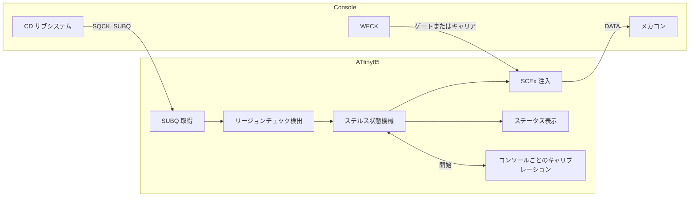

<div align="center">

<h1>openscex-modchip</h1>

<p>
  <a href="README.md">English</a> &nbsp;·&nbsp; <b>日本語</b> &nbsp;·&nbsp; <a href="README.zh.md">中文</a>
</p>

<strong>PlayStation と PSone のためのステルス SCEx リージョン解除。コンソールに合わせて自分のクロックを補正する ATtiny85 に載ります。</strong>

<br><br>

[](https://github.com/gufranco/openscex-modchip/actions/workflows/ci.yml)
[](https://github.com/gufranco/openscex-modchip/releases)
[](AGENTS.md)
[](LICENSE)

<br>

<p>
  <a href="#クイックスタート">クイックスタート</a> &nbsp;|&nbsp;
  <a href="#コンソールのタップ位置">配線</a> &nbsp;|&nbsp;
  <a href="#ステータス表示">ステータス表示</a> &nbsp;|&nbsp;
  <a href="#他のチップとの比較">他のチップとの比較</a> &nbsp;|&nbsp;
  <a href="../../issues/new?template=compatibility.yml">あなたの機種を報告</a>
</p>

</div>

フラッシュ [**6016**](Makefile) バイト · 基板 [**8**](assets/psnee) 系統、PU-7 から PM-41(2) · リージョン [**3**](src/region.c) 種 · MISRA 逸脱 [**0**](AGENTS.md) · ホストの行と分岐カバレッジ [**100%**](tests/host) · ミュータント [**637/637**](tools/mutate.py) 撃破

```bash
gh release download --repo gufranco/openscex-modchip --pattern 'openscex-modchip-attiny85.hex' --pattern SHA256SUMS
sha256sum -c SHA256SUMS --ignore-missing
avrdude -c <programmer> -p attiny85 -U flash:w:openscex-modchip-attiny85.hex:i
```

> [!IMPORTANT]
> 現在のファームウェアはシミュレーションのゲートをすべて通過していますが、まだ実機では動かしていません。配線前にタップ位置の電圧を測ってください。 出典: [compatibility reports](https://github.com/gufranco/openscex-modchip/issues?q=label%3Acompatibility), [tests/sim](tests/sim)。

初代 PlayStation と PSone 向けの、ATtiny85 で動くリージョン解除ファームウェアです。設定されたリージョン文字列を SUBQ リージョンチェックの窓の間だけ送り、それ以外は DATA をハイインピーダンスに保ちます。ブート ROM はパッチしないので、日本のフット機と PAL の PSone にはパッチ済み BIOS も必要です。光学ドライブエミュレータではなく、PS2 やサターンには対応せず、LibCrypt も回避しません。 出典: [src/run.c](src/run.c), [src/inject.c](src/inject.c), [AGENTS.md](AGENTS.md)。

| | | 出典 |
|:--|:--|:--|
| **受け入れ後は沈黙**<br>最初のプログラム領域フレーム以降は文字列を始めません。送信中の文字列は最後まで送り、長くても 181 ms で終わります。再び応じるのは、アンチモッドの TOC 再読み取りのような新しいリードイン読み取りだけです。 | **蓋線なしのディスク交換**<br>SUBQ フレームが 1.5 s 途絶えると交換とみなし、次のディスクに向けて再武装します。 | [src/inject.c](src/inject.c), [src/loop.c](src/loop.c), [src/run.c](src/run.c) |
| **自己補正のタイミング**<br>コンソールの 75 Hz の SUBQ フレームを計時し、内蔵発振器を 1% 以内に補正します。クロック線は不要です。 | **1 リージョン、1 つの窓**<br>設定したリージョン文字列だけを、SUBQ リージョンチェックの窓の間だけ、武装ごとに最大 16 回。 | [src/trim.c](src/trim.c), [src/region.c](src/region.c), [include/pscu/config.h](include/pscu/config.h) |
| **ステータス LED またはブザー**<br>1 本のピンで起動の段階、ディスクごとの結果、配線の異常を示す。final ビルドは短く鳴るだけで、異常は 1 回だけ知らせる。 | **コードで実証**<br>MISRA C:2012 準拠、ホストカバレッジ 100%、simavr コンソールモデル、ミューテーションテスト、バイト一致の再ビルド。 | [src/indicator.c](src/indicator.c), [tests/host](tests/host), [tools/mutate.py](tools/mutate.py) |

## 概要

| 項目 | 値 | 出典 |
|:-----|:---|:--|
| 対象機種 | PlayStation フット機 PU-7 から PU-23、PSone PM-41 と PM-41(2) | [assets/psnee](assets/psnee), [PsNee PSNee.ino L372-L406](https://github.com/kalymos/PsNee/blob/df52aec97d4e1677e3ed3ead1fba0bf102b1cfd7/PSNee/PSNee.ino#L372-L406) |
| MCU | ATtiny85（8 ピン DIP） | [include/port/registers.h](include/port/registers.h), [ATtiny25/45/85 datasheet 2586Q](https://ww1.microchip.com/downloads/en/DeviceDoc/Atmel-2586-AVR-8-bit-Microcontroller-ATtiny25-ATtiny45-ATtiny85_Datasheet.pdf) |
| 方式 | SCEx 注入 | [src/inject.c](src/inject.c), [psx-spx cdromdrive.md, SCEx](https://github.com/psx-spx/psx-spx.github.io/blob/6d7d1bc106a7e0b616b0330fe58401ab1ba57f0f/docs/cdromdrive.md#L1211-L1230) |
| リージョン | ビルドごとに 1 つ、`REGION=jp\|us\|eu`（既定 us） | [Makefile](Makefile), [src/region.c](src/region.c) |
| クロック | 内蔵 8 MHz RC 発振器。コンソールの SUBQ フレームレートで補正 | [src/trim.c](src/trim.c), [ATtiny25/45/85 datasheet 2586Q](https://ww1.microchip.com/downloads/en/DeviceDoc/Atmel-2586-AVR-8-bit-Microcontroller-ATtiny25-ATtiny45-ATtiny85_Datasheet.pdf) |
| 配線 | 信号 4 本（SQCK、SUBQ、DATA、WFCK）と電源、LED かアクティブブザーは任意 | [include/port/registers.h](include/port/registers.h), [PsNee MCU.h L453-L530](https://github.com/kalymos/PsNee/blob/df52aec97d4e1677e3ed3ead1fba0bf102b1cfd7/PSNee/MCU.h#L453-L530) |
| ツールチェーン | C17、MISRA C:2012 逸脱ゼロ、バージョン固定の Docker イメージ | [Dockerfile](Dockerfile), [AGENTS.md](AGENTS.md) |

## 機種ごとのビルド

| 機種 | 基板 | `REGION` | 2 回目のリージョンチェック | 出典 |
|:-----|:-----|:---------|:---------------------------|:--|
| フット US/カナダ、SCPH-1001 | PU-8 | `us` | なし | [consolemods PS1 region information](https://consolemods.org/wiki/PS1:Region_Information), [PsNee PSNee.ino L10-L17](https://github.com/kalymos/PsNee/blob/df52aec97d4e1677e3ed3ead1fba0bf102b1cfd7/PSNee/PSNee.ino#L10-L17) |
| フット US/カナダ、SCPH-550x1/700x1/900x1 | PU-18 から PU-23 | `us` | なし | [consolemods PS1 region information](https://consolemods.org/wiki/PS1:Region_Information), [PsNee PSNee.ino L10-L17](https://github.com/kalymos/PsNee/blob/df52aec97d4e1677e3ed3ead1fba0bf102b1cfd7/PSNee/PSNee.ino#L10-L17) |
| フット PAL、SCPH-1002 | PU-8 | `eu` | なし | [consolemods PS1 region information](https://consolemods.org/wiki/PS1:Region_Information), [PsNee PSNee.ino L10-L17](https://github.com/kalymos/PsNee/blob/df52aec97d4e1677e3ed3ead1fba0bf102b1cfd7/PSNee/PSNee.ino#L10-L17) |
| フット PAL、SCPH-550x2/900x2 | PU-18 から PU-22 | `eu` | なし | [consolemods PS1 region information](https://consolemods.org/wiki/PS1:Region_Information), [PsNee PSNee.ino L10-L17](https://github.com/kalymos/PsNee/blob/df52aec97d4e1677e3ed3ead1fba0bf102b1cfd7/PSNee/PSNee.ino#L10-L17) |
| PSone US/カナダ、SCPH-101 | PM-41 / PM-41(2) | `us` | なし | [consolemods PS1 region information](https://consolemods.org/wiki/PS1:Region_Information), [PsNee PSNee.ino L10-L17](https://github.com/kalymos/PsNee/blob/df52aec97d4e1677e3ed3ead1fba0bf102b1cfd7/PSNee/PSNee.ino#L10-L17) |
| PSone PAL、SCPH-102 | PM-41 / PM-41(2) | `eu` | ブート ROM 内。パッチ済み BIOS が必要 | [consolemods PS1 region information](https://consolemods.org/wiki/PS1:Region_Information), [PsNee PSNee.ino L33-L38](https://github.com/kalymos/PsNee/blob/df52aec97d4e1677e3ed3ead1fba0bf102b1cfd7/PSNee/PSNee.ino#L33-L38) |
| PSone 日本、SCPH-100 | PM-41 | `jp` | ブート ROM 内。パッチ済み BIOS が必要 | [consolemods PS1 region information](https://consolemods.org/wiki/PS1:Region_Information), [PsNee PSNee.ino L33-L38](https://github.com/kalymos/PsNee/blob/df52aec97d4e1677e3ed3ead1fba0bf102b1cfd7/PSNee/PSNee.ino#L33-L38) |
| フット日本、SCPH-1000/3000/3500/5000/5500/7000/7500/9000 | PU-7 から PU-23 | `jp` | ブート ROM 内。パッチ済み BIOS が必要。ただし初期の SCPH-1000 はそれでもディスクを起動する | [consolemods PS1 region information](https://consolemods.org/wiki/PS1:Region_Information), [PsNee PSNee.ino L33-L38](https://github.com/kalymos/PsNee/blob/df52aec97d4e1677e3ed3ead1fba0bf102b1cfd7/PSNee/PSNee.ino#L33-L38) |
| アジア、SCPH-xxx3 | 不明 | `jp` | なし | [consolemods PS1 region information](https://consolemods.org/wiki/PS1:Region_Information), [PsNee PSNee.ino L10-L17](https://github.com/kalymos/PsNee/blob/df52aec97d4e1677e3ed3ead1fba0bf102b1cfd7/PSNee/PSNee.ino#L10-L17) |
| アジア ビデオ CD、SCPH-5903 | 不明 | `jp` + `VCD_FILTER=on` | なし | [consolemods PS1 region information](https://consolemods.org/wiki/PS1:Region_Information), [PsNee PSNee.ino L456-L490](https://github.com/kalymos/PsNee/blob/df52aec97d4e1677e3ed3ead1fba0bf102b1cfd7/PSNee/PSNee.ino#L456-L490) |

PU-7 と PU-8 は PsNee V9.0 と同じく静的ゲート方式です。開発機（DTL-H120x、PU-9）は焼いたディスクをそのまま読むためチップ不要です。 出典: [PsNee PSNee.ino L33-L38](https://github.com/kalymos/PsNee/blob/df52aec97d4e1677e3ed3ead1fba0bf102b1cfd7/PSNee/PSNee.ino#L33-L38), [PsNee PSNee.ino L10-L17](https://github.com/kalymos/PsNee/blob/df52aec97d4e1677e3ed3ead1fba0bf102b1cfd7/PSNee/PSNee.ino#L10-L17), [PsNee PSNee.ino L456-L490](https://github.com/kalymos/PsNee/blob/df52aec97d4e1677e3ed3ead1fba0bf102b1cfd7/PSNee/PSNee.ino#L456-L490), [src/subq.c](src/subq.c)。

## クイックスタート

各[リリース](../../releases)にはビルド済みイメージが付きます: `us`、`eu`、`jp`、SCPH-5903 用の `jp-vcd`、それぞれの静かな `-final` 版（[ステータス表示](#ステータス表示) を参照）、`SHA256SUMS` ファイル、ライセンス、それらをビルドしたツールチェーンの SPDX 部品表 `toolchain.spdx.json`、そして部品表を含むこれらすべてのファイルのビルド来歴アテステーション。書き込む前にダウンロードを確認してください:

```bash
sha256sum -c SHA256SUMS --ignore-missing
gh attestation verify openscex-modchip-attiny85.hex --repo gufranco/openscex-modchip
```

リリースはコミット履歴から自動でバージョンが付きます。ソースからビルドする場合、ビルド、チェック、テストはすべてバージョン固定の Docker ツールチェーン内で `make` を通して実行し、ホストで動くのは `avrdude` だけです。 出典: [.releaserc.json](.releaserc.json), [.github/workflows/release.yml](.github/workflows/release.yml)。

| ツール | 用途 | 出典 |
|:-------|:-----|:--|
| Docker | 固定ツールチェーンを動かす | [Docker](https://docs.docker.com/get-docker/), [Dockerfile](Dockerfile) |
| Git | リポジトリを取得する | [Git](https://git-scm.com/downloads) |
| avrdude | イメージをチップに書き込む | [avrdude](https://github.com/avrdudes/avrdude) |
| Python 3.13 以降 | ホスト上で make の Docker ラッパーを動かす | [Python](https://www.python.org/downloads/), [tools/docker_make.py](tools/docker_make.py), [pyproject.toml](pyproject.toml) |

```bash
git clone https://github.com/gufranco/openscex-modchip.git
cd openscex-modchip
make REGION=us                                        # アメリカ
make REGION=jp VCD_FILTER=on                          # SCPH-5903
make REGION=us PROFILE=final                          # アメリカ、静かな表示
make REGION=us PROFILE=trace                          # アメリカ、ピン 2 にデバッグトレース
avrdude -c <programmer> -p attiny85 -U flash:w:build/attiny85/release/openscex-modchip-attiny85.hex:i
avrdude -c <programmer> -p attiny85 -U lfuse:w:0xE2:m -U hfuse:w:0xDD:m -U efuse:w:0xFF:m
```

ISP は何でも使えます。Arduino as ISP も可。フラッシュを先に、ヒューズを最後に書きます。low ヒューズ `0xE2` は内蔵 8 MHz 発振器、緩やかな電源立ち上がり向けの起動遅延、クロック分周なしを選びます（CKSEL 0010、SUT 10。データシート Table 6-6 と Table 6-7）。ファームウェアは起動時にクロックプリスケーラもクリアするので、CKDIV8 で遅くなることはありません。書き直すとキャリブレーションレコードと発振器の補正も消え、チップが学び直します。 出典: [Arduino as ISP](https://docs.arduino.cc/built-in-examples/arduino-isp/ArduinoISP/), [ATtiny25/45/85 datasheet 2586Q](https://ww1.microchip.com/downloads/en/DeviceDoc/Atmel-2586-AVR-8-bit-Microcontroller-ATtiny25-ATtiny45-ATtiny85_Datasheet.pdf), [src/run.c](src/run.c)。

新品の ATtiny85 は CKDIV8 がプログラム済みで 1 MHz で動くため、ヒューズを書くまで ISP クロックは 250 kHz 未満にします。データシートは ISP クロックの High と Low がそれぞれ CPU 2 クロックより長いことを求めます。Arduino as ISP はもともとこの範囲です。別のライタでは、最初の書き込みだけ avrdude の `-B`、たとえば `-B 8` を付けてください。出典: [ATtiny25/45/85 datasheet 2586Q](https://ww1.microchip.com/downloads/en/DeviceDoc/Atmel-2586-AVR-8-bit-Microcontroller-ATtiny25-ATtiny45-ATtiny85_Datasheet.pdf), [avrdude manual, -B](https://avrdudes.github.io/avrdude/8.0/avrdude_3.html)。

| ビルド | ヒューズ（low / high / extended） | 出典 |
|:-------|:----------------------------------|:--|
| 内蔵 8 MHz、2.7 V のブラウンアウト検出付き、推奨 | `0xE2` / `0xDD` / `0xFF` | [ATtiny25/45/85 datasheet 2586Q](https://ww1.microchip.com/downloads/en/DeviceDoc/Atmel-2586-AVR-8-bit-Microcontroller-ATtiny25-ATtiny45-ATtiny85_Datasheet.pdf) |
| 内蔵 8 MHz、ブラウンアウト検出なし | `0xE2` / `0xDF` / `0xFF` | [ATtiny25/45/85 datasheet 2586Q](https://ww1.microchip.com/downloads/en/DeviceDoc/Atmel-2586-AVR-8-bit-Microcontroller-ATtiny25-ATtiny45-ATtiny85_Datasheet.pdf) |

ブラウンアウト検出は、電源が速度グレード上の下限である 2.7 V を下回る間チップをリセットに保ちます。有効にしておいてください。ファームウェアも各文字列の前に電源を測り、約 2.75 V 未満では送信を控えてコード 7 を示します。この値は、バンドギャップが高めに出るチップでも 5 パーセント低い 3.3 V 電源を通します。 出典: [ATtiny25/45/85 datasheet 2586Q](https://ww1.microchip.com/downloads/en/DeviceDoc/Atmel-2586-AVR-8-bit-Microcontroller-ATtiny25-ATtiny45-ATtiny85_Datasheet.pdf), [src/supply.c](src/supply.c)。

[Makefile](Makefile) のターゲットで検証:

```bash
make size        # イメージサイズ。空きフラッシュが 256 バイト未満なら失敗
make test        # ホストテスト、simavr コンソールモデルとスタック検査
make analyse     # 整形、lint、型、ライセンス、MISRA、Python テスト
make repro       # リリースの全イメージを 2 回新規ビルドし、バイト単位で一致
make mutate      # ロジック層のミューテーションテスト
make mutate_platform  # run.c と engine.c のミューテーション、シミュレータで検出
make bench_ci    # コンソールベンチ: 同じ模擬コンソールでこのファームウェアと PsNee を比較
```

同じゲートが `main` への push とプルリクエストごとに CI で走ります。定義は [`.github/workflows/ci.yml`](.github/workflows/ci.yml)。`make mutate_platform` は別のワークフロー [`.github/workflows/mutation.yml`](.github/workflows/mutation.yml) で、ファームウェア、シミュレータのテスト、ミューテーションツール、固定したツールチェーンのいずれかが変わるたびに走ります。`make hooks` でコミットメッセージと整形のチェックをローカルで有効にできます。

## MCU ピン配置

4 本の SCEx 信号と表示ピンは PsNee の `MCU.h` にある ATtiny85 の割り当てを保つので、PsNee の配線ガイドとピン単位で一致します。PB5 はリセットのままなので、チップは ISP で書き込めます。ピン番号は 8 ピン PDIP のものです。SOIC はデータシートで確認してください。 出典: [PsNee MCU.h L453-L530](https://github.com/kalymos/PsNee/blob/df52aec97d4e1677e3ed3ead1fba0bf102b1cfd7/PSNee/MCU.h#L453-L530), [include/port/registers.h](include/port/registers.h), [ATtiny25/45/85 datasheet 2586Q](https://ww1.microchip.com/downloads/en/DeviceDoc/Atmel-2586-AVR-8-bit-Microcontroller-ATtiny25-ATtiny45-ATtiny85_Datasheet.pdf)。

| DIP ピン | ポート | 信号 | 方向 | 接続先 | 出典 |
|:--------:|:-------|:-----|:-----|:-------|:--|
| 1 | PB5 | RESET | - | リセットのまま | [include/port/registers.h](include/port/registers.h), [ATtiny25/45/85 datasheet 2586Q](https://ww1.microchip.com/downloads/en/DeviceDoc/Atmel-2586-AVR-8-bit-Microcontroller-ATtiny25-ATtiny45-ATtiny85_Datasheet.pdf) |
| 2 | PB3 | INDICATOR | 出力、任意 | 1 kΩ の抵抗経由の状態 LED、アクティブブザー、または付けない | [include/port/registers.h](include/port/registers.h), [PsNee PSNee.ino L64](https://github.com/kalymos/PsNee/blob/df52aec97d4e1677e3ed3ead1fba0bf102b1cfd7/PSNee/PSNee.ino#L64) |
| 3 | PB4 | WFCK | 入出力 | 静的ゲート、または PU-22 以降のライブキャリア | [include/port/registers.h](include/port/registers.h), [PsNee MCU.h L453-L530](https://github.com/kalymos/PsNee/blob/df52aec97d4e1677e3ed3ead1fba0bf102b1cfd7/PSNee/MCU.h#L453-L530) |
| 4 | GND | GND | - | コンソールのグランド | [ATtiny25/45/85 datasheet 2586Q](https://ww1.microchip.com/downloads/en/DeviceDoc/Atmel-2586-AVR-8-bit-Microcontroller-ATtiny25-ATtiny45-ATtiny85_Datasheet.pdf) |
| 5 | PB0 | SQCK | 入力 | SUBQ シリアルクロック | [include/port/registers.h](include/port/registers.h), [PsNee MCU.h L453-L530](https://github.com/kalymos/PsNee/blob/df52aec97d4e1677e3ed3ead1fba0bf102b1cfd7/PSNee/MCU.h#L453-L530) |
| 6 | PB1 | SUBQ | 入力 | SUBQ シリアルデータ | [include/port/registers.h](include/port/registers.h), [PsNee MCU.h L453-L530](https://github.com/kalymos/PsNee/blob/df52aec97d4e1677e3ed3ead1fba0bf102b1cfd7/PSNee/MCU.h#L453-L530) |
| 7 | PB2 | DATA | 出力、Low 駆動またはハイ Z | メカコンへの SCEx 注入 | [include/port/registers.h](include/port/registers.h), [src/port.S](src/port.S) |
| 8 | VCC | VCC | - | コンソール電源、先に測る | [ATtiny25/45/85 datasheet 2586Q](https://ww1.microchip.com/downloads/en/DeviceDoc/Atmel-2586-AVR-8-bit-Microcontroller-ATtiny25-ATtiny45-ATtiny85_Datasheet.pdf) |

## コンソールのタップ位置

下の写真は各基板の SQCK、SUBQ、DATA、WFCK、VCC、GND を示しています。各線は写真の位置にはんだ付けしてください。PU-18 の写真は裏面です。AX、DX、RESET は PsNee のブート ROM パッチ用なので接続しないでください。 出典: [assets/psnee](assets/psnee)。

<table>
<tr><td align="center" width="33%"><a href="assets/psnee/pu-7.jpg"></a><br><sub><b>PU-7</b>。写真: PsNee</sub></td><td align="center" width="33%"><a href="assets/psnee/pu-8a.jpg"></a><br><sub><b>PU-8</b>、1-658-467-22。写真: PsNee</sub></td><td align="center" width="33%"><a href="assets/psnee/pu-8b.jpg"></a><br><sub><b>PU-8</b>、1-658-467-12。写真: PsNee</sub></td></tr>
<tr><td align="center" width="33%"><a href="assets/psnee/pu-18.jpg"></a><br><sub><b>PU-18</b>。写真: PsNee</sub></td><td align="center" width="33%"><a href="assets/psnee/pu-20.jpg"></a><br><sub><b>PU-20</b>。写真: PsNee</sub></td><td align="center" width="33%"><a href="assets/psnee/pu-22.jpg"></a><br><sub><b>PU-22</b>。写真: PsNee</sub></td></tr>
<tr><td align="center" width="33%"><a href="assets/psnee/pu-23.jpg"></a><br><sub><b>PU-23</b>。写真: PsNee</sub></td><td align="center" width="33%"><a href="assets/psnee/pm-41.jpg"></a><br><sub><b>PM-41</b>。写真: PsNee</sub></td><td align="center" width="33%"><a href="assets/psnee/pm-41-2.jpg"></a><br><sub><b>PM-41(2)</b>。写真: PsNee</sub></td></tr>
</table>

この 9 枚の写真は kalymos とコントリビュータによる [PsNee](https://github.com/kalymos/PsNee) V9.0 のもので、[Unlicense](LICENSES/Unlicense.txt) でパブリックドメインに置かれており、縮小してここに複製しています。

| 基板 | SCPH 世代 | DATA 注入点 | WFCK の役割 | 出典 |
|:-----|:----------|:------------|:------------|:--|
| PU-7、PU-8、PU-18、PU-20 | 1000-750x | ウォブル ASIC からメカコンへのデジタル NRZ 出力 | 静的ゲート | [assets/psnee](assets/psnee), [PsNee PSNee.ino L372-L406](https://github.com/kalymos/PsNee/blob/df52aec97d4e1677e3ed3ead1fba0bf102b1cfd7/PSNee/PSNee.ino#L372-L406) |
| PU-22、PU-23 | 7500-900x | CD プロセッサのトラッキング線、WFCK を偽キャリアに、3 線プラスリンク | ライブクロック、同期必須 | [assets/psnee](assets/psnee), [PsNee PSNee.ino L372-L406](https://github.com/kalymos/PsNee/blob/df52aec97d4e1677e3ed3ead1fba0bf102b1cfd7/PSNee/PSNee.ino#L372-L406) |
| PM-41、PM-41(2) | PSone 100-103 | 同じトラッキング線キャリア方式。PM-41(2) では待機中にチップの I/O を浮かせる | ライブクロック | [assets/psnee](assets/psnee), [quade.co PsNee guide](https://quade.co/ps1-modchip-guide/psnee/) |

クロック線も蓋線もないので、4 本の信号線が届く場所ならどこにでも置けます。線は短く保ってください。長い線はノイズを拾い、Mayumi V4 の不具合の既知の原因です（quade.co）。以前のリリース向けの取り付けは、このファームウェアを書き込む前にクロック線と蓋線を外してください。2 番ピンはいまは PB3 (インジケーター出力) なので、残したコンソールのクロックと逆に駆動します。 出典: [src/trim.c](src/trim.c), [src/loop.c](src/loop.c), [quade.co Mayumi V4 guide](https://quade.co/ps1-modchip-guide/mayumi-v4/), [include/port/registers.h](include/port/registers.h)。

## キャリア基板

3 種類の任意の基板が、チップを DIP-8 ソケットに保持して書き換え時に取り外せるようにします。コンソールからの配線は、一辺に 6 mm 間隔で並ぶ 4 × 4 mm の穴なし表面パッド 6 個で受けます。順に WFCK、SQCK、SUBQ、DATA、VCC、GND です。部品はすべてスルーホールで、チップ内蔵のプルアップはコンソールのノイズに弱いため、10 kΩ プルアップで RESET を High に保ちます。各基板は回路図、レイアウト、デザインルールを含む KiCad 10 プロジェクトです。出典: [hardware](hardware)。

| 基板 | 部品 | 寸法 | 出典 |
|:--|:--|:--|:--|
| キャリア | ソケット、100 nF デカップリング、キー付き ISP ヘッダ、10 kΩ RESET プルアップ、表示回路: PB3 が 2N3904 を駆動し、2 極 DIP スイッチの設定で 1 kΩ 抵抗付き LED、ブザー、両方、またはどちらも鳴らさない。ブザーは 10 Ω と 100 µF のフィルタから給電され、1N4148 が並列に入る。スライドスイッチが PB3 を表示回路か、1 kΩ を介して 6 ピンのシリアルトレース用ヘッダにつなぐ | 35.7 × 52.2 mm | [hardware/openscex-carrier.kicad_sch](hardware/openscex-carrier.kicad_sch), [hardware/openscex-carrier.kicad_pcb](hardware/openscex-carrier.kicad_pcb) |
| ミニ | ソケット、100 nF デカップリング、10 kΩ RESET プルアップ、PB3 に直接つなぐ 1 kΩ 抵抗付き LED、キー付き ISP ヘッダ | 35.7 × 25.2 mm | [hardware/openscex-mini.kicad_sch](hardware/openscex-mini.kicad_sch), [hardware/openscex-mini.kicad_pcb](hardware/openscex-mini.kicad_pcb) |
| ベア | ソケット、100 nF デカップリング、10 kΩ RESET プルアップのみ | 35.7 × 21.7 mm | [hardware/openscex-bare.kicad_sch](hardware/openscex-bare.kicad_sch), [hardware/openscex-bare.kicad_pcb](hardware/openscex-bare.kicad_pcb) |

<table>
<tr><td align="center" width="33%"><a href="assets/boards/carrier-3d.png"></a><br><sub><b>キャリア基板</b>, 3D 表示</sub></td><td align="center" width="33%"><a href="assets/boards/carrier-top.png"></a><br><sub><b>キャリア基板</b>, 表面</sub></td><td align="center" width="33%"><a href="assets/boards/carrier-bottom.png"></a><br><sub><b>キャリア基板</b>, 裏面、グラウンドプレーン</sub></td></tr>
<tr><td align="center" width="33%"><a href="assets/boards/mini-3d.png"></a><br><sub><b>ミニ基板</b>, 3D 表示</sub></td><td align="center" width="33%"><a href="assets/boards/mini-top.png"></a><br><sub><b>ミニ基板</b>, 表面</sub></td><td align="center" width="33%"><a href="assets/boards/mini-bottom.png"></a><br><sub><b>ミニ基板</b>, 裏面、グラウンドプレーン</sub></td></tr>
<tr><td align="center" width="33%"><a href="assets/boards/bare-3d.png"></a><br><sub><b>ベア基板</b>, 3D 表示</sub></td><td align="center" width="33%"><a href="assets/boards/bare-top.png"></a><br><sub><b>ベア基板</b>, 表面</sub></td><td align="center" width="33%"><a href="assets/boards/bare-bottom.png"></a><br><sub><b>ベア基板</b>, 裏面、グラウンドプレーン</sub></td></tr>
</table>

3 枚ともノイズ対策を施した 2 層基板です。配線は可能な限り表面を通し、裏面はコンソール信号線の下のグラウンドプレーンとして残します。両面にグラウンドを流し込み、0.6 mm のビアで縫い合わせています。45 度を超えて曲がる配線はなく、異なるネットの配線は互いに 1 mm、パッドから 0.8 mm 離しています。キャリア基板では、2.4 kHz のパルスで最大 30 mA を流すブザーをコンソール信号線から最も遠い角に置き、そのリップルをフィルタでチップの電源から遠ざけます。出典: [hardware/openscex-carrier.kicad_dru](hardware/openscex-carrier.kicad_dru), [hardware/openscex-carrier.kicad_pcb](hardware/openscex-carrier.kicad_pcb), [CMI-1295IC-0385T datasheet](https://www.sameskydevices.com/product/resource/cmi-1295ic-0385t.pdf)。

ISP ヘッダは AVR の 6 ピン配列に従います: 1 MISO が SUBQ、2 VCC、3 SCK が DATA、4 MOSI が SQCK、5 RESET、6 GND。キー付きシュラウドは他の部品から 1.5 mm 離しています。書き換えは基板をコンソールから外すか配線を外して行ってください。取り付けたままでは、ライタがコンソールの電源に給電し、SQCK と SUBQ でコンソールのドライバと衝突します。出典: [hardware/openscex-carrier.kicad_sch](hardware/openscex-carrier.kicad_sch), [hardware/openscex-mini.kicad_sch](hardware/openscex-mini.kicad_sch), [ATtiny25/45/85 datasheet 2586Q](https://ww1.microchip.com/downloads/en/DeviceDoc/Atmel-2586-AVR-8-bit-Microcontroller-ATtiny25-ATtiny45-ATtiny85_Datasheet.pdf)。

キャリアのトレース用ヘッダ J2 には FTDI TTL-232R ケーブルの 6 ピンソケットが挿さります。1 番ピンが GND、5 番ピンがケーブルの RXD 入力で、2、3、4、6 番ピンは未接続のままなので、ケーブルの 5 V 出力がコンソールに届くことはありません。スライドスイッチ SW2 (C&K OS102011MS2QN1) は、つまみを IND 側にすると PB3 を表示回路へ、TRACE 側にするとヘッダへつなぎます。接点はブレーク・ビフォア・メイクなので、トレース中に表示回路が動くことはありません。直列の 1 kΩ 抵抗は、片側の電源が入っていないときに反対側へ流れ込む電流を制限します。ヘッダは基板の端に置き、周囲 2 mm を空けているので、ソケットやそこに挿したアダプタがほかの部品に当たりません。出典: [hardware/openscex-carrier.kicad_sch](hardware/openscex-carrier.kicad_sch), [hardware/openscex-carrier.kicad_pcb](hardware/openscex-carrier.kicad_pcb), [TTL-232R datasheet](https://www.farnell.com/datasheets/81225.pdf), [C&K OS series datasheet](https://www.littelfuse.com/assetdocs/littelfuse-c-k-slide-os-series-datasheet?assetguid=f8954ac2-65ba-431f-af55-b0493370575e)。

各基板には部品表と、基板メーカーにそのまま渡せる Gerber とドリルのアーカイブがあり、どちらも KiCad 10.0.6 で出力しました。ティアドロップは基板自体に描き込んであるので、KiCad での再充填は不要です。出典: [hardware/openscex-carrier-bom.csv](hardware/openscex-carrier-bom.csv), [hardware/fab/openscex-carrier-gerbers.zip](hardware/fab/openscex-carrier-gerbers.zip), [hardware/openscex-mini-bom.csv](hardware/openscex-mini-bom.csv), [hardware/fab/openscex-mini-gerbers.zip](hardware/fab/openscex-mini-gerbers.zip), [hardware/openscex-bare-bom.csv](hardware/openscex-bare-bom.csv), [hardware/fab/openscex-bare-gerbers.zip](hardware/fab/openscex-bare-gerbers.zip)。

## 安全

- 配線前に、すべてのタップ位置の電圧を測ってください。PU-7 から PM-41(2) まで、どの基板もほとんどの IC を +3.5 V で動かしており、チップの電源もこれです。基板の +5 V は AV マルチ出力、オーディオアンプ、サウンドと CD 用電源のレギュレータなど一部の部品に使われるだけで、PsNee はチップをそこにつながないよう警告しています。 出典: [psx-spx pinouts.md, voltage summary](https://github.com/psx-spx/psx-spx.github.io/blob/6d7d1bc106a7e0b616b0330fe58401ab1ba57f0f/docs/pinouts.md#L1777-L1795), [PsNee changelog](https://github.com/kalymos/PsNee/blob/df52aec97d4e1677e3ed3ead1fba0bf102b1cfd7/changelog#L38)。
- コンソールを開けて CD サブシステムにはんだ付けすると壊すことがあります。自己責任で作ってください。 出典: [quade.co PS1 modchip guide](https://quade.co/ps1-modchip-guide/)。

## ステータス表示

PB3 には任意で LED かアクティブブザーをつなぎ、これがチップ唯一の診断手段です。現在の段階、各ディスクがリージョンチェックを通ったか、問題があればどの配線を見るべきかを示します。どの機能も遅らせず妨げず、履歴も持たないので、起動時の 2 つを除くコードは現在の状態を示します。 出典: [src/indicator.c](src/indicator.c)。

| 部品 | 選び方 | 出典 |
|:-----|:-------|:--|
| LED | 3 mm か 5 mm の赤、橙、黄、緑の LED、順方向電圧約 2 V。青や白は順方向電圧が 3 V あり、コンソールの 3.5 V 電源では抵抗にほとんど電圧が残らないので不可 | [Kingbright WP7113ID datasheet](https://www.kingbrightusa.com/images/catalog/SPEC/WP7113ID.pdf), [ATtiny25/45/85 datasheet 2586Q](https://ww1.microchip.com/downloads/en/DeviceDoc/Atmel-2586-AVR-8-bit-Microcontroller-ATtiny25-ATtiny45-ATtiny85_Datasheet.pdf) |
| 抵抗 | 1 kΩ、ワット数は問わない。コンソールの 3.5 V で約 1.5 mA で、ピンの絶対最大定格 40 mA を大きく下回る | [ATtiny25/45/85 datasheet 2586Q](https://ww1.microchip.com/downloads/en/DeviceDoc/Atmel-2586-AVR-8-bit-Microcontroller-ATtiny25-ATtiny45-ATtiny85_Datasheet.pdf) |
| LED の配線 | 2 番ピン（PB3）から抵抗、抵抗から LED のアノード（長い足）、カソード（平らな側）を GND へ | [include/port/registers.h](include/port/registers.h) |
| ブザー | LED の代わりに、直流をかけるだけで鳴るアクティブ圧電ブザー。例えば PUI Audio AI-3035-TWT-3V-R: 2 から 5 V、3 V で最大 9 mA、約 3.5 kHz、直径 30 mm | [AI-3035-TWT-3V-R datasheet](https://api.puiaudio.com/filename/AI-3035-TWT-3V-R.pdf), [ATtiny25/45/85 datasheet 2586Q](https://ww1.microchip.com/downloads/en/DeviceDoc/Atmel-2586-AVR-8-bit-Microcontroller-ATtiny25-ATtiny45-ATtiny85_Datasheet.pdf) |
| ブザーの配線 | 2 番ピン（PB3）をブザーの + 端子へ、- 端子を GND へ。抵抗もダイオードも不要: 圧電素子はコイルではないので、切っても電圧スパイクを返さない。電磁ブザーはコイルなので、ピンへの直結には対応しない。キャリア基板は Q1 とフライバックダイオードを介して駆動する | [hardware/openscex-carrier.kicad_sch](hardware/openscex-carrier.kicad_sch),  [AI-3035-TWT-3V-R datasheet](https://api.puiaudio.com/filename/AI-3035-TWT-3V-R.pdf), [include/port/registers.h](include/port/registers.h) |

ピンを駆動するビルドは 2 種類あります。既定の `debug` は下の表のすべてを示し、`make PROFILE=final` でビルドして `-final` イメージとして配布する `final` は静かです。取り付けと不具合調査には `debug`、遊ぶときは `final` を書き込みます。違うのはピンだけで、両者が同じ文字列を同じ時刻に送ることをシミュレータがエッジ単位で確かめます。 出典: [include/pscu/indicator.h](include/pscu/indicator.h), [tests/sim/sim_profile.c](tests/sim/sim_profile.c)。

| 段階 | debug | final | 出典 |
|:-----|:------|:------|:--|
| 基板判別 | 電源投入後約 0.4 s 点灯 | 消灯 | [src/engine.c](src/engine.c) |
| 基板確定 | 静的ゲート基板（PU-18、PU-20）なら 300 ms の点滅 1 回、WFCK キャリア基板（PU-22 以降）なら 2 回 | 静的ゲート基板なら 60 ms の短音 1 回、WFCK キャリア基板なら 2 回 | [src/indicator.c](src/indicator.c) |
| ディスク待ち | 2 s ごとに 40 ms の短い点灯 | 消灯 | [src/indicator.c](src/indicator.c) |
| 注入中 | リージョン文字列 1 本ごとに 90 から 181 ms の点灯 | 消灯 | [src/engine.c](src/engine.c) |
| 結果 | コードを 3 回示し、その後消灯 | 受理されたディスクは 60 ms の短音 1 回、拒否されたディスクはコード 2 を 2 回。その後消灯 | [src/indicator.c](src/indicator.c) |
| プレイ中 | 消灯。OSCCAL が動くか校正値を書き込むたびに 40 ms の点灯 | 消灯 | [src/indicator.c](src/indicator.c), [src/run.c](src/run.c) |

コードは 700 ms の長い点灯を 300 ms 間隔で数え、2 s 休んでから繰り返します。`final` ではコード 3 と 4 はディスクごとに 1 回だけ示し、コード 7 は続く間 30 s ごとに繰り返します。 出典: [src/indicator.c](src/indicator.c)。

| コード | 意味 | 確認先 | 出典 |
|:------:|:-----|:-------|:--|
| 1 | コンソールがリージョン文字列を受け入れた | 何もしない、ディスクは動く | [src/indicator.c](src/indicator.c), [src/loop.c](src/loop.c) |
| 2 | 文字列を送ったがコンソールがプログラム領域に達しなかった | DATA と WFCK の配線、ビルドのリージョンがディスクと合っているか | [src/indicator.c](src/indicator.c), [src/loop.c](src/loop.c) |
| 3 | 電源投入後 5 s SUBQ フレームが無い。15 s 示してから鼓動の点滅に戻る | SQCK、SUBQ、電源と GND。ディスクが無いときも出る | [src/indicator.c](src/indicator.c), [src/loop.c](src/loop.c) |
| 4 | フレームは来るが 20 s リージョンチェックが無い。続く間は繰り返す | SUBQ。音楽 CD でも正常に出る | [src/indicator.c](src/indicator.c), [src/loop.c](src/loop.c) |
| 5 | ウォッチドッグがチップをリセットした。次の起動で 1 回示す | 注入中に止まった WFCK | [src/indicator.c](src/indicator.c), [src/port_chip.S](src/port_chip.S) |
| 6 | 基板がキャリブレーションに保存したものと違う。起動時に 1 回示し、コード 5 が優先 | 不安定な WFCK の配線。チップを別のコンソールに移した場合を除く | [src/indicator.c](src/indicator.c), [src/calib.c](src/calib.c) |
| 7 | 電源が約 2.75 V 未満と測れた、または測定に失敗した。続く間は文字列を送らず、コード 3 と 4 より優先 | 取り出し点の VCC と GND。3.3 V 以上あること | [src/indicator.c](src/indicator.c), [src/supply.c](src/supply.c) |

### シリアルトレース

`make PROFILE=trace` は、ピン 2 (PB3) を表示の代わりに 115200 baud、8N1 のシリアル線にするイメージをビルドします。オシロスコープなしで故障を突き止めるのに必要なものがすべて流れます。起動レポート、チップが取り込んだすべての SUBQ フレーム、そしてチップが下した判断ごとの 1 行で、どれにも電源投入からの時刻が付きます。行は各フレームの後の空き時間に、1 回の空き時間につき判断 1 行までで送られるので、DATA はほかの 2 つのイメージと同じタイミングを保ち、シミュレータがそれをエッジ単位で確かめます。 出典: [src/trace.c](src/trace.c), [src/run.c](src/run.c), [tests/sim/sim_trace.c](tests/sim/sim_trace.c), [tests/sim/sim_profile.c](tests/sim/sim_profile.c)。

キャリアでは SW2 を TRACE 側にし、TTL-232R ケーブルを黒線が GND に来る向きでトレース用ヘッダに挿します。ほかの基板では、ピン 2 を USB シリアルアダプタの RX 入力に、アダプタの GND をコンソールの GND につなぎます。mini では線が待機している間 LED が点いたままです。線は 0 とコンソールの 3.5 V ロジック電源の間で振れるので、TTL-232R-3V3 のような 3.3 V アダプタで読めます。起動レポートが入るように、コンソールの電源を入れる前に取り込みを始めてください。 出典: [hardware/openscex-carrier.kicad_sch](hardware/openscex-carrier.kicad_sch), [TTL-232R datasheet](https://www.farnell.com/datasheets/81225.pdf), [psx-spx pinouts.md, voltage summary](https://github.com/psx-spx/psx-spx.github.io/blob/6d7d1bc106a7e0b616b0330fe58401ab1ba57f0f/docs/pinouts.md#L1777-L1795)。

```sh
# Linux。macOS ではポートが /dev/cu.usbserial-* で、stty は -f を使う
stty -F /dev/ttyUSB0 115200 raw && cat /dev/ttyUSB0 | tee capture.txt
python3 tools/serial_trace.py capture.txt
```

フレームの行は SUBQ の 12 バイトを 16 進数で表したもので、取り込みに失敗した場合はすべて `F` になります。それ以外の行は `@` と時刻で始まり、`@1.460 OPEN 0A 0A` のように電源投入からの秒とミリ秒が付きます。 出典: [src/trace.c](src/trace.c)。

| 行 | 意味 | 出典 |
|:--|:--|:--|
| `BOOT US 1A2B` | ビルドに組み込んだ地域と、コミットの先頭 16 進 4 桁。末尾の `V` は Video CD フィルタ | [src/trace.c](src/trace.c), [Makefile](Makefile) |
| `RST PWR`、`RST WDT` | 電源投入から始まったか、メインループが止まってウォッチドッグで再起動したか | [src/trace.c](src/trace.c), [src/port_chip.S](src/port_chip.S) |
| `BRD W D` | 基板。`W` は WFCK キャリア、`G` は固定ゲート。続く `D` は検出、`K` はウォッチドッグ再起動後に記録から引き継ぎ、`C` は検出したが記録と違う基板 | [src/trace.c](src/trace.c), [src/calib.c](src/calib.c) |
| `OSC 50>4E` | OSCCAL の工場出荷値から適用値まで。その後は 75 Hz のフレーム周期に合わせた各トリム段階 | [src/trace.c](src/trace.c), [src/trim.c](src/trim.c) |
| `REC W 0C P -2` | 較正記録。基板、16 進の開始値、`F` 固定済みか `P` 探索中か、トリム。起動時は EEPROM から読んだ値、その後は学習するたびに | [src/trace.c](src/trace.c), [src/calib.c](src/calib.c) |
| `SUP OK 3303mV`、`SUP LOW 2601mV` | 起動時の電源電圧と、2.75 V の保護値をまたぐたびの電圧。下回ると文字列も記録の書き込みも行わない | [src/trace.c](src/trace.c), [src/supply.c](src/supply.c) |
| `DISC`、`GONE` | 正しい SUBQ フレームが再び来た、または 1.5 s 来ていない | [src/trace.c](src/trace.c), [src/inject.c](src/inject.c) |
| `OPEN 0A 0A` | ウィンドウが開いた。SUBQ カウンタと到達した開始値を 16 進で | [src/trace.c](src/trace.c), [src/loop.c](src/loop.c) |
| `HOLD 03 0A 3303mV` | ウィンドウを保持し送信しない。電源保護値の下か、開いた後に開始値をわずかに下回ったとき | [src/trace.c](src/trace.c), [src/loop.c](src/loop.c) |
| `SHUT P 00` | ウィンドウが閉じた。`P` はプログラム領域のフレーム、`G` はディスクが外れた、`D` はカウンタが下がった | [src/trace.c](src/trace.c), [src/loop.c](src/loop.c) |
| `SCEX 3 W` | この開放での最大 16 本のうち 3 本目の文字列と、送ったときの基板モード | [src/trace.c](src/trace.c), [src/engine.c](src/engine.c) |
| `PASS`、`FAIL` | 文字列の後にコンソールがプログラム領域へ進んだか、時間内に進まなかったか | [src/trace.c](src/trace.c), [src/loop.c](src/loop.c) |
| `MISS 0B 0C` | ウィンドウが開く前にリードインが終わった。カウンタの到達値と必要な開始値。次のディスクでは開始値が早まる | [src/trace.c](src/trace.c), [src/calib.c](src/calib.c) |
| `SAVE OK`、`SAVE NO 2601mV` | 記録を EEPROM に書いた、または電源不足で書かずに保持して再試行する | [src/trace.c](src/trace.c), [src/engine.c](src/engine.c) |
| `LOST 2` | 4 件のキューに収まらないほど続いて捨てたイベントの数 | [src/trace.c](src/trace.c), [include/pscu/trace.h](include/pscu/trace.h) |

`tools/serial_trace.py` は保存した取り込み、またはパイプで渡した端末の出力を読み、時系列を言葉で表示します。各フレームはディスク上の位置と CRC の確認付きで、同じフレームの連続は 1 行にまとめます。最後に、考えられる故障と確認すべき点を示す診断を出します。フレームがない、またはすべての取り込みが失敗したなら SQCK と SUBQ の配線、CRC 不良が多いならその配線のノイズ、ウォッチドッグ再起動なら文字列の途中で止まった WFCK、電源投入の繰り返しや電源不足なら電源の取り出し点、ウィンドウを開かないリードインなら学習した開始値、`PASS` のない文字列なら DATA と WFCK の配線か地域の不一致、`PASS` の後もゲームが止まるならアンチ改造チェックかブート ROM の地域チェックです。`--summary` は診断だけを表示します。 出典: [tools/serial_trace.py](tools/serial_trace.py), [tests/serial_trace/test_serial_trace.py](tests/serial_trace/test_serial_trace.py)。


## 仕組み



## 含まれるもの

| 機能 | 内容 | 出典 |
|:-----|:-----|:--|
| SCEx 注入 | 44 ビット LSB ファーストのリージョン文字列。PU-7 から PU-20 は静的ゲート方式で、PsNee と Mayumi V4 と同じく文字列ごとに WFCK を Low に保持し、PU-22 以降は WFCK キャリア方式 | [src/inject.c](src/inject.c), [src/port.S](src/port.S), [PsNee PSNee.ino L53](https://github.com/kalymos/PsNee/blob/df52aec97d4e1677e3ed3ead1fba0bf102b1cfd7/PSNee/PSNee.ino#L53) |
| 基板の自動判別 | 起動時の WFCK でゲートかキャリアかを選ぶので、1 つのビルドが全基板に合う。キャリアとみなすのは、MultiMode 3 と Mayumi V4 と同じく、前のエッジから 360 µs 以内の WFCK エッジが途切れずに 25 回続いたときだけ。ゲート基板では各文字列の前に WFCK を 13.1 ms 再観測するので、遅れて始まるキャリアを Low に保つことはない。ウォッチドッグリセットの後は起動時に記録した基板を使うので、止まったキャリアをゲートとして駆動しない | [src/board_mode.c](src/board_mode.c), [src/engine.c](src/engine.c), [src/calib.c](src/calib.c), [PsNee PSNee.ino L372-L406](https://github.com/kalymos/PsNee/blob/df52aec97d4e1677e3ed3ead1fba0bf102b1cfd7/PSNee/PSNee.ino#L372-L406) |
| 電源ガード | 各文字列の前に 1.1 V のバンドギャップで自分の電源を測る。約 2.75 V 未満、またはありえない読み値なら何も送らずコード 7 を示す。短い低下は送信を止めるだけで数え直さず、閉じたままの窓からキャリブレーションは何も学ばない | [src/supply.c](src/supply.c), [src/port_chip.S](src/port_chip.S), [ATtiny25/45/85 datasheet 2586Q](https://ww1.microchip.com/downloads/en/DeviceDoc/Atmel-2586-AVR-8-bit-Microcontroller-ATtiny25-ATtiny45-ATtiny85_Datasheet.pdf) |
| 発振器の補正 | コンソールの 75 Hz の SUBQ フレームをリードイン中もプレイ中も計時し、バッチごとに最大 4 段、1 回の書き込みで 1 段ずつ OSCCAL を動かして 1% 以内に入れる。工場値から 16 段を超えては動かさない。補正値は EEPROM に保存し、起動時に適用する | [src/trim.c](src/trim.c), [src/run.c](src/run.c), [ATtiny25/45/85 datasheet 2586Q](https://ww1.microchip.com/downloads/en/DeviceDoc/Atmel-2586-AVR-8-bit-Microcontroller-ATtiny25-ATtiny45-ATtiny85_Datasheet.pdf) |
| ディスク交換 | 蓋線は不要。止まったドライブだけが生む 1.5 s の有効な SUBQ フレームの途絶で再武装する。シークや再読み取りはフレームを出し続ける。SUBQ カウンタは開始位置から 8 フレームで止まるので、拒否されたディスクでも蓋を開けてから約 0.5 秒で窓が閉じる。どのディスクも上限の 16 本全部を受けられる | [src/inject.c](src/inject.c), [src/loop.c](src/loop.c), [include/pscu/loop.h](include/pscu/loop.h) |
| ステルス | SUBQ リージョンチェックの窓の間だけ、武装ごとに上限付きで、PsNee と Mayumi V4 と同じく文字列の間に 5 フレーム（67 ms）空けて注入する。それ以外は DATA をハイ Z、表示ピンをオフにする。コンソールがプログラム領域を読んだ後は文字列を始めず、送信中の文字列は最後まで送る。アンチモッド v2 の TOC 再読み取りのような以後のリードイン読み取りには、同じ上限で再び応じる。計数が開始点をわずかに下回っても上限と間隔は保たれ、8 フレーム下回って初めて再武装する | [src/inject.c](src/inject.c), [src/loop.c](src/loop.c), [include/pscu/config.h](include/pscu/config.h), [PsNee PSNee.ino L53](https://github.com/kalymos/PsNee/blob/df52aec97d4e1677e3ed3ead1fba0bf102b1cfd7/PSNee/PSNee.ino#L53), [psx-spx cdromformat.md, anti-modchip](https://github.com/psx-spx/psx-spx.github.io/blob/6d7d1bc106a7e0b616b0330fe58401ab1ba57f0f/docs/cdromformat.md#L1624-L1646) |
| 単一リージョン | `REGION` だけを送り、3 つ全部は送らない | [src/region.c](src/region.c) |
| 適応タイミング | WFCK キャリア基板では注入ビットを WFCK の 30 周期で計時するので、等速でも倍速でもコンソールのクロックに従う。静的ゲート基板では補正済みの発振器で計時する | [src/port.S](src/port.S), [src/trim.c](src/trim.c) |
| 自己回復 | 各 SUBQ 取得はフレーム間の隙間で再同期し、エッジが 30 ms 来ないか、ビットが 1 フレームより長い 16 ms を超えると諦めるので、浮いた SQCK はチップを再起動させずにコード 3 を示す。注入中に WFCK が止まるとウォッチドッグが DATA を解放する。プルアップが必要なピンはない: SQCK、SUBQ、WFCK はコンソールの線、DATA は解放中はコンソールの線、PB3 は出力 | [src/engine.c](src/engine.c), [src/port.S](src/port.S), [include/port/registers.h](include/port/registers.h) |
| フレームの完全性 | SUBQ フレームは CRC-16 が一致するときだけ数えるので、壊れたフレームやずれたフレームは文字列を起動せず、ディスクの存在とも、プログラム領域とも見なされない | [src/subq.c](src/subq.c), [ECMA-130, Q-channel CRC](https://ecma-international.org/publications-and-standards/standards/ecma-130/) |
| ステータス表示 | 任意の LED かアクティブブザーが起動の段階、ディスクごとの結果、現在の異常を示す。ファームウェアはそれを待たず、何もつながなくても正しく動く | [src/indicator.c](src/indicator.c) |
| 現場診断 | コードが、クロックが来ない SUBQ からリージョンチェックが来ない SUBQ まで、失敗した段階を示す。プログラマは不要 | [src/indicator.c](src/indicator.c), [src/loop.c](src/loop.c) |
| コンソールごとのキャリブレーション | このコンソールの開始位置と自分の発振器の速さを学び、6 バイトの EEPROM レコードに保存する。無いか壊れていれば既定値に戻る | [src/calib.c](src/calib.c) |
| 閉ループ確認 | 注入後、プログラム領域のフレーム（実在のトラック番号）を待つ。メカコンは文字列を受け入れた後でしかそれを許さないので、その結果を示す | [src/inject.c](src/inject.c), [src/loop.c](src/loop.c) |
| 検証 | ホストの行と分岐カバレッジ 100%、速い発振器と遅い発振器を含む simavr コンソールモデル、ミューテーションテスト、再現可能ビルド、そして 1 台の模擬コンソールをこのファームウェア、PsNee、Mayumi V4、MM3 に流すコンソールベンチ。このチップは、他が受け入れられる場面では受け入れられ、ビットセルがそれらの範囲内にあり、リージョンチェックの外で送る量がそれ以下でなければならない。ベンチは到達可能な全命令を実行し、到達できない命令にはソースに理由を記す | [tests/host](tests/host), [tests/sim](tests/sim), [tools/mutate.py](tools/mutate.py), [tools/bench](tools/bench), [CONTRIBUTING.md](CONTRIBUTING.md) |

## コンソールごとのキャリブレーション

チップはこのコンソールがリージョン文字列をどう読むかを学び、6 バイトの EEPROM レコードに保存するので、以降のディスクでは DATA を駆動する時間が短くなります。学習した値は既定値の方向にしか戻らないので、レコードが失われても壊れても別物でも、失うのはステルス性だけでディスクではありません。 出典: [src/calib.c](src/calib.c)。

| 値 | 学習元 | 効果 | 出典 |
|:---|:-------|:-----|:--|
| 開始位置 | 受け入れられたディスクごとに開始をリードインのフレーム 2 個分（27 ms）遅らせ、最大 20 フレームまで。`jp` ビルドは既定値のまま。PsNee が日本のコンソールでの遅いトリガーを戒めているため | 文字列がリージョンチェックの近くで始まる。拒否か、開始前にリードインの読み出しが終わると 2 フレーム戻し、探索を終える | [src/calib.c](src/calib.c), [PsNee PSNee.ino L48](https://github.com/kalymos/PsNee/blob/df52aec97d4e1677e3ed3ead1fba0bf102b1cfd7/PSNee/PSNee.ino#L48) |
| 基板 | 起動時に判別した基板 | 基板が違えばコード 6 を 1 回示し、開始位置をやり直す | [src/calib.c](src/calib.c), [src/indicator.c](src/indicator.c) |
| 発振器 | コンソールの水晶による 75 Hz の等速フレーム間隔、リードイン中もプレイ中も。発振器の速さは電源電圧に左右されるので、電源チェックが通っている間だけ | 64 フレームのバッチごとに、1% の不感帯を超えた誤差 1% ごとに 1 段（切り上げ）、最大 4 段、書き込みごとに 1 段ずつ OSCCAL を動かす。補正はチップのものなので、基板が変わっても保つ | [src/trim.c](src/trim.c), [src/run.c](src/run.c) |

チップは値が変わったバイトだけを、起動時、ディスクのチェックが決着した後、または発振器のトリムが動いたときにだけ書き、ステルス窓が開いているか保持されている間は書かず、書けなかった記録は保持して再試行するので、トリムも落ち着いたコンソールでは何も書きません。セルの書き換え寿命は 100,000 回です。電源断で途中まで書かれたレコードはチェックバイトで検出し、既定値として読みます。どちらのヒューズ設定も EESAVE を未プログラムのままにするので、書き直すとレコードも消えます（データシート Table 20-4、ハイヒューズのビット 3）。2 フレームの刻みと 20 フレームの上限は、まだコンソールで調整していません。補正の目標はデータシートのユーザー校正後の精度 1% で、工場出荷時は 10% です（Table 21-2）。 出典: [src/calib.c](src/calib.c), [src/port_chip.S](src/port_chip.S), [ATtiny25/45/85 datasheet 2586Q](https://ww1.microchip.com/downloads/en/DeviceDoc/Atmel-2586-AVR-8-bit-Microcontroller-ATtiny25-ATtiny45-ATtiny85_Datasheet.pdf)。

## 設定

ひとつのソースから全バリアントをビルドします。ノブは `make` に渡します。 出典: [Makefile](Makefile)。

| ノブ | 値 | 既定 | 選ぶもの | 出典 |
|:-----|:---|:-----|:---------|:--|
| `REGION` | `jp`、`us`、`eu` | `us` | チップが送る唯一のリージョン文字列 | [Makefile](Makefile), [src/region.c](src/region.c) |
| `PROFILE` | `debug`、`final`、`trace` | `debug` | 2 番ピンの役割。debug はすべての段階、文字列、異常を示し、final は電源投入時と受理時に短く鳴り、各異常を 1 回だけ示す。trace はピンを 115200 baud のシリアル線にして、起動レポート、各 SUBQ フレーム、チップの各判断を送る。DATA は 3 つとも同じ | [Makefile](Makefile), [src/run.c](src/run.c), [src/trace.c](src/trace.c), [include/pscu/indicator.h](include/pscu/indicator.h) |
| `VCD_FILTER` | `off`、`on` | `off` | SCPH-5903 専用で on。PsNee V9.0 の SCPH-5903 フィルタと同じく、注入はゲームのリードイン TOC でのみ起動し、ビデオ CD では起動しない | [Makefile](Makefile), [src/subq.c](src/subq.c), [PsNee PSNee.ino L456-L490](https://github.com/kalymos/PsNee/blob/df52aec97d4e1677e3ed3ead1fba0bf102b1cfd7/PSNee/PSNee.ino#L456-L490) |

既定以外のリージョン、フィルタ、プロファイルは成果物名にタグを付けます。例 `openscex-modchip-attiny85-jp.hex`、`openscex-modchip-attiny85-jp-vcd.hex`、`openscex-modchip-attiny85-final.hex`。 出典: [Makefile](Makefile)。

## 他のチップとの比較

| 能力 | openscex | PsNee V9 | Mayumi V4 | MM3 | 出典 |
|:-----|:---------|:---------|:----------|:----|:--|
| ステルスの契機 | プログラム領域で閉じる SUBQ チェック窓 | SUBQ デコード | センス線と蓋線 | Mayumi V4 と同じプログラム | [src/loop.c](src/loop.c), [PsNee PSNee.ino L525-L551](https://github.com/kalymos/PsNee/blob/df52aec97d4e1677e3ed3ead1fba0bf102b1cfd7/PSNee/PSNee.ino#L525-L551), [quade.co Mayumi V4 guide](https://quade.co/ps1-modchip-guide/mayumi-v4/), [quade.co MM3 guide](https://quade.co/ps1-modchip-guide/mm3/) |
| ディスク交換の検出 | ドライブ停止中の SUBQ の沈黙 | SUBQ カウンタの減衰 | 蓋線 | 蓋線 | [src/run.c](src/run.c), [PsNee PSNee.ino L525-L551](https://github.com/kalymos/PsNee/blob/df52aec97d4e1677e3ed3ead1fba0bf102b1cfd7/PSNee/PSNee.ino#L525-L551), [quade.co Mayumi V4 guide](https://quade.co/ps1-modchip-guide/mayumi-v4/), [quade.co MM3 guide](https://quade.co/ps1-modchip-guide/mm3/) |
| クロック | 内蔵、SUBQ で補正 | 内蔵 | コンソール | 内蔵 RC | [src/trim.c](src/trim.c), [quade.co PsNee guide](https://quade.co/ps1-modchip-guide/psnee/), [quade.co Mayumi V4 guide](https://quade.co/ps1-modchip-guide/mayumi-v4/), [quade.co MM3 guide](https://quade.co/ps1-modchip-guide/mm3/) |
| ブート ROM の BIOS パッチ | なし、パッチ済み BIOS を使う | あり、ATmega 版 | なし | なし | [AGENTS.md](AGENTS.md), [PsNee PSNee.ino L33-L38](https://github.com/kalymos/PsNee/blob/df52aec97d4e1677e3ed3ead1fba0bf102b1cfd7/PSNee/PSNee.ino#L33-L38), [quade.co Mayumi V4 guide](https://quade.co/ps1-modchip-guide/mayumi-v4/), [quade.co MM3 guide](https://quade.co/ps1-modchip-guide/mm3/) |
| 基板 | PU-7 から PM-41(2) | PU-7 から PM-41(2) | PU-18 以降 | PU-7 以降 | [src/board_mode.c](src/board_mode.c), [quade.co PsNee guide](https://quade.co/ps1-modchip-guide/psnee/), [quade.co Mayumi V4 guide](https://quade.co/ps1-modchip-guide/mayumi-v4/), [quade.co MM3 guide](https://quade.co/ps1-modchip-guide/mm3/) |
| 診断 | 表示ピンの段階と結果コード | シリアルデバッグ | なし | なし | [src/indicator.c](src/indicator.c), [quade.co PsNee guide](https://quade.co/ps1-modchip-guide/psnee/) |
| コンソールごとの学習 | 開始位置と発振器の補正 | なし | なし | なし | [src/calib.c](src/calib.c), [quade.co PsNee guide](https://quade.co/ps1-modchip-guide/psnee/) |
| テストと静的解析 | ホスト、simavr、ミューテーション、MISRA、コンソールベンチ | なし | なし | なし | [CONTRIBUTING.md](CONTRIBUTING.md), [.github/workflows/ci.yml](.github/workflows/ci.yml) |
| 実績 | 2 基板、以前のファームウェア | 数年 | 数十年 | 数十年 | [compatibility reports](https://github.com/gufranco/openscex-modchip/issues?q=label%3Acompatibility), [quade.co PS1 modchip guide](https://quade.co/ps1-modchip-guide/) |

### コンソールベンチでの比較

コンソールベンチは、同じ模擬コンソールを、ビルドまたは読み込みできるすべてのチップに流します。各項目はアンチモッド検査かコンソールの障害を模したもので、チップが対象とする基板のすべてのシナリオで成り立つときだけ合格です。どの基板も対象外なら「対象外」です。これはシミュレーションの結果で、実機の結果ではありません。モデルと出典は [CONTRIBUTING.md](CONTRIBUTING.md) にあります。

<!-- showcase:start -->
| 項目 | openscex | psnee-attiny85 | psnee-atmega328p | mayumi-v4 | mm3-12c508a | old-crow-12c508 | old-crow-12c508-v54f | old-crow-16c84 | old-crow-16c54 | modavr-attiny13 | ubernee-atmega328p | onechip-12c508a | liss-at90s1200 | 出典 |
|---|---|---|---|---|---|---|---|---|---|---|---|---|---|---|
| アンチモッド v1 の検査中は無信号 | 合格 | 合格 | 合格 | 不合格 | 不合格 | 不合格 | 不合格 | 不合格 | 不合格 | 不合格 | 合格 | 合格 | 不合格 | [psx-spx cdromformat.md, anti-modchip](https://github.com/psx-spx/psx-spx.github.io/blob/6d7d1bc106a7e0b616b0330fe58401ab1ba57f0f/docs/cdromformat.md#L1624-L1646) |
| アンチモッド v2 の再読込で再認証 | 合格 | 合格 | 合格 | 不合格 | 不合格 | 合格 | 合格 | 合格 | 合格 | 合格 | 合格 | 不合格 | 合格 | [tonyhax docs/ap_v2.c](https://github.com/socram8888/tonyhax/blob/6c9d18ccbdfd3ffc3dc5f0eb373a50600199e208/docs/ap_v2.c#L225-L285), [aprip readme, APv2](https://github.com/alex-free/aprip/blob/767fa1ded63076e2380822986120170272420443/readme.md#apv2) |
| アンチモッド v2 の検査中は無信号 | 合格 | 合格 | 合格 | 不合格 | 不合格 | 不合格 | 不合格 | 不合格 | 不合格 | 不合格 | 合格 | 合格 | 不合格 | [tonyhax docs/ap_v2.c](https://github.com/socram8888/tonyhax/blob/6c9d18ccbdfd3ffc3dc5f0eb373a50600199e208/docs/ap_v2.c#L225-L285), [psx-spx cdromformat.md, anti-modchip](https://github.com/psx-spx/psx-spx.github.io/blob/6d7d1bc106a7e0b616b0330fe58401ab1ba57f0f/docs/cdromformat.md#L1624-L1646) |
| ゲーム開始後は文字列を送らない | 合格 | 合格 | 合格 | 不合格 | 不合格 | 不合格 | 不合格 | 不合格 | 不合格 | 不合格 | 不合格 | 不合格 | 不合格 | [psx-spx cdromdrive.md, 19h,04h](https://github.com/psx-spx/psx-spx.github.io/blob/6d7d1bc106a7e0b616b0330fe58401ab1ba57f0f/docs/cdromdrive.md#L1211-L1230) |
| 注入していない間はコンソール側のピンを解放 | 合格 | 不合格 | 不合格 | 不合格 | 不合格 | 不合格 | 不合格 | 不合格 | 不合格 | 不合格 | 不合格 | 不合格 | 不合格 | [quade.co PsNee guide](https://quade.co/ps1-modchip-guide/psnee/), [bench runners](bench) |
| SQCK が固着した後も認証 | 合格 | 合格 | 合格 | 合格 | 合格 | 対象外 | 対象外 | 対象外 | 対象外 | 対象外 | 合格 | 不合格 | 対象外 | [tools/bench/edge_scenarios.py](tools/bench/edge_scenarios.py) |
| WFCK 停止から復帰し WFCK を駆動しない | 合格 | 合格 | 合格 | 合格 | 合格 | 対象外 | 対象外 | 対象外 | 対象外 | 対象外 | 不合格 | 合格 | 対象外 | [tools/bench/edge_scenarios.py](tools/bench/edge_scenarios.py) |
| 2 枚目のディスクで再起動 | 合格 | 合格 | 合格 | 合格 | 合格 | 対象外 | 対象外 | 対象外 | 対象外 | 対象外 | 合格 | 合格 | 対象外 | [tools/bench/scenarios.py](tools/bench/scenarios.py) |

- **アンチモッド v1 の検査中は無信号**: ゲームはプログラム領域の再生中に SCEx 文字列を数える。正規ディスクではそこに文字列はなく、完全に受け取った文字列が 1 本でもあればモッドチップと判定される。出典: [psx-spx cdromformat.md, anti-modchip](https://github.com/psx-spx/psx-spx.github.io/blob/6d7d1bc106a7e0b616b0330fe58401ab1ba57f0f/docs/cdromformat.md#L1624-L1646)。
- **アンチモッド v2 の再読込で再認証**: ReadTOC は正規ディスクの認証状態を消し、リードインを読み直す間に完全な文字列が届かなければ、コピーでは GetID が失敗する。出典: [tonyhax docs/ap_v2.c](https://github.com/socram8888/tonyhax/blob/6c9d18ccbdfd3ffc3dc5f0eb373a50600199e208/docs/ap_v2.c#L225-L285), [aprip readme, APv2](https://github.com/alex-free/aprip/blob/767fa1ded63076e2380822986120170272420443/readme.md#apv2)。
- **アンチモッド v2 の検査中は無信号**: 再読み取りの後、ゲームはディスクの中央へシークし、再び SCEx 文字列を数える。出典: [tonyhax docs/ap_v2.c](https://github.com/socram8888/tonyhax/blob/6c9d18ccbdfd3ffc3dc5f0eb373a50600199e208/docs/ap_v2.c#L225-L285), [psx-spx cdromformat.md, anti-modchip](https://github.com/psx-spx/psx-spx.github.io/blob/6d7d1bc106a7e0b616b0330fe58401ab1ba57f0f/docs/cdromformat.md#L1624-L1646)。
- **ゲーム開始後は文字列を送らない**: リージョンチェックはリードインを読む。プログラム領域を読んでいる間の文字列こそ検出側が探すものである。出典: [psx-spx cdromdrive.md, 19h,04h](https://github.com/psx-spx/psx-spx.github.io/blob/6d7d1bc106a7e0b616b0330fe58401ab1ba57f0f/docs/cdromdrive.md#L1211-L1230)。
- **注入していない間はコンソール側のピンを解放**: 文字列の合間に駆動またはプルアップされた線はコンソール自身の信号に負荷をかけ (PM-41(2) のピックアップノイズ)、監視する側からも見える。DATA、ゲート、すべての入力で確認する。出典: [quade.co PsNee guide](https://quade.co/ps1-modchip-guide/psnee/), [bench runners](bench)。
- **SQCK が固着した後も認証**: フレームの途中で止まったクロックで、チップがチェックを越えて止まってはならない。出典: [tools/bench/edge_scenarios.py](tools/bench/edge_scenarios.py)。
- **WFCK 停止から復帰し WFCK を駆動しない**: キャリア基板では WFCK は CD DSP の出力であり、それを駆動するとコンソールとぶつかる。出典: [tools/bench/edge_scenarios.py](tools/bench/edge_scenarios.py)。
- **2 枚目のディスクで再起動**: 複数枚組のゲームは、交換の後に再びリージョンを求める。出典: [tools/bench/scenarios.py](tools/bench/scenarios.py)。
<!-- showcase:end -->

## 実機での試験

2026-10-05 のコンソールクロック版ファームウェアで、実機でリージョン外のディスクが起動した組み合わせ。 出典: [compatibility reports](https://github.com/gufranco/openscex-modchip/issues?q=label%3Acompatibility)。

| 基板 | 機種 | クロック | 注入 | 状態 | 出典 |
|:-----|:-----|:---------|:-----|:-----|:--|
| PU-18 | フット機、NTSC-U/C | コンソール | SCEx | 起動 | [compatibility reports](https://github.com/gufranco/openscex-modchip/issues?q=label%3Acompatibility) |
| PM-41 | PSone | コンソール | SCEx | 起動 | [compatibility reports](https://github.com/gufranco/openscex-modchip/issues?q=label%3Acompatibility) |

このファームウェアは、蓋線なしのディスク交換検出、補正付きの内蔵発振器、プログラム領域での沈黙、再読み取りの扱い、上限付きの SUBQ 待ちより前のもので、現在のファームウェアはまだ実機で動かしていません。実機未試験: PU-7、PU-8、PU-20、PU-22、PU-23、PM-41(2)、どの基板でも PAL と NTSC-J。 出典: [compatibility reports](https://github.com/gufranco/openscex-modchip/issues?q=label%3Acompatibility), [AGENTS.md](AGENTS.md)。

あなたの機種を加えるには、[互換性レポート](../../issues/new?template=compatibility.yml)を開いてください。APv1 または APv2 のアンチ改造プロテクトを持つディスクは、ステルス窓を最も厳しく試します。本体がゲームを読み始めた後もチップが黙っている場合にだけ起動するからです。フォームはその結果を尋ねます。[tonyhax international のアンチ海賊版表](https://github.com/alex-free/tonyhax/blob/7fd1825740c670bd4612db5db999ebd285c66796/anti-piracy-bypass.md)には APv1 が 57 枚、APv2 が 200 枚載っています。出典: [tonyhax international のアンチ海賊版表](https://github.com/alex-free/tonyhax/blob/7fd1825740c670bd4612db5db999ebd285c66796/anti-piracy-bypass.md)、[src/inject.c](src/inject.c)。

## バージョニング

リリースは `0.x` 系の[セマンティックバージョニング](https://semver.org/)に従うので、マイナーリリースでも互換性が壊れることがあります。v0.3.0 から v0.8.0 は ATtiny84 のビルド、v0.2.0 までは以前の 4 線設計の ATtiny85 のビルドです。各リリースは CI が通り、プッシュが対象範囲を変えたときはプラットフォームのミューテーションも通ったコミットに変更履歴の追記だけを加えたものからビルドされ、それ以外を変えるタグは[リリースジョブ](.github/workflows/release.yml)が拒否します。注記は[リリース](../../releases)にあります。

## サポート

| 用件 | 窓口 |
|:-----|:-----|
| バグ報告 | [バグ用テンプレート](../../issues/new?template=bug.yml) |
| あなたの機種での結果 | [互換性レポート](../../issues/new?template=compatibility.yml) |
| セキュリティ報告 | [セキュリティポリシー](SECURITY.md)、非公開で報告 |
| 貢献 | [コントリビューションガイド](CONTRIBUTING.md) |
| 行動規範 | [行動規範](CODE_OF_CONDUCT.md) |

## ライセンス

ファームウェア、ドキュメント、[hardware/](hardware) の基板設計は [MIT](LICENSE)。

[hardware/openscex.pretty](hardware/openscex.pretty) のフットプリントは KiCad ライブラリのフットプリントを元にしており、そのライセンス [CC-BY-SA-4.0](LICENSES/CC-BY-SA-4.0.txt) と [KiCad ライブラリ例外](LICENSES/KiCad-libraries-exception.txt) を引き継ぎます。これを使って作った基板には義務は生じません。出典: [REUSE.toml](REUSE.toml)。
