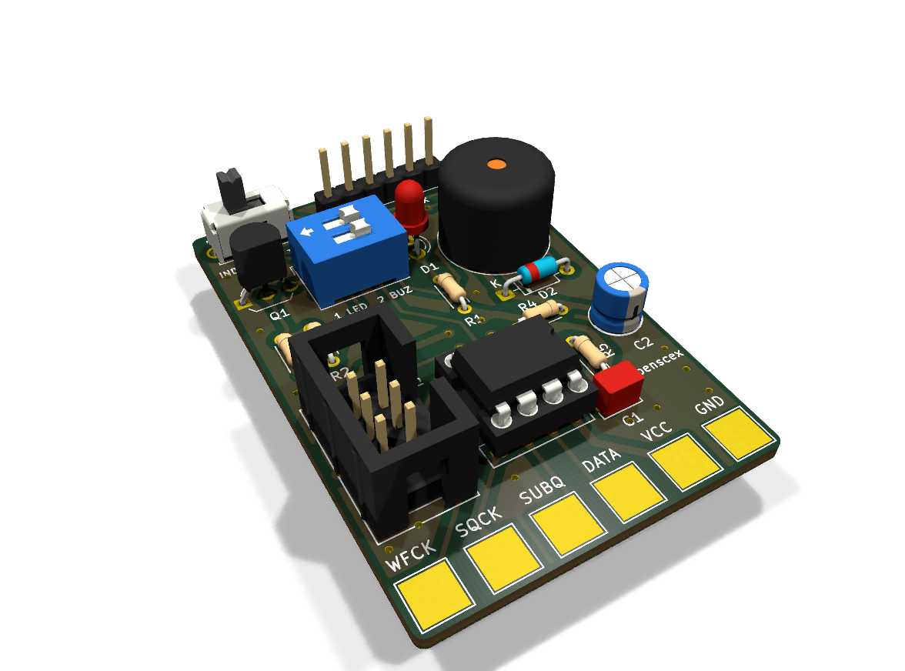
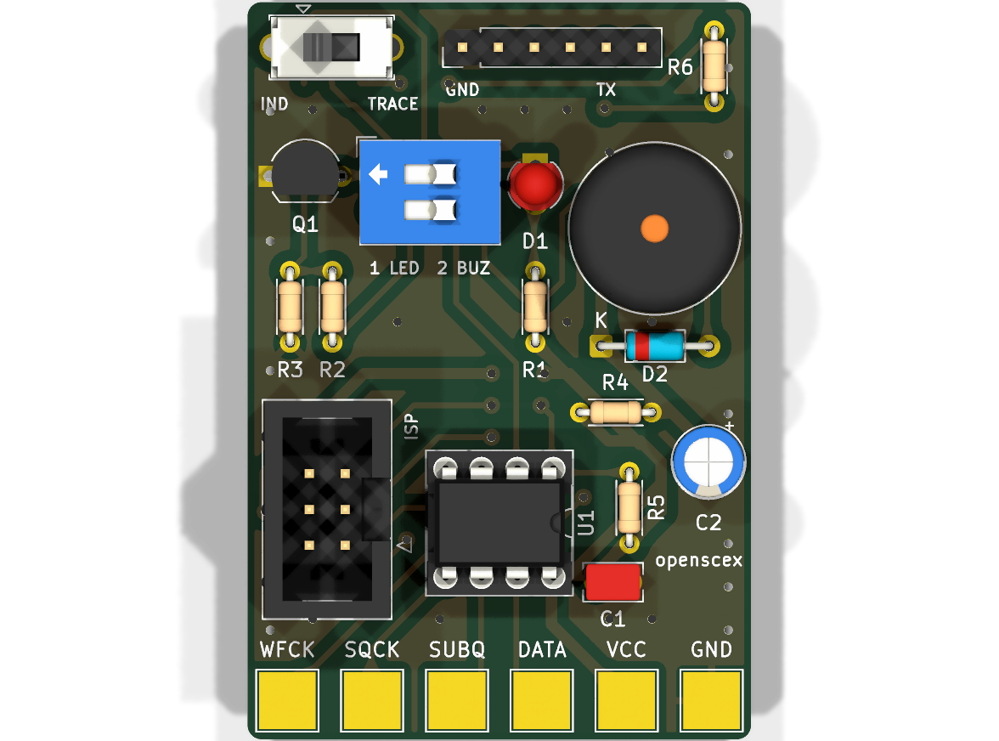
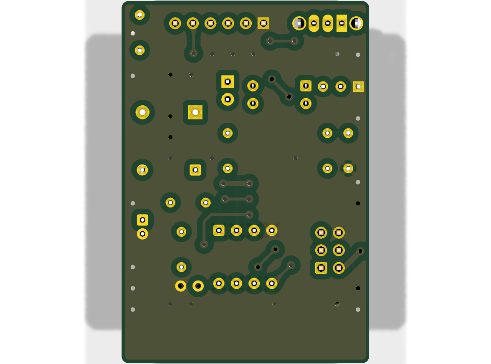
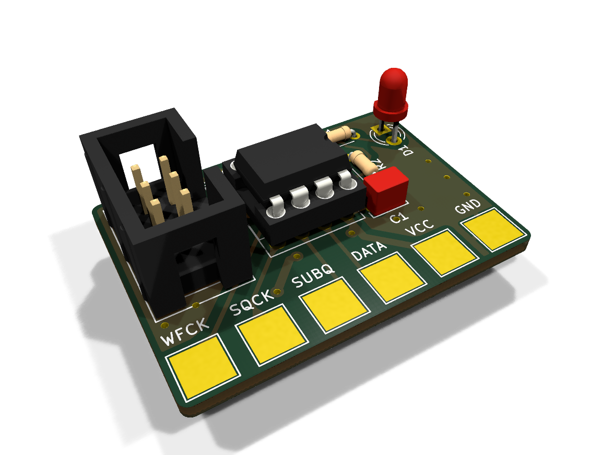
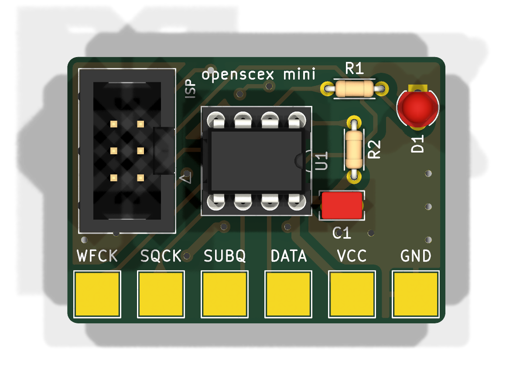
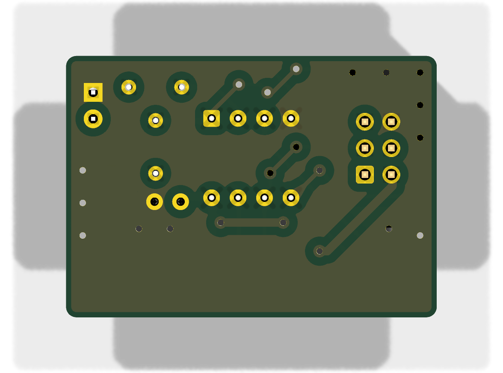
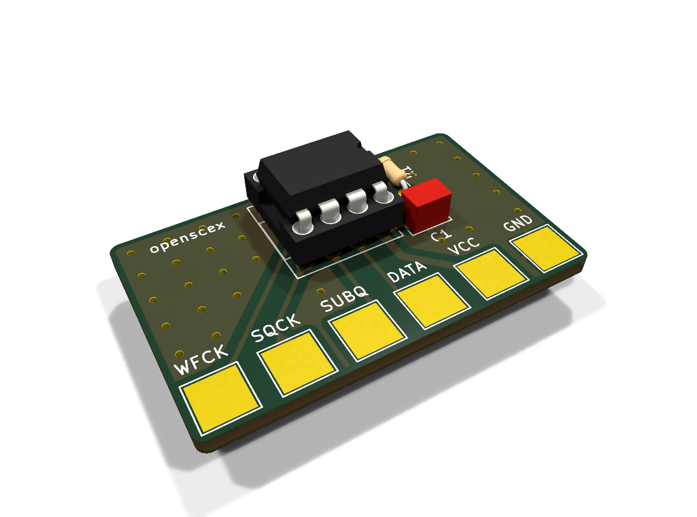
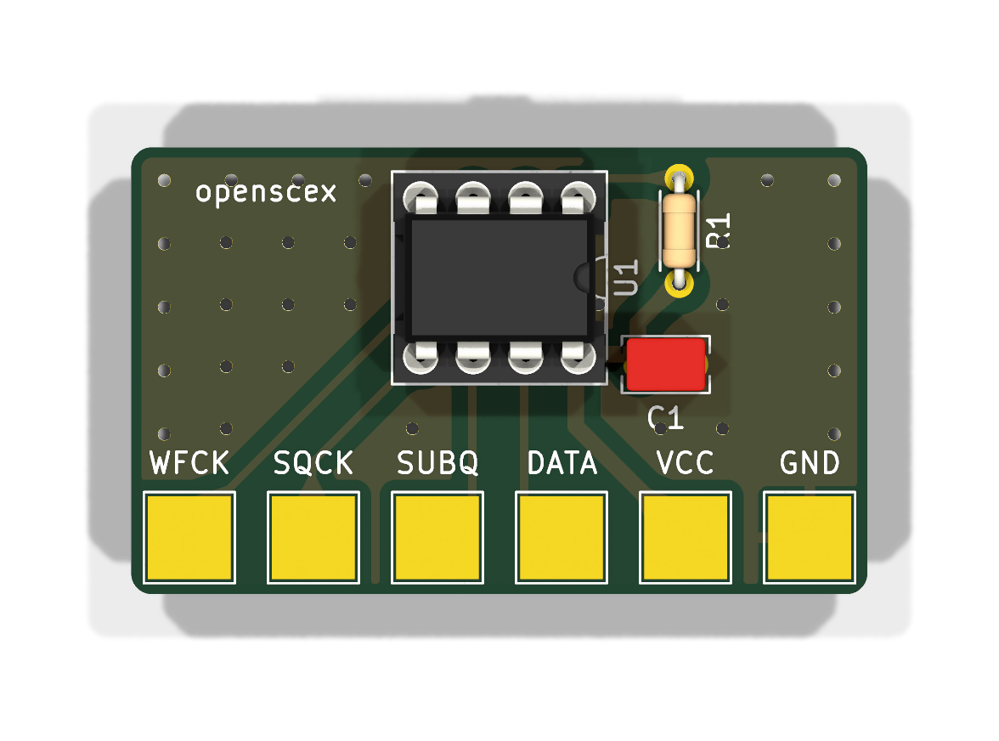
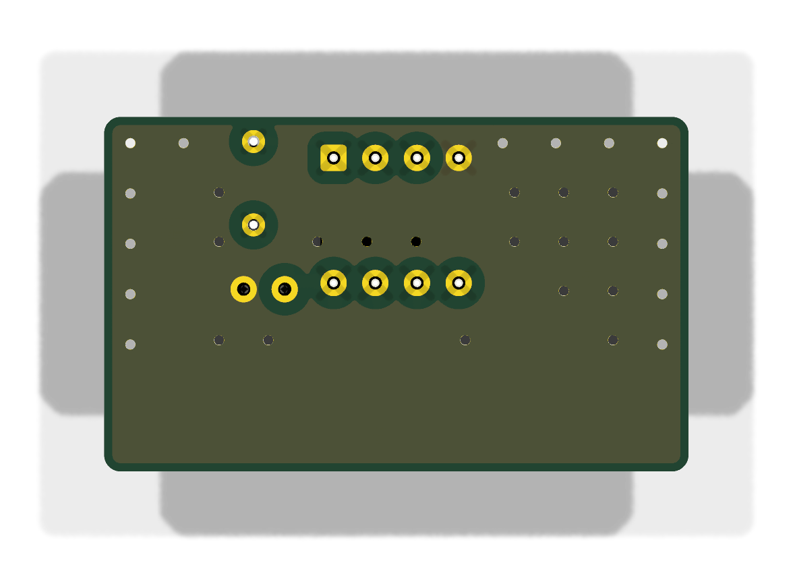
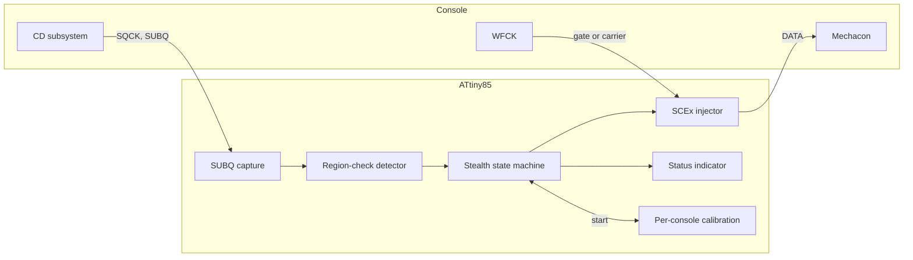

<div align="center">

<h1>openscex-modchip</h1>

<p>
  <b>English</b> &nbsp;·&nbsp; <a href="README.ja.md">日本語</a> &nbsp;·&nbsp; <a href="README.zh.md">中文</a>
</p>

<strong>Stealth SCEx region unlock for the PlayStation and PSone, on an ATtiny85 that trims its own clock against the console.</strong>

<br><br>

[](https://github.com/gufranco/openscex-modchip/actions/workflows/ci.yml)
[](https://github.com/gufranco/openscex-modchip/releases)
[](AGENTS.md)
[](LICENSE)

<br>

<p>
  <a href="#quick-start">Quick start</a> &nbsp;|&nbsp;
  <a href="#console-tap-points">Wiring</a> &nbsp;|&nbsp;
  <a href="#status-indicator">Status indicator</a> &nbsp;|&nbsp;
  <a href="#against-other-chips">Comparison</a> &nbsp;|&nbsp;
  <a href="../../issues/new?template=compatibility.yml">Report your console</a>
</p>

</div>

[**5902**](Makefile) bytes of flash · [**8**](assets/psnee) board families, PU-7 to PM-41(2) · [**3**](src/region.c) regions · [**0**](AGENTS.md) MISRA deviations · [**100%**](tests/host) host line and branch coverage · [**598/598**](tools/mutate.py) mutants killed

```bash
gh release download --repo gufranco/openscex-modchip --pattern 'openscex-modchip-attiny85.hex' --pattern SHA256SUMS
sha256sum -c SHA256SUMS --ignore-missing
avrdude -c <programmer> -p attiny85 -U flash:w:openscex-modchip-attiny85.hex:i
```

> [!IMPORTANT]
> The current firmware passes the full simulation gate and has not yet run on a console. Measure the tap voltages before wiring. Source: [compatibility reports](https://github.com/gufranco/openscex-modchip/issues?q=label%3Acompatibility), [tests/sim](tests/sim).

Region-unlock firmware for the original PlayStation and the PSone, on an ATtiny85. It sends the configured region string only inside the SUBQ region-check window and keeps DATA high-impedance the rest of the time. It does not patch the boot ROM, so Japanese fat consoles and the PAL PSone also need a patched BIOS. It is not an optical-drive emulator, does not support PS2 or Saturn, and does not defeat LibCrypt. Source: [src/run.c](src/run.c), [src/inject.c](src/inject.c), [AGENTS.md](AGENTS.md).

| | | Source |
|:--|:--|:--|
| **Silent after acceptance**<br>No string starts after the first program-area frame; one already under way finishes, within 176 ms. Only a new lead-in read, such as an anti-mod TOC re-read, is served again. | **Disc swaps without a lid wire**<br>1.5 s without SUBQ frames counts as a swap and re-arms the chip for the next disc. | [src/inject.c](src/inject.c), [src/loop.c](src/loop.c), [src/run.c](src/run.c) |
| **Self-trimmed timing**<br>The chip times the console's 75 Hz SUBQ frames and trims its internal oscillator to within 1%. No clock wire. | **One region, one window**<br>Only the configured region string, only inside the SUBQ region-check window, at most 16 strings per arming. | [src/trim.c](src/trim.c), [src/region.c](src/region.c), [include/pscu/config.h](include/pscu/config.h) |
| **Status LED or buzzer**<br>One pin reports boot stages, each disc's result and wiring faults. A final build only chirps and reports each fault once. | **Proven in code**<br>MISRA C:2012 clean, 100% host coverage, a simavr console model, mutation testing, byte-identical rebuilds. | [src/indicator.c](src/indicator.c), [tests/host](tests/host), [tools/mutate.py](tools/mutate.py) |

## Overview

| Property | Value | Source |
|:---------|:------|:--|
| Console targets | PlayStation fat PU-7 through PU-23, PSone PM-41 and PM-41(2) | [assets/psnee](assets/psnee), [PsNee PSNee.ino L372-L406](https://github.com/kalymos/PsNee/blob/df52aec97d4e1677e3ed3ead1fba0bf102b1cfd7/PSNee/PSNee.ino#L372-L406) |
| MCU | ATtiny85 (8-pin DIP) | [include/port/registers.h](include/port/registers.h), [ATtiny25/45/85 datasheet 2586Q](https://ww1.microchip.com/downloads/en/DeviceDoc/Atmel-2586-AVR-8-bit-Microcontroller-ATtiny25-ATtiny45-ATtiny85_Datasheet.pdf) |
| Method | SCEx injection | [src/inject.c](src/inject.c), [psx-spx cdromdrive.md, SCEx](https://github.com/psx-spx/psx-spx.github.io/blob/6d7d1bc106a7e0b616b0330fe58401ab1ba57f0f/docs/cdromdrive.md#L1211-L1230) |
| Region | one per build, `REGION=jp\|us\|eu` (default us) | [Makefile](Makefile), [src/region.c](src/region.c) |
| Clock | the internal 8 MHz RC oscillator, trimmed against the console's SUBQ frame rate | [src/trim.c](src/trim.c), [ATtiny25/45/85 datasheet 2586Q](https://ww1.microchip.com/downloads/en/DeviceDoc/Atmel-2586-AVR-8-bit-Microcontroller-ATtiny25-ATtiny45-ATtiny85_Datasheet.pdf) |
| Wires | 4 signals (SQCK, SUBQ, DATA, WFCK) plus power; optional LED or active buzzer | [include/port/registers.h](include/port/registers.h), [PsNee MCU.h L453-L530](https://github.com/kalymos/PsNee/blob/df52aec97d4e1677e3ed3ead1fba0bf102b1cfd7/PSNee/MCU.h#L453-L530) |
| Toolchain | C17, MISRA C:2012 zero deviations, pinned Docker image | [Dockerfile](Dockerfile), [AGENTS.md](AGENTS.md) |

## Supported build per console

| Console | Board | `REGION` | Second region check | Source |
|:--------|:------|:---------|:--------------------|:--|
| Fat US/Canada, SCPH-1001 | PU-8 | `us` | none | [consolemods PS1 region information](https://consolemods.org/wiki/PS1:Region_Information), [PsNee PSNee.ino L10-L17](https://github.com/kalymos/PsNee/blob/df52aec97d4e1677e3ed3ead1fba0bf102b1cfd7/PSNee/PSNee.ino#L10-L17) |
| Fat US/Canada, SCPH-550x1/700x1/900x1 | PU-18 to PU-23 | `us` | none | [consolemods PS1 region information](https://consolemods.org/wiki/PS1:Region_Information), [PsNee PSNee.ino L10-L17](https://github.com/kalymos/PsNee/blob/df52aec97d4e1677e3ed3ead1fba0bf102b1cfd7/PSNee/PSNee.ino#L10-L17) |
| Fat PAL, SCPH-1002 | PU-8 | `eu` | none | [consolemods PS1 region information](https://consolemods.org/wiki/PS1:Region_Information), [PsNee PSNee.ino L10-L17](https://github.com/kalymos/PsNee/blob/df52aec97d4e1677e3ed3ead1fba0bf102b1cfd7/PSNee/PSNee.ino#L10-L17) |
| Fat PAL, SCPH-550x2/900x2 | PU-18 to PU-22 | `eu` | none | [consolemods PS1 region information](https://consolemods.org/wiki/PS1:Region_Information), [PsNee PSNee.ino L10-L17](https://github.com/kalymos/PsNee/blob/df52aec97d4e1677e3ed3ead1fba0bf102b1cfd7/PSNee/PSNee.ino#L10-L17) |
| PSone US/Canada, SCPH-101 | PM-41 / PM-41(2) | `us` | none | [consolemods PS1 region information](https://consolemods.org/wiki/PS1:Region_Information), [PsNee PSNee.ino L10-L17](https://github.com/kalymos/PsNee/blob/df52aec97d4e1677e3ed3ead1fba0bf102b1cfd7/PSNee/PSNee.ino#L10-L17) |
| PSone PAL, SCPH-102 | PM-41 / PM-41(2) | `eu` | in the boot ROM; needs a patched BIOS | [consolemods PS1 region information](https://consolemods.org/wiki/PS1:Region_Information), [PsNee PSNee.ino L33-L38](https://github.com/kalymos/PsNee/blob/df52aec97d4e1677e3ed3ead1fba0bf102b1cfd7/PSNee/PSNee.ino#L33-L38) |
| PSone Japan, SCPH-100 | PM-41 | `jp` | in the boot ROM; needs a patched BIOS | [consolemods PS1 region information](https://consolemods.org/wiki/PS1:Region_Information), [PsNee PSNee.ino L33-L38](https://github.com/kalymos/PsNee/blob/df52aec97d4e1677e3ed3ead1fba0bf102b1cfd7/PSNee/PSNee.ino#L33-L38) |
| Fat Japan, SCPH-1000/3000/3500/5000/5500/7000/7500/9000 | PU-7 to PU-23 | `jp` | in the boot ROM; needs a patched BIOS, though early SCPH-1000 units boot the disc anyway | [consolemods PS1 region information](https://consolemods.org/wiki/PS1:Region_Information), [PsNee PSNee.ino L33-L38](https://github.com/kalymos/PsNee/blob/df52aec97d4e1677e3ed3ead1fba0bf102b1cfd7/PSNee/PSNee.ino#L33-L38) |
| Asia, SCPH-xxx3 | unknown | `jp` | none | [consolemods PS1 region information](https://consolemods.org/wiki/PS1:Region_Information), [PsNee PSNee.ino L10-L17](https://github.com/kalymos/PsNee/blob/df52aec97d4e1677e3ed3ead1fba0bf102b1cfd7/PSNee/PSNee.ino#L10-L17) |
| Asia Video CD, SCPH-5903 | unknown | `jp` + `VCD_FILTER=on` | none | [consolemods PS1 region information](https://consolemods.org/wiki/PS1:Region_Information), [PsNee PSNee.ino L456-L490](https://github.com/kalymos/PsNee/blob/df52aec97d4e1677e3ed3ead1fba0bf102b1cfd7/PSNee/PSNee.ino#L456-L490) |

The PU-7 and PU-8 use the static-gate method, as in PsNee V9.0. Dev boards (DTL-H120x, PU-9) read burned discs natively and need no chip. Source: [PsNee PSNee.ino L33-L38](https://github.com/kalymos/PsNee/blob/df52aec97d4e1677e3ed3ead1fba0bf102b1cfd7/PSNee/PSNee.ino#L33-L38), [PsNee PSNee.ino L10-L17](https://github.com/kalymos/PsNee/blob/df52aec97d4e1677e3ed3ead1fba0bf102b1cfd7/PSNee/PSNee.ino#L10-L17), [PsNee PSNee.ino L456-L490](https://github.com/kalymos/PsNee/blob/df52aec97d4e1677e3ed3ead1fba0bf102b1cfd7/PSNee/PSNee.ino#L456-L490), [src/subq.c](src/subq.c).

## Quick start

Each [release](../../releases) carries prebuilt images: `us`, `eu`, `jp`, `jp-vcd` for the SCPH-5903, a quiet `-final` variant of each (see [Status indicator](#status-indicator)), a `SHA256SUMS` file, the license, `toolchain.spdx.json`, an SPDX bill of materials of the toolchain that built them, and build-provenance and SBOM attestations. Check a download before flashing it:

```bash
sha256sum -c SHA256SUMS --ignore-missing
gh attestation verify openscex-modchip-attiny85.hex --repo gufranco/openscex-modchip
```

Releases are versioned automatically from the commit history. To build from source, run every build, check and test through `make` in the pinned Docker toolchain; only `avrdude` runs on the host. Source: [.releaserc.json](.releaserc.json), [.github/workflows/release.yml](.github/workflows/release.yml).

| Tool | Purpose | Source |
|:-----|:--------|:--|
| Docker | runs the pinned toolchain | [Docker](https://docs.docker.com/get-docker/), [Dockerfile](Dockerfile) |
| Git | clones the repository | [Git](https://git-scm.com/downloads) |
| avrdude | flashes the image to the chip | [avrdude](https://github.com/avrdudes/avrdude) |
| Python 3 | runs make's Docker wrapper on the host | [Python](https://www.python.org/downloads/), [tools/docker_make.py](tools/docker_make.py) |

```bash
git clone https://github.com/gufranco/openscex-modchip.git
cd openscex-modchip
make REGION=us                                        # America
make REGION=jp VCD_FILTER=on                          # SCPH-5903
make REGION=us PROFILE=final                          # America, quiet indicator
make REGION=us PROFILE=trace                          # America, debug trace on pin 2
avrdude -c <programmer> -p attiny85 -U flash:w:build/attiny85/release/openscex-modchip-attiny85.hex:i
avrdude -c <programmer> -p attiny85 -U lfuse:w:0xE2:m -U hfuse:w:0xDD:m -U efuse:w:0xFF:m
```

Any ISP works, including an Arduino as ISP. Write the flash first and the fuses last. The low fuse `0xE2` selects the internal 8 MHz oscillator, the slow-rising-power start-up delay and no clock divider (CKSEL 0010, SUT 10; datasheet Tables 6-6 and 6-7). The firmware also clears the clock prescaler at boot, so CKDIV8 cannot slow it. Reflashing erases the calibration record and oscillator trim; the chip learns them again. Source: [Arduino as ISP](https://docs.arduino.cc/built-in-examples/arduino-isp/ArduinoISP/), [ATtiny25/45/85 datasheet 2586Q](https://ww1.microchip.com/downloads/en/DeviceDoc/Atmel-2586-AVR-8-bit-Microcontroller-ATtiny25-ATtiny45-ATtiny85_Datasheet.pdf), [src/run.c](src/run.c).

A new ATtiny85 ships with CKDIV8 programmed and runs at 1 MHz, so the ISP clock must stay below 250 kHz until the fuses are written; the datasheet requires each half of the ISP clock to last more than two CPU cycles. An Arduino as ISP already does. With another programmer, add avrdude's `-B`, for example `-B 8`, for the first write. Source: [ATtiny25/45/85 datasheet 2586Q](https://ww1.microchip.com/downloads/en/DeviceDoc/Atmel-2586-AVR-8-bit-Microcontroller-ATtiny25-ATtiny45-ATtiny85_Datasheet.pdf), [avrdude manual, -B](https://avrdudes.github.io/avrdude/8.0/avrdude_3.html).

| Build | Fuses (low / high / extended) | Source |
|:------|:------------------------------|:--|
| Internal 8 MHz with brown-out detection at 2.7 V, recommended | `0xE2` / `0xDD` / `0xFF` | [ATtiny25/45/85 datasheet 2586Q](https://ww1.microchip.com/downloads/en/DeviceDoc/Atmel-2586-AVR-8-bit-Microcontroller-ATtiny25-ATtiny45-ATtiny85_Datasheet.pdf) |
| Internal 8 MHz without brown-out detection | `0xE2` / `0xDF` / `0xFF` | [ATtiny25/45/85 datasheet 2586Q](https://ww1.microchip.com/downloads/en/DeviceDoc/Atmel-2586-AVR-8-bit-Microcontroller-ATtiny25-ATtiny45-ATtiny85_Datasheet.pdf) |

Brown-out detection holds the chip in reset below 2.7 V, the ATtiny85's minimum supply for its speed grade; keep it on. The firmware also measures its supply before every string and holds back below about 2.75 V, shown as code 7. That limit still passes a 3.3 V supply 5 percent low on a chip whose bandgap reads high. Source: [ATtiny25/45/85 datasheet 2586Q](https://ww1.microchip.com/downloads/en/DeviceDoc/Atmel-2586-AVR-8-bit-Microcontroller-ATtiny25-ATtiny45-ATtiny85_Datasheet.pdf), [src/supply.c](src/supply.c).

Verify with the [Makefile](Makefile) targets:

```bash
make size        # image size; fails when less than 256 bytes of flash stay free
make test        # host tests, simavr console model and its stack check
make analyse     # formatting, lint, types, licences, MISRA and the Python tests
make repro       # every release image, built twice from clean, byte-identical
make mutate      # mutation testing on the logic layer
make mutate_platform  # mutation of run.c and engine.c, killed by the simulator
make bench_ci    # console bench: this firmware against PsNee in the same simulated console
```

CI runs the same gates on every push and pull request, as defined in [`.github/workflows/ci.yml`](.github/workflows/ci.yml). `make hooks` enables the commit-message and formatting checks locally.

## MCU pinout

The four SCEx signals and the indicator pin keep PsNee's ATtiny85 assignment from its `MCU.h`, so PsNee wiring guides match pin for pin. PB5 stays RESET, so the chip remains ISP-programmable. Pin numbers are for the 8-pin PDIP; check the datasheet for SOIC. Source: [PsNee MCU.h L453-L530](https://github.com/kalymos/PsNee/blob/df52aec97d4e1677e3ed3ead1fba0bf102b1cfd7/PSNee/MCU.h#L453-L530), [include/port/registers.h](include/port/registers.h), [ATtiny25/45/85 datasheet 2586Q](https://ww1.microchip.com/downloads/en/DeviceDoc/Atmel-2586-AVR-8-bit-Microcontroller-ATtiny25-ATtiny45-ATtiny85_Datasheet.pdf).

| DIP pin | Port | Signal | Direction | Connect to | Source |
|:-------:|:-----|:-------|:----------|:-----------|:--|
| 1 | PB5 | RESET | - | leave as reset | [include/port/registers.h](include/port/registers.h), [ATtiny25/45/85 datasheet 2586Q](https://ww1.microchip.com/downloads/en/DeviceDoc/Atmel-2586-AVR-8-bit-Microcontroller-ATtiny25-ATtiny45-ATtiny85_Datasheet.pdf) |
| 2 | PB3 | INDICATOR | out, optional | status LED through a 1 kΩ resistor, an active buzzer, or leave off | [include/port/registers.h](include/port/registers.h), [PsNee PSNee.ino L64](https://github.com/kalymos/PsNee/blob/df52aec97d4e1677e3ed3ead1fba0bf102b1cfd7/PSNee/PSNee.ino#L64) |
| 3 | PB4 | WFCK | in and out | static gate, or PU-22+ live carrier | [include/port/registers.h](include/port/registers.h), [PsNee MCU.h L453-L530](https://github.com/kalymos/PsNee/blob/df52aec97d4e1677e3ed3ead1fba0bf102b1cfd7/PSNee/MCU.h#L453-L530) |
| 4 | GND | GND | - | console ground | [ATtiny25/45/85 datasheet 2586Q](https://ww1.microchip.com/downloads/en/DeviceDoc/Atmel-2586-AVR-8-bit-Microcontroller-ATtiny25-ATtiny45-ATtiny85_Datasheet.pdf) |
| 5 | PB0 | SQCK | in | SUBQ serial clock | [include/port/registers.h](include/port/registers.h), [PsNee MCU.h L453-L530](https://github.com/kalymos/PsNee/blob/df52aec97d4e1677e3ed3ead1fba0bf102b1cfd7/PSNee/MCU.h#L453-L530) |
| 6 | PB1 | SUBQ | in | SUBQ serial data | [include/port/registers.h](include/port/registers.h), [PsNee MCU.h L453-L530](https://github.com/kalymos/PsNee/blob/df52aec97d4e1677e3ed3ead1fba0bf102b1cfd7/PSNee/MCU.h#L453-L530) |
| 7 | PB2 | DATA | out, drive-low or high-Z | SCEx injection into the mechacon | [include/port/registers.h](include/port/registers.h), [src/port.S](src/port.S) |
| 8 | VCC | VCC | - | console supply, measure first | [ATtiny25/45/85 datasheet 2586Q](https://ww1.microchip.com/downloads/en/DeviceDoc/Atmel-2586-AVR-8-bit-Microcontroller-ATtiny25-ATtiny45-ATtiny85_Datasheet.pdf) |

## Console tap points

The photos below label SQCK, SUBQ, DATA, WFCK, VCC and GND on each board; solder each wire where they are marked. The PU-18 photo shows the underside. Leave AX, DX and RESET unconnected: they belong to PsNee's boot-ROM patch. Source: [assets/psnee](assets/psnee).

<table>
<tr><td align="center" width="33%"><a href="assets/psnee/pu-7.jpg"></a><br><sub><b>PU-7</b>. Photo from PsNee</sub></td><td align="center" width="33%"><a href="assets/psnee/pu-8a.jpg"></a><br><sub><b>PU-8</b>, 1-658-467-22. Photo from PsNee</sub></td><td align="center" width="33%"><a href="assets/psnee/pu-8b.jpg"></a><br><sub><b>PU-8</b>, 1-658-467-12. Photo from PsNee</sub></td></tr>
<tr><td align="center" width="33%"><a href="assets/psnee/pu-18.jpg"></a><br><sub><b>PU-18</b>. Photo from PsNee</sub></td><td align="center" width="33%"><a href="assets/psnee/pu-20.jpg"></a><br><sub><b>PU-20</b>. Photo from PsNee</sub></td><td align="center" width="33%"><a href="assets/psnee/pu-22.jpg"></a><br><sub><b>PU-22</b>. Photo from PsNee</sub></td></tr>
<tr><td align="center" width="33%"><a href="assets/psnee/pu-23.jpg"></a><br><sub><b>PU-23</b>. Photo from PsNee</sub></td><td align="center" width="33%"><a href="assets/psnee/pm-41.jpg"></a><br><sub><b>PM-41</b>. Photo from PsNee</sub></td><td align="center" width="33%"><a href="assets/psnee/pm-41-2.jpg"></a><br><sub><b>PM-41(2)</b>. Photo from PsNee</sub></td></tr>
</table>

These nine photos come from [PsNee](https://github.com/kalymos/PsNee) V9.0 by kalymos and its contributors, released into the public domain under the [Unlicense](LICENSES/Unlicense.txt), and are copied here resized.

| Board family | SCPH era | DATA injection point | WFCK role | Source |
|:-------------|:---------|:---------------------|:----------|:--|
| PU-7, PU-8, PU-18, PU-20 | 1000-750x | digital NRZ output of the wobble ASIC into the mechacon | static gate | [assets/psnee](assets/psnee), [PsNee PSNee.ino L372-L406](https://github.com/kalymos/PsNee/blob/df52aec97d4e1677e3ed3ead1fba0bf102b1cfd7/PSNee/PSNee.ino#L372-L406) |
| PU-22, PU-23 | 7500-900x | CD-processor tracking line, WFCK as a fake carrier, three-wire-plus-link | live clock, sync required | [assets/psnee](assets/psnee), [PsNee PSNee.ino L372-L406](https://github.com/kalymos/PsNee/blob/df52aec97d4e1677e3ed3ead1fba0bf102b1cfd7/PSNee/PSNee.ino#L372-L406) |
| PM-41, PM-41(2) | PSone 100-103 | same tracking-line carrier method; float the chip I/O when idle on PM-41(2) | live clock | [assets/psnee](assets/psnee), [quade.co PsNee guide](https://quade.co/ps1-modchip-guide/psnee/) |

With no clock or lid wire, the chip can sit anywhere the four signal wires reach. Keep those wires short: long wires pick up noise, a known cause of Mayumi V4 failures (quade.co). Remove the clock and lid wires of an install made for an earlier release before flashing this firmware, because pin 2 is now PB3, the indicator output, and would drive against a console clock left there. Source: [src/trim.c](src/trim.c), [src/loop.c](src/loop.c), [quade.co Mayumi V4 guide](https://quade.co/ps1-modchip-guide/mayumi-v4/), [include/port/registers.h](include/port/registers.h).

## Carrier boards

Three optional boards hold the chip in a DIP-8 socket, so it comes out for reflashing. The console wires land on six 4 by 4 mm top-side pads with no holes, 6 mm apart along one edge: WFCK, SQCK, SUBQ, DATA, VCC and GND. Every part is through-hole, and a 10 kΩ pull-up holds RESET high because the chip's internal one is weak against console noise. Each board is a KiCad 10 project with its schematic, layout and design rules. Source: [hardware](hardware).

| Board | Parts | Size | Source |
|:--|:--|:--|:--|
| Carrier | socket, 100 nF decoupling, keyed ISP header, 10 kΩ RESET pull-up, and an indicator: PB3 switches a 2N3904 driving the LED with its 1 kΩ resistor, the buzzer, both or neither, set by a two-position DIP switch; the buzzer runs from a 10 Ω and 100 µF filter with a 1N4148 across it; a slide switch hands PB3 to the indicator or, through 1 kΩ, to a 6-pin serial trace header | 35.7 × 52.2 mm | [hardware/openscex-carrier.kicad_sch](hardware/openscex-carrier.kicad_sch), [hardware/openscex-carrier.kicad_pcb](hardware/openscex-carrier.kicad_pcb) |
| Mini | socket, 100 nF decoupling, 10 kΩ RESET pull-up, the LED with its 1 kΩ resistor straight on PB3, keyed ISP header | 35.7 × 25.2 mm | [hardware/openscex-mini.kicad_sch](hardware/openscex-mini.kicad_sch), [hardware/openscex-mini.kicad_pcb](hardware/openscex-mini.kicad_pcb) |
| Bare | socket, 100 nF decoupling and a 10 kΩ RESET pull-up, nothing else | 35.7 × 21.7 mm | [hardware/openscex-bare.kicad_sch](hardware/openscex-bare.kicad_sch), [hardware/openscex-bare.kicad_pcb](hardware/openscex-bare.kicad_pcb) |

<table>
<tr><td align="center" width="33%"><a href="assets/boards/carrier-3d.png"></a><br><sub><b>Carrier board</b>, 3D view</sub></td><td align="center" width="33%"><a href="assets/boards/carrier-top.png"></a><br><sub><b>Carrier board</b>, top</sub></td><td align="center" width="33%"><a href="assets/boards/carrier-bottom.png"></a><br><sub><b>Carrier board</b>, bottom, the ground plane</sub></td></tr>
<tr><td align="center" width="33%"><a href="assets/boards/mini-3d.png"></a><br><sub><b>Mini board</b>, 3D view</sub></td><td align="center" width="33%"><a href="assets/boards/mini-top.png"></a><br><sub><b>Mini board</b>, top</sub></td><td align="center" width="33%"><a href="assets/boards/mini-bottom.png"></a><br><sub><b>Mini board</b>, bottom, the ground plane</sub></td></tr>
<tr><td align="center" width="33%"><a href="assets/boards/bare-3d.png"></a><br><sub><b>Bare board</b>, 3D view</sub></td><td align="center" width="33%"><a href="assets/boards/bare-top.png"></a><br><sub><b>Bare board</b>, top</sub></td><td align="center" width="33%"><a href="assets/boards/bare-bottom.png"></a><br><sub><b>Bare board</b>, bottom, the ground plane</sub></td></tr>
</table>

All three are two-layer boards laid out against noise. Tracks run on top where they can, so the bottom stays a ground plane under the console lines; both layers are ground-poured and stitched with 0.6 mm vias; no track bends more than 45 degrees; different nets keep 1 mm apart and 0.8 mm from pads. On the carrier the buzzer, which draws up to 30 mA in 2.4 kHz pulses, sits in the corner farthest from the console lines, behind a filter that keeps its ripple off the chip's supply. Source: [hardware/openscex-carrier.kicad_dru](hardware/openscex-carrier.kicad_dru), [hardware/openscex-carrier.kicad_pcb](hardware/openscex-carrier.kicad_pcb), [CMI-1295IC-0385T datasheet](https://www.sameskydevices.com/product/resource/cmi-1295ic-0385t.pdf).

The ISP header follows the AVR 6-pin layout: 1 MISO on SUBQ, 2 VCC, 3 SCK on DATA, 4 MOSI on SQCK, 5 RESET, 6 GND. Its keyed shroud keeps 1.5 mm clear of every other part. Reflash with the board out of the console or its wires unsoldered; in place, the programmer would feed the console's supply and fight the console's drivers on SQCK and SUBQ. Source: [hardware/openscex-carrier.kicad_sch](hardware/openscex-carrier.kicad_sch), [hardware/openscex-mini.kicad_sch](hardware/openscex-mini.kicad_sch), [ATtiny25/45/85 datasheet 2586Q](https://ww1.microchip.com/downloads/en/DeviceDoc/Atmel-2586-AVR-8-bit-Microcontroller-ATtiny25-ATtiny45-ATtiny85_Datasheet.pdf).

The carrier's trace header J2 takes the 6-way socket of an FTDI TTL-232R cable: pin 1 is GND, pin 5 the cable's RXD input, and pins 2, 3, 4 and 6 stay open, so the cable's 5 V output never reaches the console. The slide switch SW2, a C&K OS102011MS2QN1, sends PB3 to the indicator with the slider toward IND and to the header with it toward TRACE; its contacts break before they make, so the indicator stays silent while the trace runs. A 1 kΩ resistor in series limits the current into either side while the other is unpowered. The header stands at the board edge with 2 mm clear around it, so the socket or an adapter plugged on it meets no other part. Source: [hardware/openscex-carrier.kicad_sch](hardware/openscex-carrier.kicad_sch), [hardware/openscex-carrier.kicad_pcb](hardware/openscex-carrier.kicad_pcb), [TTL-232R datasheet](https://www.farnell.com/datasheets/81225.pdf), [C&K OS series datasheet](https://www.littelfuse.com/assetdocs/littelfuse-c-k-slide-os-series-datasheet?assetguid=f8954ac2-65ba-431f-af55-b0493370575e).

Each board has a bill of materials and a Gerber and drill archive ready for a board house, both exported with KiCad 10.0.6. Teardrops are drawn into the board, so the archive needs no refill in KiCad. Source: [hardware/openscex-carrier-bom.csv](hardware/openscex-carrier-bom.csv), [hardware/fab/openscex-carrier-gerbers.zip](hardware/fab/openscex-carrier-gerbers.zip), [hardware/openscex-mini-bom.csv](hardware/openscex-mini-bom.csv), [hardware/fab/openscex-mini-gerbers.zip](hardware/fab/openscex-mini-gerbers.zip), [hardware/openscex-bare-bom.csv](hardware/openscex-bare-bom.csv), [hardware/fab/openscex-bare-gerbers.zip](hardware/fab/openscex-bare-gerbers.zip).

## Safety

- Measure the voltage at every tap point before wiring. Every board, PU-7 to PM-41(2), runs most of its chips from +3.5 V, and that is the chip's supply; the board's +5 V rail feeds a few parts such as the AV multi out, the audio amplifier and the regulator for the sound and CD supply, and PsNee warns against wiring the chip to it. Source: [psx-spx pinouts.md, voltage summary](https://github.com/psx-spx/psx-spx.github.io/blob/6d7d1bc106a7e0b616b0330fe58401ab1ba57f0f/docs/pinouts.md#L1777-L1795), [PsNee changelog](https://github.com/kalymos/PsNee/blob/df52aec97d4e1677e3ed3ead1fba0bf102b1cfd7/changelog#L38).
- Opening a console and soldering to the CD subsystem can destroy it. Build at your own risk. Source: [quade.co PS1 modchip guide](https://quade.co/ps1-modchip-guide/).

## Status indicator

PB3 drives an optional LED or active buzzer, the chip's only diagnostic channel. It shows the current stage, whether each disc passed its region check, and which wire to check when something fails. It never delays or gates a feature and keeps no history, so every code except the two boot codes describes the present. Source: [src/indicator.c](src/indicator.c).

| Part | Choice | Source |
|:-----|:-------|:--|
| LED | a 3 mm or 5 mm red, orange, yellow or green LED, forward voltage about 2 V; not blue or white, whose 3 V forward voltage leaves almost nothing across the resistor on the console's 3.5 V supply | [Kingbright WP7113ID datasheet](https://www.kingbrightusa.com/images/catalog/SPEC/WP7113ID.pdf), [ATtiny25/45/85 datasheet 2586Q](https://ww1.microchip.com/downloads/en/DeviceDoc/Atmel-2586-AVR-8-bit-Microcontroller-ATtiny25-ATtiny45-ATtiny85_Datasheet.pdf) |
| Resistor | 1 kΩ, any wattage: about 1.5 mA at the console's 3.5 V, well under the pin's 40 mA absolute maximum | [ATtiny25/45/85 datasheet 2586Q](https://ww1.microchip.com/downloads/en/DeviceDoc/Atmel-2586-AVR-8-bit-Microcontroller-ATtiny25-ATtiny45-ATtiny85_Datasheet.pdf) |
| LED wiring | pin 2 (PB3) to the resistor, the resistor to the LED anode (long leg), the cathode (flat side) to ground | [include/port/registers.h](include/port/registers.h) |
| Buzzer | instead of the LED, an active piezo buzzer, which sounds on plain DC, such as the PUI Audio AI-3035-TWT-3V-R: 2 to 5 V, at most 9 mA at 3 V, about 3.5 kHz, 30 mm across | [AI-3035-TWT-3V-R datasheet](https://api.puiaudio.com/filename/AI-3035-TWT-3V-R.pdf), [ATtiny25/45/85 datasheet 2586Q](https://ww1.microchip.com/downloads/en/DeviceDoc/Atmel-2586-AVR-8-bit-Microcontroller-ATtiny25-ATtiny45-ATtiny85_Datasheet.pdf) |
| Buzzer wiring | pin 2 (PB3) to the buzzer's + lead, the - lead to ground, with no resistor or diode: a piezo is not a coil and sends no spike back when switched off. Wired straight to the pin, a magnetic buzzer is not supported, since it is a coil; the carrier board drives one through Q1 with a flyback diode | [hardware/openscex-carrier.kicad_sch](hardware/openscex-carrier.kicad_sch),  [AI-3035-TWT-3V-R datasheet](https://api.puiaudio.com/filename/AI-3035-TWT-3V-R.pdf), [include/port/registers.h](include/port/registers.h) |

Two builds drive the pin. `debug`, the default, shows everything below; `final`, built with `make PROFILE=final` and released as the `-final` images, stays quiet. Flash `debug` to install and troubleshoot, then `final` to play. Only the pin differs: the simulator checks edge by edge that both send the same strings at the same times. Source: [include/pscu/indicator.h](include/pscu/indicator.h), [tests/sim/sim_profile.c](tests/sim/sim_profile.c).

| Stage | debug | final | Source |
|:------|:------|:------|:--|
| Board detection | lit for about 0.4 s after power-on | dark | [src/engine.c](src/engine.c) |
| Board found | one 300 ms blink for a static-gate board (PU-18, PU-20), two for a WFCK-carrier board (PU-22 and later) | one 60 ms chirp for a static-gate board, two for a WFCK-carrier board | [src/indicator.c](src/indicator.c) |
| Waiting for a disc | a 40 ms blip every 2 s | dark | [src/indicator.c](src/indicator.c) |
| Injecting | a 90 to 181 ms flash per region string | dark | [src/engine.c](src/engine.c) |
| Result | a code shown three times, then dark | an accepted disc gives one 60 ms chirp, a refused one code 2 twice; then dark | [src/indicator.c](src/indicator.c) |
| Play | dark, with a 40 ms tick each time OSCCAL moves or the calibration is written | dark | [src/indicator.c](src/indicator.c), [src/run.c](src/run.c) |

Codes are long 700 ms flashes, 300 ms apart, with a 2 s pause before the code repeats. In `final`, codes 3 and 4 play once per disc, and code 7 repeats every 30 s while it holds. Source: [src/indicator.c](src/indicator.c).

| Code | Meaning | Check | Source |
|:----:|:--------|:------|:--|
| 1 | the console accepted the region string | nothing, the disc plays | [src/indicator.c](src/indicator.c), [src/loop.c](src/loop.c) |
| 2 | strings were sent and the console never reached the program area | DATA and WFCK wiring, and that the build's region matches the disc | [src/indicator.c](src/indicator.c), [src/loop.c](src/loop.c) |
| 3 | no SUBQ frame for 5 s after power-on; shown for 15 s, then the heartbeat | SQCK, SUBQ, power and ground; also shown with no disc in | [src/indicator.c](src/indicator.c), [src/loop.c](src/loop.c) |
| 4 | frames arrive but no region check for 20 s; repeats while it holds | SUBQ; also normal with an audio CD | [src/indicator.c](src/indicator.c), [src/loop.c](src/loop.c) |
| 5 | the watchdog reset the chip, shown once at the next boot | WFCK, which stalled mid-injection | [src/indicator.c](src/indicator.c), [src/port_chip.S](src/port_chip.S) |
| 6 | the board differs from the one the calibration stored, shown once at boot; code 5 takes priority | the WFCK wire, which is intermittent, unless the chip moved to another console | [src/indicator.c](src/indicator.c), [src/calib.c](src/calib.c) |
| 7 | the supply measured under about 2.75 V, or the reading failed; no string is sent while it holds, and it outranks codes 3 and 4 | VCC and ground at the tap points, which must measure 3.3 V or more | [src/indicator.c](src/indicator.c), [src/supply.c](src/supply.c) |

### Serial trace

`make PROFILE=trace` builds an image that turns pin 2 (PB3) into a serial line instead of the indicator, at 115200 baud, 8N1. It carries everything needed to find a fault without an oscilloscope: a boot report, every SUBQ frame the chip captured, and a line for every decision it took, each with its time since power-on. The lines go out in the gap after each frame, at most one decision per gap, so DATA keeps the timing of the other two images, which the simulator checks edge by edge. Source: [src/trace.c](src/trace.c), [src/run.c](src/run.c), [tests/sim/sim_trace.c](tests/sim/sim_trace.c), [tests/sim/sim_profile.c](tests/sim/sim_profile.c).

To connect it on the carrier, slide SW2 to TRACE and plug a TTL-232R cable onto the trace header, black wire on GND. On the other boards, wire pin 2 to the RX input of a USB serial adapter and its ground to the console's ground; on the mini the LED stays lit while the line idles. The line swings between 0 and the console's 3.5 V logic supply, which a 3.3 V adapter such as the TTL-232R-3V3 reads. Start the capture before powering the console, so the boot report is in it. Source: [hardware/openscex-carrier.kicad_sch](hardware/openscex-carrier.kicad_sch), [TTL-232R datasheet](https://www.farnell.com/datasheets/81225.pdf), [psx-spx pinouts.md, voltage summary](https://github.com/psx-spx/psx-spx.github.io/blob/6d7d1bc106a7e0b616b0330fe58401ab1ba57f0f/docs/pinouts.md#L1777-L1795).

```sh
# Linux; on macOS the port is /dev/cu.usbserial-*, and stty takes -f
stty -F /dev/ttyUSB0 115200 raw && cat /dev/ttyUSB0 | tee capture.txt
python3 tools/serial_trace.py capture.txt
```

Each frame line is the 12 SUBQ bytes in hex; a failed capture reads as all `F`. Every other line starts with `@` and the time, such as `@1.460 OPEN 0A 0A`, in seconds and milliseconds since power-on. Source: [src/trace.c](src/trace.c).

| Line | Meaning | Source |
|:--|:--|:--|
| `BOOT US 1A2B` | the region built in and the first four hex digits of the commit; a trailing `V` means the Video CD filter | [src/trace.c](src/trace.c), [Makefile](Makefile) |
| `RST PWR`, `RST WDT` | started from power-on, or restarted by the watchdog after the main loop stalled | [src/trace.c](src/trace.c), [src/port_chip.S](src/port_chip.S) |
| `BRD W D` | the board: `W` WFCK carrier or `G` static gate; then `D` detected, `K` kept from the record after a watchdog reset, or `C` detected and not the board recorded | [src/trace.c](src/trace.c), [src/calib.c](src/calib.c) |
| `OSC 50>4E` | OSCCAL from its factory value to the value applied, and later each trim step against the 75 Hz frame rate | [src/trace.c](src/trace.c), [src/trim.c](src/trim.c) |
| `REC W 0C P -2` | the calibration record: board, start in hex, `F` frozen or `P` still probing, and the trim; at boot as read from EEPROM, later each time it is learned | [src/trace.c](src/trace.c), [src/calib.c](src/calib.c) |
| `SUP OK 3303mV`, `SUP LOW 2601mV` | the supply at boot and each time it crosses the 2.75 V guard; below it no string is sent and no record written | [src/trace.c](src/trace.c), [src/supply.c](src/supply.c) |
| `DISC`, `GONE` | valid SUBQ frames again, or none for 1.5 s | [src/trace.c](src/trace.c), [src/inject.c](src/inject.c) |
| `OPEN 0A 0A` | the window opened: the SUBQ counter and the start it reached, in hex | [src/trace.c](src/trace.c), [src/loop.c](src/loop.c) |
| `HOLD 03 0A 3303mV` | the window held without sending: under the supply guard, or just below the start after it opened | [src/trace.c](src/trace.c), [src/loop.c](src/loop.c) |
| `SHUT P 00` | the window shut: `P` a program-area frame, `G` the disc left, `D` the counter fell back | [src/trace.c](src/trace.c), [src/loop.c](src/loop.c) |
| `SCEX 3 W` | string 3 of at most 16 in this opening, and the board mode it was sent in | [src/trace.c](src/trace.c), [src/engine.c](src/engine.c) |
| `PASS`, `FAIL` | the console went on to the program area after the strings, or did not in time | [src/trace.c](src/trace.c), [src/loop.c](src/loop.c) |
| `MISS 0B 0C` | the lead-in ended before the window opened: how far the counter got and the start it needed; the start moves earlier for the next disc | [src/trace.c](src/trace.c), [src/calib.c](src/calib.c) |
| `SAVE OK`, `SAVE NO 2601mV` | the record written to EEPROM, or refused for a low supply and kept to try again | [src/trace.c](src/trace.c), [src/engine.c](src/engine.c) |
| `LOST 2` | events dropped because more came in a row than the four-event queue holds | [src/trace.c](src/trace.c), [include/pscu/trace.h](include/pscu/trace.h) |

`tools/serial_trace.py` reads a saved capture, or the terminal piped into it, and prints the timeline in words, with each frame's place on the disc and its CRC checked and runs of the same frame folded into one line. It ends with a diagnosis that names the likely fault and what to check: no frame or every capture failed points to the SQCK and SUBQ wires, many bad CRCs to noise on them, watchdog restarts to a stuck SQCK, repeated power-on starts or a low supply to the power tap, a lead-in that never opens the window to the learned start, strings without `PASS` to the DATA and WFCK wires or a region mismatch, and `PASS` with a game that still stops to an anti-mod check or a boot-ROM region check. `--summary` prints the diagnosis alone. Source: [tools/serial_trace.py](tools/serial_trace.py), [tests/serial_trace/test_serial_trace.py](tests/serial_trace/test_serial_trace.py).

## How it works



## What's included

| Feature | Detail | Source |
|:--------|:-------|:--|
| SCEx injection | 44-bit LSB-first region string; the static-gate method on PU-7 to PU-20, with WFCK held low for each string as in PsNee and Mayumi V4, and the WFCK-carrier method on PU-22 and later | [src/inject.c](src/inject.c), [src/port.S](src/port.S), [PsNee PSNee.ino L53](https://github.com/kalymos/PsNee/blob/df52aec97d4e1677e3ed3ead1fba0bf102b1cfd7/PSNee/PSNee.ino#L53) |
| Board auto-detect | WFCK at boot selects gate or carrier mode, so one build fits every family. A carrier needs 25 unbroken WFCK edges, each within 360 µs of the last, as MultiMode 3 and Mayumi V4 require. On a gate board WFCK is watched again for 13.1 ms before each string, so a late-starting carrier is never held low. After a watchdog reset the board recorded at boot is kept, so a stalled carrier is not driven as a gate | [src/board_mode.c](src/board_mode.c), [src/engine.c](src/engine.c), [src/calib.c](src/calib.c), [PsNee PSNee.ino L372-L406](https://github.com/kalymos/PsNee/blob/df52aec97d4e1677e3ed3ead1fba0bf102b1cfd7/PSNee/PSNee.ino#L372-L406) |
| Supply guard | before every string the chip measures its supply against its 1.1 V bandgap; below about 2.75 V, or on an impossible reading, it sends nothing and shows code 7. A brief dip pauses a burst without restarting its count, and a window kept shut teaches the calibration nothing | [src/supply.c](src/supply.c), [src/port_chip.S](src/port_chip.S), [ATtiny25/45/85 datasheet 2586Q](https://ww1.microchip.com/downloads/en/DeviceDoc/Atmel-2586-AVR-8-bit-Microcontroller-ATtiny25-ATtiny45-ATtiny85_Datasheet.pdf) |
| Oscillator trim | times the console's 75 Hz SUBQ frames in the lead-in and in play, and steps OSCCAL up to 4 notches per batch, one per write, until within 1%, never more than 16 notches from the factory value; the trim is stored in EEPROM and applied at boot | [src/trim.c](src/trim.c), [src/run.c](src/run.c), [ATtiny25/45/85 datasheet 2586Q](https://ww1.microchip.com/downloads/en/DeviceDoc/Atmel-2586-AVR-8-bit-Microcontroller-ATtiny25-ATtiny45-ATtiny85_Datasheet.pdf) |
| Disc swaps | no lid wire: 1.5 s without a valid SUBQ frame, which only a stopped drive gives, re-arms the chip; seeks and rereads keep producing frames. The SUBQ counter stops 8 frames past the start, so the window closes within about half a second after a lid opens, even on a refused disc. Every disc may get the full 16-string cap | [src/inject.c](src/inject.c), [src/loop.c](src/loop.c), [include/pscu/loop.h](include/pscu/loop.h) |
| Stealth | injects only inside the SUBQ region-check window, capped per arming, 5 frames (67 ms) between strings as in PsNee and Mayumi V4; otherwise DATA is high-Z and the indicator off. Once the console reads the program area no string starts; one already under way finishes. A later lead-in read, such as the anti-mod v2 TOC re-read, is served again under the same cap. A count that dips just under the start keeps the cap and gap; only a drop 8 frames below it re-arms | [src/inject.c](src/inject.c), [src/loop.c](src/loop.c), [include/pscu/config.h](include/pscu/config.h), [PsNee PSNee.ino L53](https://github.com/kalymos/PsNee/blob/df52aec97d4e1677e3ed3ead1fba0bf102b1cfd7/PSNee/PSNee.ino#L53), [psx-spx cdromformat.md, anti-modchip](https://github.com/psx-spx/psx-spx.github.io/blob/6d7d1bc106a7e0b616b0330fe58401ab1ba57f0f/docs/cdromformat.md#L1624-L1646) |
| Single configured region | emits only `REGION`, never all three | [src/region.c](src/region.c) |
| Adaptive timing | on WFCK-carrier boards each injected bit lasts 30 WFCK periods, following the console's clock at single and double speed; on static-gate boards the trimmed oscillator times it | [src/port.S](src/port.S), [src/trim.c](src/trim.c) |
| Self-recovery | each SUBQ capture realigns on the gap between frames and gives up after 30 ms; the watchdog releases DATA if WFCK stalls mid-injection. No pin needs a pull-up: SQCK, SUBQ and WFCK are console lines, DATA is the console's line while released, and PB3 is an output | [src/engine.c](src/engine.c), [src/port.S](src/port.S), [include/port/registers.h](include/port/registers.h) |
| Frame integrity | a SUBQ frame counts only when its CRC-16 matches, so a corrupted or misaligned frame cannot arm a string, mark a disc present or pass for the program area | [src/subq.c](src/subq.c), [ECMA-130, Q-channel CRC](https://ecma-international.org/publications-and-standards/standards/ecma-130/) |
| Status indicator | an optional LED or active buzzer shows boot stages, each disc's result and live faults; the firmware never waits on it and works with nothing fitted | [src/indicator.c](src/indicator.c) |
| In-field diagnostics | the codes name the failing stage, from a SUBQ line that never clocks to one that never shows a region check; no programmer needed | [src/indicator.c](src/indicator.c), [src/loop.c](src/loop.c) |
| Per-console calibration | learns this console's start point and its own oscillator rate in a six-byte EEPROM record; a missing or damaged record falls back to the defaults | [src/calib.c](src/calib.c) |
| Closed-loop confirmation | after injecting, the chip waits for a program-area frame (a real track number), which the mechacon allows only after accepting the string, and reports the result | [src/inject.c](src/inject.c), [src/loop.c](src/loop.c) |
| Verification | 100% host line and branch coverage, a simavr console model with fast and slow oscillators, mutation testing, reproducible builds, and a console bench that plays one simulated console into this firmware, PsNee, Mayumi V4 and MM3. This one must accept wherever they do, keep its bit cell in their range and send no more outside the region check. The bench executes every reachable instruction; each unreachable one carries its reason in the source | [tests/host](tests/host), [tests/sim](tests/sim), [tools/mutate.py](tools/mutate.py), [tools/bench](tools/bench), [CONTRIBUTING.md](CONTRIBUTING.md) |

## Per-console calibration

The chip learns how this console reads the region string and keeps the result in a six-byte EEPROM record, so later discs spend less time with DATA driven. Learned values only fall back toward the defaults, so a lost, damaged or foreign record costs stealth, never a disc. Source: [src/calib.c](src/calib.c).

| Value | Learned from | Effect | Source |
|:------|:-------------|:-------|:--|
| Start point | each accepted disc moves the start 2 lead-in frames (27 ms) later, up to 20 frames; a `jp` build keeps the default, as PsNee warns against a later trigger on Japanese consoles | strings start closer to the region check; a refusal, or a lead-in read that ends before the start, steps back 2 frames and ends the probe | [src/calib.c](src/calib.c), [PsNee PSNee.ino L48](https://github.com/kalymos/PsNee/blob/df52aec97d4e1677e3ed3ead1fba0bf102b1cfd7/PSNee/PSNee.ino#L48) |
| Board | the board detected at boot | a different board shows code 6 once and restarts the start point | [src/calib.c](src/calib.c), [src/indicator.c](src/indicator.c) |
| Oscillator | single-speed frame spacing, 75 Hz from the console's crystal, in the lead-in and in play, only while the supply check passes, since the oscillator's rate follows its supply | each 64-frame batch moves OSCCAL one notch per percent of error beyond a 1% dead band, rounded up, at most 4, one notch per write; the trim belongs to the chip, so a board change keeps it | [src/trim.c](src/trim.c), [src/run.c](src/run.c) |

The chip writes only changed bytes, only at boot, after a disc's check resolves or when the oscillator trim moves, never while the stealth window is open or held, and a write that cannot finish is kept and retried, so a settled console with a settled trim writes nothing; cell endurance is 100,000 writes. A check byte makes a record cut short by power-off read as the defaults. Reflashing erases the record, because both fuse sets leave EESAVE unprogrammed (datasheet Table 20-4, high fuse bit 3). The 2-frame step and the 20-frame bound are not yet tuned on a console. The trim targets the datasheet's 1% after user calibration, against 10% from the factory (Table 21-2). Source: [src/calib.c](src/calib.c), [src/port_chip.S](src/port_chip.S), [ATtiny25/45/85 datasheet 2586Q](https://ww1.microchip.com/downloads/en/DeviceDoc/Atmel-2586-AVR-8-bit-Microcontroller-ATtiny25-ATtiny45-ATtiny85_Datasheet.pdf).

## Configuration

One source builds every variant; the knobs are passed to `make`. Source: [Makefile](Makefile).

| Knob | Values | Default | Selects | Source |
|:-----|:-------|:--------|:--------|:--|
| `REGION` | `jp`, `us`, `eu` | `us` | the one region string the chip emits | [Makefile](Makefile), [src/region.c](src/region.c) |
| `PROFILE` | `debug`, `final`, `trace` | `debug` | what pin 2 does: debug lights or sounds every stage, string and fault; final chirps at power-on and on an accepted disc, and shows each fault once; trace makes it a 115200-baud serial line carrying a boot report, each SUBQ frame and each decision the chip takes; DATA is the same in all three | [Makefile](Makefile), [src/run.c](src/run.c), [src/trace.c](src/trace.c), [include/pscu/indicator.h](include/pscu/indicator.h) |
| `VCD_FILTER` | `off`, `on` | `off` | on for the SCPH-5903 only: injection arms on a game's lead-in TOC, never on a Video CD's, as PsNee V9.0's SCPH-5903 filter does | [Makefile](Makefile), [src/subq.c](src/subq.c), [PsNee PSNee.ino L456-L490](https://github.com/kalymos/PsNee/blob/df52aec97d4e1677e3ed3ead1fba0bf102b1cfd7/PSNee/PSNee.ino#L456-L490) |

A non-default region, filter or profile tags the artifact name, for example `openscex-modchip-attiny85-jp.hex`, `openscex-modchip-attiny85-jp-vcd.hex` or `openscex-modchip-attiny85-final.hex`. Source: [Makefile](Makefile).

## Against other chips

| Capability | openscex | PsNee V9 | Mayumi V4 | MM3 | Source |
|:-----------|:---------|:---------|:----------|:----|:--|
| Stealth trigger | SUBQ check window, closed by the program area | SUBQ decode | sense line plus lid line | same program as Mayumi V4 | [src/loop.c](src/loop.c), [PsNee PSNee.ino L525-L551](https://github.com/kalymos/PsNee/blob/df52aec97d4e1677e3ed3ead1fba0bf102b1cfd7/PSNee/PSNee.ino#L525-L551), [quade.co Mayumi V4 guide](https://quade.co/ps1-modchip-guide/mayumi-v4/), [quade.co MM3 guide](https://quade.co/ps1-modchip-guide/mm3/) |
| Disc-swap detection | SUBQ silence while the drive is stopped | SUBQ counter decay | lid line | lid line | [src/run.c](src/run.c), [PsNee PSNee.ino L525-L551](https://github.com/kalymos/PsNee/blob/df52aec97d4e1677e3ed3ead1fba0bf102b1cfd7/PSNee/PSNee.ino#L525-L551), [quade.co Mayumi V4 guide](https://quade.co/ps1-modchip-guide/mayumi-v4/), [quade.co MM3 guide](https://quade.co/ps1-modchip-guide/mm3/) |
| Clock | internal, trimmed against SUBQ | internal | console | internal RC | [src/trim.c](src/trim.c), [quade.co PsNee guide](https://quade.co/ps1-modchip-guide/psnee/), [quade.co Mayumi V4 guide](https://quade.co/ps1-modchip-guide/mayumi-v4/), [quade.co MM3 guide](https://quade.co/ps1-modchip-guide/mm3/) |
| Boot-ROM BIOS patch | no, use a patched BIOS | yes, ATmega builds | no | no | [AGENTS.md](AGENTS.md), [PsNee PSNee.ino L33-L38](https://github.com/kalymos/PsNee/blob/df52aec97d4e1677e3ed3ead1fba0bf102b1cfd7/PSNee/PSNee.ino#L33-L38), [quade.co Mayumi V4 guide](https://quade.co/ps1-modchip-guide/mayumi-v4/), [quade.co MM3 guide](https://quade.co/ps1-modchip-guide/mm3/) |
| Boards | PU-7 to PM-41(2) | PU-7 to PM-41(2) | PU-18 and later | PU-7 and later | [src/board_mode.c](src/board_mode.c), [quade.co PsNee guide](https://quade.co/ps1-modchip-guide/psnee/), [quade.co Mayumi V4 guide](https://quade.co/ps1-modchip-guide/mayumi-v4/), [quade.co MM3 guide](https://quade.co/ps1-modchip-guide/mm3/) |
| Diagnostics | indicator stage and result codes | serial debug | none | none | [src/indicator.c](src/indicator.c), [quade.co PsNee guide](https://quade.co/ps1-modchip-guide/psnee/) |
| Per-console learning | start point and oscillator trim | none | none | none | [src/calib.c](src/calib.c), [quade.co PsNee guide](https://quade.co/ps1-modchip-guide/psnee/) |
| Tests and static analysis | host, simavr, mutation, MISRA, console bench | none | none | none | [CONTRIBUTING.md](CONTRIBUTING.md), [.github/workflows/ci.yml](.github/workflows/ci.yml) |
| Field record | 2 boards, earlier firmware | years | decades | decades | [compatibility reports](https://github.com/gufranco/openscex-modchip/issues?q=label%3Acompatibility), [quade.co PS1 modchip guide](https://quade.co/ps1-modchip-guide/) |

### In the console bench

The console bench plays one simulated console into every chip it can build or load. Each check models an anti-mod test or a console fault and holds only if it holds in every scenario for a board the chip targets; a chip that targets none of those boards reads n/a. These are simulation results, not console results; [CONTRIBUTING.md](CONTRIBUTING.md) describes the model and its sources.

<!-- showcase:start -->
| Property | openscex | psnee-attiny85 | psnee-atmega328p | mayumi-v4 | mm3-12c508a | old-crow-12c508 | old-crow-12c508-v54f | old-crow-16c84 | old-crow-16c54 | modavr-attiny13 | ubernee-atmega328p | onechip-12c508a | liss-at90s1200 | Source |
|---|---|---|---|---|---|---|---|---|---|---|---|---|---|---|
| Silent in the anti-mod v1 probe | pass | pass | pass | fail | fail | fail | fail | fail | fail | fail | pass | pass | fail | [psx-spx cdromformat.md, anti-modchip](https://github.com/psx-spx/psx-spx.github.io/blob/6d7d1bc106a7e0b616b0330fe58401ab1ba57f0f/docs/cdromformat.md#L1624-L1646) |
| Re-authenticates in the anti-mod v2 re-read | pass | pass | pass | fail | fail | pass | pass | pass | pass | pass | pass | fail | pass | [tonyhax docs/ap_v2.c](https://github.com/socram8888/tonyhax/blob/6c9d18ccbdfd3ffc3dc5f0eb373a50600199e208/docs/ap_v2.c#L225-L285), [aprip readme, APv2](https://github.com/alex-free/aprip/blob/767fa1ded63076e2380822986120170272420443/readme.md#apv2) |
| Silent in the anti-mod v2 probe | pass | pass | pass | fail | fail | fail | fail | fail | fail | fail | pass | pass | fail | [tonyhax docs/ap_v2.c](https://github.com/socram8888/tonyhax/blob/6c9d18ccbdfd3ffc3dc5f0eb373a50600199e208/docs/ap_v2.c#L225-L285), [psx-spx cdromformat.md, anti-modchip](https://github.com/psx-spx/psx-spx.github.io/blob/6d7d1bc106a7e0b616b0330fe58401ab1ba57f0f/docs/cdromformat.md#L1624-L1646) |
| No string once the game runs | pass | pass | pass | fail | fail | fail | fail | fail | fail | fail | fail | fail | fail | [psx-spx cdromdrive.md, 19h,04h](https://github.com/psx-spx/psx-spx.github.io/blob/6d7d1bc106a7e0b616b0330fe58401ab1ba57f0f/docs/cdromdrive.md#L1211-L1230) |
| Console pins float while not injecting | pass | fail | fail | fail | fail | fail | fail | fail | fail | fail | fail | fail | fail | [quade.co PsNee guide](https://quade.co/ps1-modchip-guide/psnee/), [bench runners](bench) |
| Accepts after SQCK sticks low | pass | pass | pass | pass | pass | n/a | n/a | n/a | n/a | n/a | pass | fail | n/a | [tools/bench/edge_scenarios.py](tools/bench/edge_scenarios.py) |
| Recovers from a WFCK stall, WFCK never driven | pass | pass | pass | pass | pass | n/a | n/a | n/a | n/a | n/a | fail | pass | n/a | [tools/bench/edge_scenarios.py](tools/bench/edge_scenarios.py) |
| Rearms for a second disc | pass | pass | pass | pass | pass | n/a | n/a | n/a | n/a | n/a | pass | pass | n/a | [tools/bench/scenarios.py](tools/bench/scenarios.py) |

- **Silent in the anti-mod v1 probe**: the game counts SCEx strings while playing the program area, where an original disc has none; any string it receives whole there means a modchip. Source: [psx-spx cdromformat.md, anti-modchip](https://github.com/psx-spx/psx-spx.github.io/blob/6d7d1bc106a7e0b616b0330fe58401ab1ba57f0f/docs/cdromformat.md#L1624-L1646).
- **Re-authenticates in the anti-mod v2 re-read**: ReadTOC clears the licensed status, and GetID fails on a copy unless a full string arrives while the lead-in is read again. Source: [tonyhax docs/ap_v2.c](https://github.com/socram8888/tonyhax/blob/6c9d18ccbdfd3ffc3dc5f0eb373a50600199e208/docs/ap_v2.c#L225-L285), [aprip readme, APv2](https://github.com/alex-free/aprip/blob/767fa1ded63076e2380822986120170272420443/readme.md#apv2).
- **Silent in the anti-mod v2 probe**: after the re-read the game seeks to the middle of the disc and counts SCEx strings again. Source: [tonyhax docs/ap_v2.c](https://github.com/socram8888/tonyhax/blob/6c9d18ccbdfd3ffc3dc5f0eb373a50600199e208/docs/ap_v2.c#L225-L285), [psx-spx cdromformat.md, anti-modchip](https://github.com/psx-spx/psx-spx.github.io/blob/6d7d1bc106a7e0b616b0330fe58401ab1ba57f0f/docs/cdromformat.md#L1624-L1646).
- **No string once the game runs**: the region check reads the lead-in; a string while the program area is read is what a detector looks for. Source: [psx-spx cdromdrive.md, 19h,04h](https://github.com/psx-spx/psx-spx.github.io/blob/6d7d1bc106a7e0b616b0330fe58401ab1ba57f0f/docs/cdromdrive.md#L1211-L1230).
- **Console pins float while not injecting**: a line driven or pulled up between strings loads the console's own signal, the PM-41(2) pickup noise, and is visible to anything watching it; checked on DATA, the gate and every input. Source: [quade.co PsNee guide](https://quade.co/ps1-modchip-guide/psnee/), [bench runners](bench).
- **Accepts after SQCK sticks low**: a clock that stops mid-frame must not hang the chip past the check. Source: [tools/bench/edge_scenarios.py](tools/bench/edge_scenarios.py).
- **Recovers from a WFCK stall, WFCK never driven**: on a carrier board WFCK is the CD DSP's output; driving it fights the console. Source: [tools/bench/edge_scenarios.py](tools/bench/edge_scenarios.py).
- **Rearms for a second disc**: a multi-disc game asks for the region again after a swap. Source: [tools/bench/scenarios.py](tools/bench/scenarios.py).
<!-- showcase:end -->

## Tested on hardware

Combinations that booted out-of-region discs on a real console with the console-clock firmware of 2026-10-05. Source: [compatibility reports](https://github.com/gufranco/openscex-modchip/issues?q=label%3Acompatibility).

| Board family | Console | Clock | Injection | Status | Source |
|:-------------|:--------|:------|:----------|:-------|:--|
| PU-18 | fat, NTSC-U/C | console | SCEx | booted | [compatibility reports](https://github.com/gufranco/openscex-modchip/issues?q=label%3Acompatibility) |
| PM-41 | PSone | console | SCEx | booted | [compatibility reports](https://github.com/gufranco/openscex-modchip/issues?q=label%3Acompatibility) |

That firmware predates the lid-wire-free swap detection, the trimmed oscillator, program-area silence, re-read handling and the bounded SUBQ waits; the current firmware has not yet run on a console. Untested on hardware: PU-7, PU-8, PU-20, PU-22, PU-23, PM-41(2), and PAL or NTSC-J on any family. Source: [compatibility reports](https://github.com/gufranco/openscex-modchip/issues?q=label%3Acompatibility), [AGENTS.md](AGENTS.md).

To add your console, open a [compatibility report](../../issues/new?template=compatibility.yml). A disc with anti-mod protection, APv1 or APv2, tests the stealth window hardest: it boots only if the chip stays silent once the console reads the game. The form asks for one; the [tonyhax international anti-piracy table](https://github.com/alex-free/tonyhax/blob/7fd1825740c670bd4612db5db999ebd285c66796/anti-piracy-bypass.md) lists 57 APv1 and 200 APv2 discs. Source: [tonyhax international anti-piracy table](https://github.com/alex-free/tonyhax/blob/7fd1825740c670bd4612db5db999ebd285c66796/anti-piracy-bypass.md), [src/inject.c](src/inject.c).

## Versioning

Releases follow [Semantic Versioning](https://semver.org/) on the `0.x` line, so a minor release can break compatibility. v0.3.0 to v0.8.0 are ATtiny84 builds, and releases up to v0.2.0 are ATtiny85 builds of an earlier four-wire design. Each release is built from a commit whose CI passed; notes are on the [releases](../../releases) page.

## Support

| Need | Where |
|:-----|:------|
| Bug report | [bug template](../../issues/new?template=bug.yml) |
| Result on your console | [compatibility report](../../issues/new?template=compatibility.yml) |
| Security report | [security policy](SECURITY.md), reported privately |
| Contributing | [contribution guide](CONTRIBUTING.md) |

## License

[MIT](LICENSE) for firmware and documentation.

The footprints in [hardware/openscex.pretty](hardware/openscex.pretty) start from KiCad's library footprints and keep their licence, [CC-BY-SA-4.0](LICENSES/CC-BY-SA-4.0.txt) with the [KiCad libraries exception](LICENSES/KiCad-libraries-exception.txt): a board made with them carries no obligation. Source: [REUSE.toml](REUSE.toml).
