<div align="center">

<h1>openscex-modchip</h1>

<p>
  <a href="README.md">English</a> &nbsp;·&nbsp; <a href="README.ja.md">日本語</a> &nbsp;·&nbsp; <b>中文</b>
</p>

<strong>面向 PlayStation 与 PSone 的隐身 SCEx 区域解锁，运行在<a href="src/trim.c">按主机校正自身时钟</a>的 ATtiny85 上。</strong>

<br><br>

[](https://github.com/gufranco/openscex-modchip/actions/workflows/ci.yml)
[](https://github.com/gufranco/openscex-modchip/releases)
[](AGENTS.md)
[](LICENSE)

<br>

<p>
  <a href="#快速开始">快速开始</a> &nbsp;|&nbsp;
  <a href="#主机接点">接线</a> &nbsp;|&nbsp;
  <a href="#状态指示">状态指示</a> &nbsp;|&nbsp;
  <a href="#与其他芯片对比">与其他芯片对比</a> &nbsp;|&nbsp;
  <a href="../../issues/new?template=compatibility.yml">报告你的主机</a>
</p>

</div>

闪存 [**6084**](Makefile) 字节 · [**8**](assets/psnee) 个主板系列，PU-7 至 PM-41(2) · [**3**](src/region.c) 个区域 · MISRA 偏离 [**0**](AGENTS.md) · 主机测试行与分支覆盖率 [**100%**](tests/host) · 变异体 [**669/669**](tools/mutate.py) 被杀死

```bash
gh release download --repo gufranco/openscex-modchip --pattern 'openscex-modchip-attiny85.hex' --pattern SHA256SUMS
sha256sum -c SHA256SUMS --ignore-missing
avrdude -c <programmer> -p attiny85 -U flash:w:openscex-modchip-attiny85.hex:i
```

> [!IMPORTANT]
> 当前固件通过了全部仿真关卡，尚未在实机上运行。接线前请测量各接点电压。 出处：[compatibility reports](https://github.com/gufranco/openscex-modchip/issues?q=label%3Acompatibility), [tests/sim](tests/sim)。

面向初代 PlayStation 与 PSone 的区域解锁固件，运行在 ATtiny85 上。它只在 SUBQ 区域检查窗口内送出配置好的区域字符串，其余时间让 DATA 保持高阻。它不修补引导 ROM，因此日本厚机与 PAL 的 PSone 还需要已修补的 BIOS。它不是光驱模拟器，不支持 PS2 或土星，也不破解 LibCrypt。 出处：[src/run.c](src/run.c), [src/inject.c](src/inject.c), [AGENTS.md](AGENTS.md)。

| | | 出处 |
|:--|:--|:--|
| **接受后保持静默**<br>第一个程序区帧之后不再开始新的字符串；正在发送的字符串会发完，最长 181 ms。只有新的导入区读取，例如反改机的 TOC 重读，才会再次得到响应。 | **无需光驱盖线的换盘**<br>SUBQ 帧中断 1.5 s 即视为换盘，并为下一张光盘重新武装。 | [src/inject.c](src/inject.c), [src/loop.c](src/loop.c), [src/run.c](src/run.c) |
| **自校正的时序**<br>芯片对主机 75 Hz 的 SUBQ 帧计时，把内部振荡器校正到 1% 以内，无需时钟线。 | **一个区域，一个窗口**<br>只送出配置的区域字符串，只在 SUBQ 区域检查窗口内，每次武装最多 16 次。 | [src/trim.c](src/trim.c), [src/region.c](src/region.c), [include/pscu/config.h](include/pscu/config.h) |
| **状态 LED**<br>一个引脚显示启动阶段、每张光盘的结果和接线故障；final 构建只短闪，每个故障只报一次。 | **代码实证**<br>MISRA C:2012 合规，主机覆盖率 100%，simavr 主机模型，变异测试，逐字节一致的重新构建。 | [src/indicator.c](src/indicator.c), [tests/host](tests/host), [tools/mutate.py](tools/mutate.py) |

## 概览

| 项目 | 值 | 出处 |
|:-----|:---|:--|
| 目标机型 | PlayStation 厚机 PU-7 至 PU-23，PSone PM-41 与 PM-41(2) | [assets/psnee](assets/psnee), [PsNee PSNee.ino L372-L406](https://github.com/kalymos/PsNee/blob/df52aec97d4e1677e3ed3ead1fba0bf102b1cfd7/PSNee/PSNee.ino#L372-L406) |
| MCU | ATtiny85（8 脚 DIP） | [include/port/registers.h](include/port/registers.h), [ATtiny25/45/85 datasheet 2586Q](https://ww1.microchip.com/downloads/en/DeviceDoc/Atmel-2586-AVR-8-bit-Microcontroller-ATtiny25-ATtiny45-ATtiny85_Datasheet.pdf) |
| 方式 | SCEx 注入 | [src/inject.c](src/inject.c), [psx-spx cdromdrive.md, SCEx](https://github.com/psx-spx/psx-spx.github.io/blob/6d7d1bc106a7e0b616b0330fe58401ab1ba57f0f/docs/cdromdrive.md#L1211-L1230) |
| 区域 | 每次构建一个，`REGION=jp\|us\|eu`（默认 us） | [Makefile](Makefile), [src/region.c](src/region.c) |
| 时钟 | 内部 8 MHz RC 振荡器，按主机的 SUBQ 帧率校正 | [src/trim.c](src/trim.c), [ATtiny25/45/85 datasheet 2586Q](https://ww1.microchip.com/downloads/en/DeviceDoc/Atmel-2586-AVR-8-bit-Microcontroller-ATtiny25-ATtiny45-ATtiny85_Datasheet.pdf) |
| 连线 | 4 根信号线（SQCK、SUBQ、DATA、WFCK）加电源；LED 可选 | [include/port/registers.h](include/port/registers.h), [PsNee MCU.h L453-L530](https://github.com/kalymos/PsNee/blob/df52aec97d4e1677e3ed3ead1fba0bf102b1cfd7/PSNee/MCU.h#L453-L530) |
| 工具链 | C17，MISRA C:2012 零偏离，版本固定的 Docker 镜像 | [Dockerfile](Dockerfile), [AGENTS.md](AGENTS.md) |

## 各机型的构建

| 主机 | 主板 | `REGION` | 第二道区域检查 | 出处 |
|:-----|:-----|:---------|:---------------|:--|
| 厚机 US/加拿大，SCPH-1001 | PU-8 | `us` | 无 | [consolemods PS1 region information](https://consolemods.org/wiki/PS1:Region_Information), [PsNee PSNee.ino L10-L17](https://github.com/kalymos/PsNee/blob/df52aec97d4e1677e3ed3ead1fba0bf102b1cfd7/PSNee/PSNee.ino#L10-L17) |
| 厚机 US/加拿大，SCPH-550x1/700x1/900x1 | PU-18 至 PU-23 | `us` | 无 | [consolemods PS1 region information](https://consolemods.org/wiki/PS1:Region_Information), [PsNee PSNee.ino L10-L17](https://github.com/kalymos/PsNee/blob/df52aec97d4e1677e3ed3ead1fba0bf102b1cfd7/PSNee/PSNee.ino#L10-L17) |
| 厚机 PAL，SCPH-1002 | PU-8 | `eu` | 无 | [consolemods PS1 region information](https://consolemods.org/wiki/PS1:Region_Information), [PsNee PSNee.ino L10-L17](https://github.com/kalymos/PsNee/blob/df52aec97d4e1677e3ed3ead1fba0bf102b1cfd7/PSNee/PSNee.ino#L10-L17) |
| 厚机 PAL，SCPH-550x2/900x2 | PU-18 至 PU-22 | `eu` | 无 | [consolemods PS1 region information](https://consolemods.org/wiki/PS1:Region_Information), [PsNee PSNee.ino L10-L17](https://github.com/kalymos/PsNee/blob/df52aec97d4e1677e3ed3ead1fba0bf102b1cfd7/PSNee/PSNee.ino#L10-L17) |
| PSone US/加拿大，SCPH-101 | PM-41 / PM-41(2) | `us` | 无 | [consolemods PS1 region information](https://consolemods.org/wiki/PS1:Region_Information), [PsNee PSNee.ino L10-L17](https://github.com/kalymos/PsNee/blob/df52aec97d4e1677e3ed3ead1fba0bf102b1cfd7/PSNee/PSNee.ino#L10-L17) |
| PSone PAL，SCPH-102 | PM-41 / PM-41(2) | `eu` | 在引导 ROM 中；需要已修补的 BIOS | [consolemods PS1 region information](https://consolemods.org/wiki/PS1:Region_Information), [PsNee PSNee.ino L33-L38](https://github.com/kalymos/PsNee/blob/df52aec97d4e1677e3ed3ead1fba0bf102b1cfd7/PSNee/PSNee.ino#L33-L38) |
| PSone 日本，SCPH-100 | PM-41 | `jp` | 在引导 ROM 中；需要已修补的 BIOS | [consolemods PS1 region information](https://consolemods.org/wiki/PS1:Region_Information), [PsNee PSNee.ino L33-L38](https://github.com/kalymos/PsNee/blob/df52aec97d4e1677e3ed3ead1fba0bf102b1cfd7/PSNee/PSNee.ino#L33-L38) |
| 厚机日本，SCPH-1000/3000/3500/5000/5500/7000/7500/9000 | PU-7 至 PU-23 | `jp` | 在引导 ROM 中；需要已修补的 BIOS，但早期的 SCPH-1000 仍会启动光盘 | [consolemods PS1 region information](https://consolemods.org/wiki/PS1:Region_Information), [PsNee PSNee.ino L33-L38](https://github.com/kalymos/PsNee/blob/df52aec97d4e1677e3ed3ead1fba0bf102b1cfd7/PSNee/PSNee.ino#L33-L38) |
| 亚洲，SCPH-xxx3 | 未知 | `jp` | 无 | [consolemods PS1 region information](https://consolemods.org/wiki/PS1:Region_Information), [PsNee PSNee.ino L10-L17](https://github.com/kalymos/PsNee/blob/df52aec97d4e1677e3ed3ead1fba0bf102b1cfd7/PSNee/PSNee.ino#L10-L17) |
| 亚洲 Video CD，SCPH-5903 | 未知 | `jp` + `VCD_FILTER=on` | 无 | [consolemods PS1 region information](https://consolemods.org/wiki/PS1:Region_Information), [PsNee PSNee.ino L456-L490](https://github.com/kalymos/PsNee/blob/df52aec97d4e1677e3ed3ead1fba0bf102b1cfd7/PSNee/PSNee.ino#L456-L490) |

PU-7 与 PU-8 与 PsNee V9.0 一样使用静态门控方式。开发机（DTL-H120x、PU-9）原生即可读刻录盘，无需芯片。 出处：[PsNee PSNee.ino L33-L38](https://github.com/kalymos/PsNee/blob/df52aec97d4e1677e3ed3ead1fba0bf102b1cfd7/PSNee/PSNee.ino#L33-L38), [PsNee PSNee.ino L10-L17](https://github.com/kalymos/PsNee/blob/df52aec97d4e1677e3ed3ead1fba0bf102b1cfd7/PSNee/PSNee.ino#L10-L17), [PsNee PSNee.ino L456-L490](https://github.com/kalymos/PsNee/blob/df52aec97d4e1677e3ed3ead1fba0bf102b1cfd7/PSNee/PSNee.ino#L456-L490), [src/subq.c](src/subq.c)。

## 快速开始

每个[发布](../../releases)都附有预构建镜像：`us`、`eu`、`jp`、SCPH-5903 用的 `jp-vcd`、它们各自安静的 `-final` 版本（见[状态指示](#状态指示)）、`SHA256SUMS` 文件、许可证、构建它们的工具链的 SPDX 物料清单 `toolchain.spdx.json`，以及覆盖其中每个文件（含物料清单）的构建来源证明。烧录前请先校验下载文件：

```bash
sha256sum -c SHA256SUMS --ignore-missing
gh attestation verify openscex-modchip-attiny85.hex --repo gufranco/openscex-modchip
```

发布版本由提交历史自动生成。若要从源码构建，所有构建、检查与测试都通过 `make` 在版本固定的 Docker 工具链中运行，主机上只运行 `avrdude`。 出处：[.releaserc.json](.releaserc.json), [.github/workflows/release.yml](.github/workflows/release.yml)。

| 工具 | 用途 | 出处 |
|:-----|:-----|:--|
| Docker | 运行固定的工具链 | [Docker](https://docs.docker.com/get-docker/), [Dockerfile](Dockerfile) |
| Git | 克隆仓库 | [Git](https://git-scm.com/downloads) |
| avrdude | 把镜像烧进芯片 | [avrdude](https://github.com/avrdudes/avrdude) |
| Python 3.13 或更高版本 | 在主机上运行 make 的 Docker 包装脚本 | [Python](https://www.python.org/downloads/), [tools/docker_make.py](tools/docker_make.py), [pyproject.toml](pyproject.toml) |

```bash
git clone https://github.com/gufranco/openscex-modchip.git
cd openscex-modchip
make REGION=us                                        # 美洲
make REGION=jp VCD_FILTER=on                          # SCPH-5903
make REGION=us PROFILE=final                          # 美洲，安静的指示
make REGION=us PROFILE=trace                          # 美洲，调试跟踪输出到引脚 2
avrdude -c <programmer> -p attiny85 -U flash:w:build/attiny85/release/openscex-modchip-attiny85.hex:i
avrdude -c <programmer> -p attiny85 -U lfuse:w:0xE2:m -U hfuse:w:0xDD:m -U efuse:w:0xFF:m
```

任何 ISP 都可以，包括 Arduino as ISP。先写闪存，最后写熔丝。low 熔丝 `0xE2` 选择内部 8 MHz 振荡器、适合缓慢上电的启动延时，且不分频（CKSEL 0010，SUT 10；数据手册 Table 6-6 与 Table 6-7）。固件在启动时也会清除时钟预分频器，因此 CKDIV8 不会让它变慢。重新烧录会擦除校准记录及振荡器校正，芯片会重新学习。 出处：[Arduino as ISP](https://docs.arduino.cc/built-in-examples/arduino-isp/ArduinoISP/), [ATtiny25/45/85 datasheet 2586Q](https://ww1.microchip.com/downloads/en/DeviceDoc/Atmel-2586-AVR-8-bit-Microcontroller-ATtiny25-ATtiny45-ATtiny85_Datasheet.pdf), [src/run.c](src/run.c)。

全新的 ATtiny85 出厂时 CKDIV8 已编程，以 1 MHz 运行，因此写入熔丝前 ISP 时钟必须低于 250 kHz；数据手册要求 ISP 时钟的高、低电平各超过两个 CPU 周期。Arduino as ISP 本身就满足。使用其他编程器时，第一次写入请加 avrdude 的 `-B`，例如 `-B 8`。来源：[ATtiny25/45/85 datasheet 2586Q](https://ww1.microchip.com/downloads/en/DeviceDoc/Atmel-2586-AVR-8-bit-Microcontroller-ATtiny25-ATtiny45-ATtiny85_Datasheet.pdf), [avrdude manual, -B](https://avrdudes.github.io/avrdude/8.0/avrdude_3.html)。

| 构建 | 熔丝（low / high / extended） | 出处 |
|:-----|:------------------------------|:--|
| 内部 8 MHz，带 2.7 V 欠压检测，推荐 | `0xE2` / `0xDD` / `0xFF` | [ATtiny25/45/85 datasheet 2586Q](https://ww1.microchip.com/downloads/en/DeviceDoc/Atmel-2586-AVR-8-bit-Microcontroller-ATtiny25-ATtiny45-ATtiny85_Datasheet.pdf) |
| 内部 8 MHz，不带欠压检测 | `0xE2` / `0xDF` / `0xFF` | [ATtiny25/45/85 datasheet 2586Q](https://ww1.microchip.com/downloads/en/DeviceDoc/Atmel-2586-AVR-8-bit-Microcontroller-ATtiny25-ATtiny45-ATtiny85_Datasheet.pdf) |

欠压检测在电源低于 2.7 V，即 ATtiny85 速度等级的最低电压时，使芯片保持复位；请保持开启。固件也在每个字符串前测量电源，低于约 2.75 V 时不发送，并显示代码 7。即使芯片的带隙读数偏高，低 5% 的 3.3 V 电源也能通过该门限。 出处：[ATtiny25/45/85 datasheet 2586Q](https://ww1.microchip.com/downloads/en/DeviceDoc/Atmel-2586-AVR-8-bit-Microcontroller-ATtiny25-ATtiny45-ATtiny85_Datasheet.pdf), [src/supply.c](src/supply.c)。

用 [Makefile](Makefile) 的目标验证：

```bash
make size        # 镜像大小；剩余闪存少于 256 字节时失败
make test        # 主机测试、simavr 主机模型及其栈检查
make analyse     # 格式、lint、类型、许可证、MISRA 与 Python 测试
make repro       # 每个发布镜像从零构建两次，逐字节一致
make mutate      # 逻辑层的变异测试
make mutate_platform  # run.c 与 engine.c 的变异测试，由模拟器捕获
make bench_ci    # 主机测试台：在同一个模拟主机中对比本固件与 PsNee
```

同样的关卡在每次 push 到 `main` 与每个拉取请求时于 CI 运行，定义在 [`.github/workflows/ci.yml`](.github/workflows/ci.yml)。`make mutate_platform` 在单独的工作流 [`.github/workflows/mutation.yml`](.github/workflows/mutation.yml) 中运行，每当固件、模拟器测试、变异工具或固定的工具链改变时触发。`make hooks` 可在本地启用提交信息与格式检查。

## MCU 引脚

4 路 SCEx 信号与指示引脚保持 PsNee `MCU.h` 中的 ATtiny85 分配，因此与 PsNee 的接线指南逐脚一致。PB5 保持为复位，芯片仍可用 ISP 烧录。引脚号对应 8 脚 PDIP，SOIC 请查数据手册。 出处：[PsNee MCU.h L453-L530](https://github.com/kalymos/PsNee/blob/df52aec97d4e1677e3ed3ead1fba0bf102b1cfd7/PSNee/MCU.h#L453-L530), [include/port/registers.h](include/port/registers.h), [ATtiny25/45/85 datasheet 2586Q](https://ww1.microchip.com/downloads/en/DeviceDoc/Atmel-2586-AVR-8-bit-Microcontroller-ATtiny25-ATtiny45-ATtiny85_Datasheet.pdf)。

| DIP 脚 | 端口 | 信号 | 方向 | 连接到 | 出处 |
|:------:|:-----|:-----|:-----|:-------|:--|
| 1 | PB5 | RESET | - | 保持为复位 | [include/port/registers.h](include/port/registers.h), [ATtiny25/45/85 datasheet 2586Q](https://ww1.microchip.com/downloads/en/DeviceDoc/Atmel-2586-AVR-8-bit-Microcontroller-ATtiny25-ATtiny45-ATtiny85_Datasheet.pdf) |
| 2 | PB3 | INDICATOR | 输出，可选 | 经 1 kΩ 电阻的状态 LED，或不接 | [include/port/registers.h](include/port/registers.h), [PsNee PSNee.ino L64](https://github.com/kalymos/PsNee/blob/df52aec97d4e1677e3ed3ead1fba0bf102b1cfd7/PSNee/PSNee.ino#L64) |
| 3 | PB4 | WFCK | 输入输出 | 静态门控，或 PU-22 及以后的实时载波 | [include/port/registers.h](include/port/registers.h), [PsNee MCU.h L453-L530](https://github.com/kalymos/PsNee/blob/df52aec97d4e1677e3ed3ead1fba0bf102b1cfd7/PSNee/MCU.h#L453-L530) |
| 4 | GND | GND | - | 主机地 | [ATtiny25/45/85 datasheet 2586Q](https://ww1.microchip.com/downloads/en/DeviceDoc/Atmel-2586-AVR-8-bit-Microcontroller-ATtiny25-ATtiny45-ATtiny85_Datasheet.pdf) |
| 5 | PB0 | SQCK | 输入 | SUBQ 串行时钟 | [include/port/registers.h](include/port/registers.h), [PsNee MCU.h L453-L530](https://github.com/kalymos/PsNee/blob/df52aec97d4e1677e3ed3ead1fba0bf102b1cfd7/PSNee/MCU.h#L453-L530) |
| 6 | PB1 | SUBQ | 输入 | SUBQ 串行数据 | [include/port/registers.h](include/port/registers.h), [PsNee MCU.h L453-L530](https://github.com/kalymos/PsNee/blob/df52aec97d4e1677e3ed3ead1fba0bf102b1cfd7/PSNee/MCU.h#L453-L530) |
| 7 | PB2 | DATA | 输出，拉低或高阻 | 向机芯控制器注入 SCEx | [include/port/registers.h](include/port/registers.h), [src/port.S](src/port.S) |
| 8 | VCC | VCC | - | 主机电源，先测量 | [ATtiny25/45/85 datasheet 2586Q](https://ww1.microchip.com/downloads/en/DeviceDoc/Atmel-2586-AVR-8-bit-Microcontroller-ATtiny25-ATtiny45-ATtiny85_Datasheet.pdf) |

## 主机接点

下方照片在每块主板上标出 SQCK、SUBQ、DATA、WFCK、VCC 与 GND，各线焊在标出的位置。PU-18 的照片是背面。AX、DX 与 RESET 属于 PsNee 的引导 ROM 补丁，请不要连接。 出处：[assets/psnee](assets/psnee)。

<table>
<tr><td align="center" width="33%"><a href="assets/psnee/pu-7.jpg">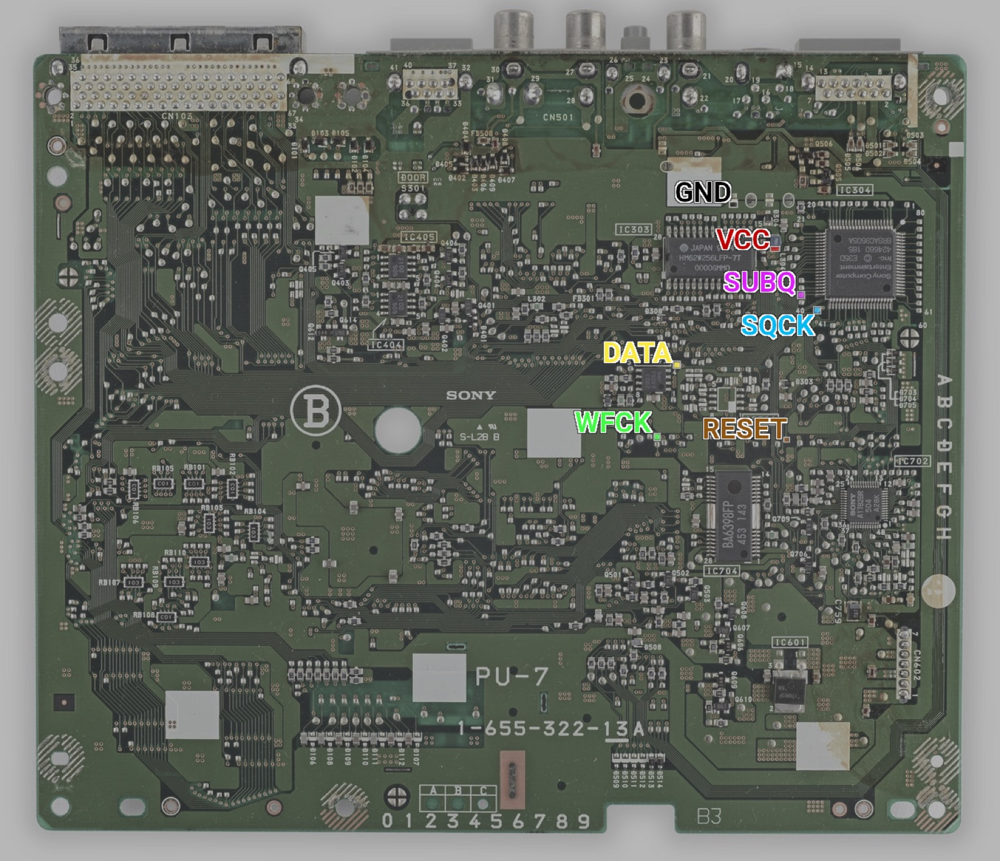</a><br><sub><b>PU-7</b>。照片来自 PsNee</sub></td><td align="center" width="33%"><a href="assets/psnee/pu-8a.jpg">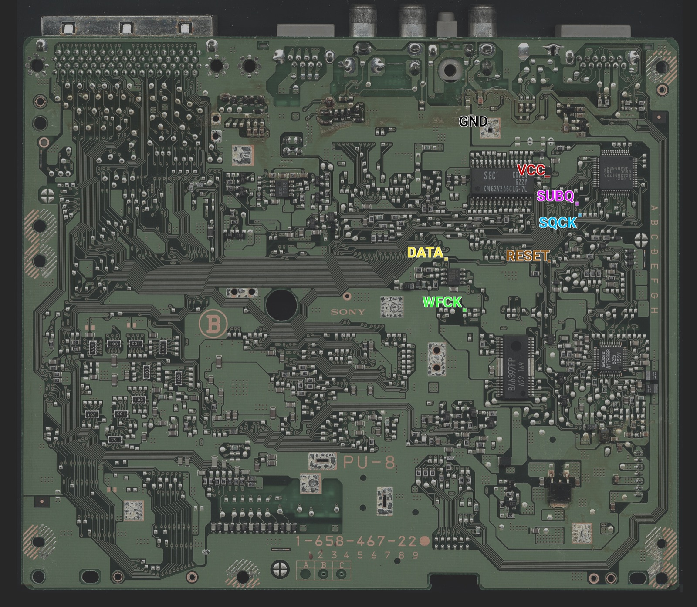</a><br><sub><b>PU-8</b>，1-658-467-22。照片来自 PsNee</sub></td><td align="center" width="33%"><a href="assets/psnee/pu-8b.jpg">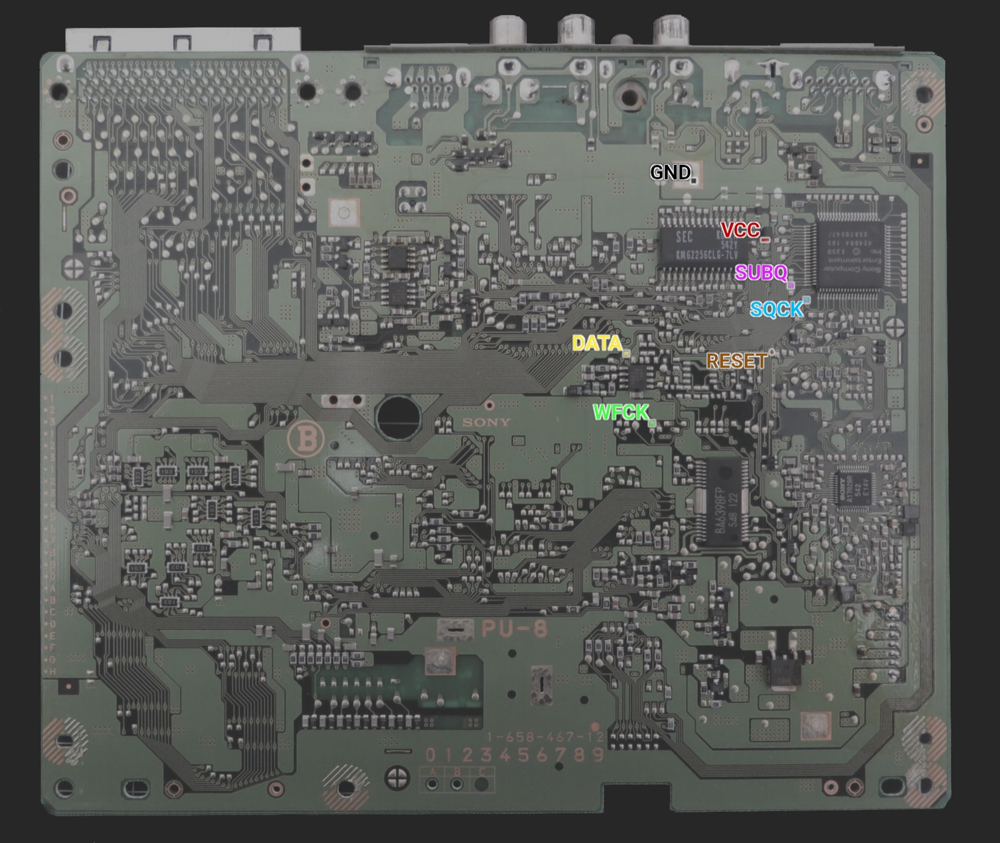</a><br><sub><b>PU-8</b>，1-658-467-12。照片来自 PsNee</sub></td></tr>
<tr><td align="center" width="33%"><a href="assets/psnee/pu-18.jpg">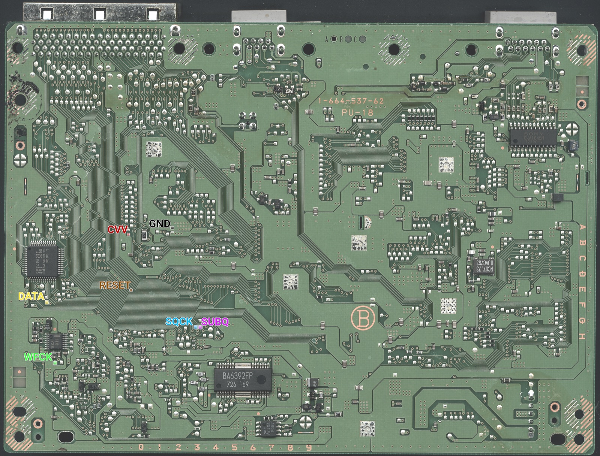</a><br><sub><b>PU-18</b>。照片来自 PsNee</sub></td><td align="center" width="33%"><a href="assets/psnee/pu-20.jpg">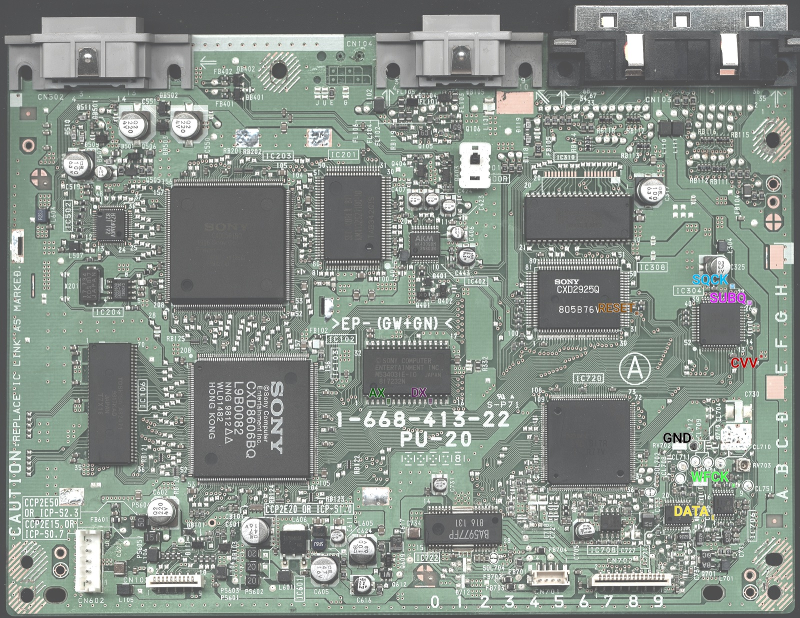</a><br><sub><b>PU-20</b>。照片来自 PsNee</sub></td><td align="center" width="33%"><a href="assets/psnee/pu-22.jpg">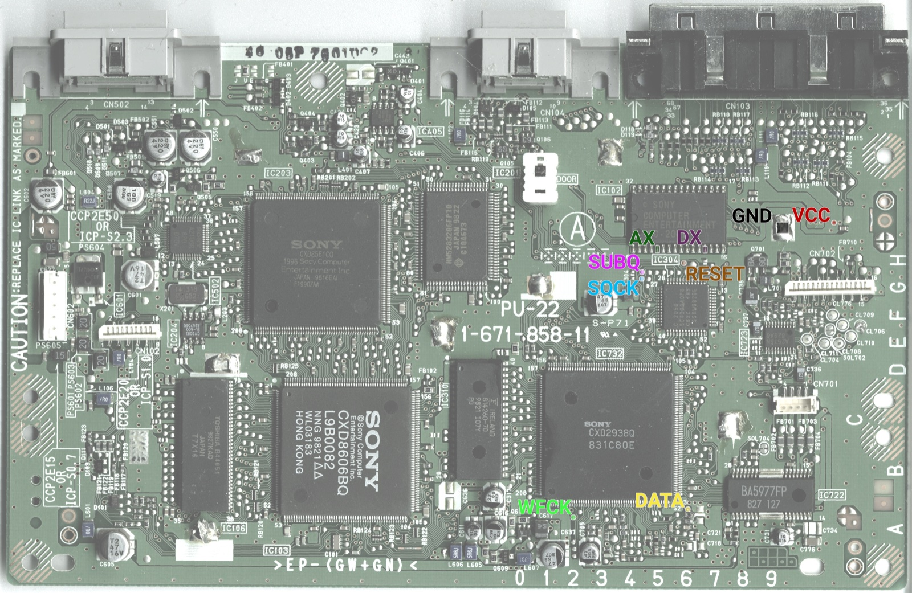</a><br><sub><b>PU-22</b>。照片来自 PsNee</sub></td></tr>
<tr><td align="center" width="33%"><a href="assets/psnee/pu-23.jpg">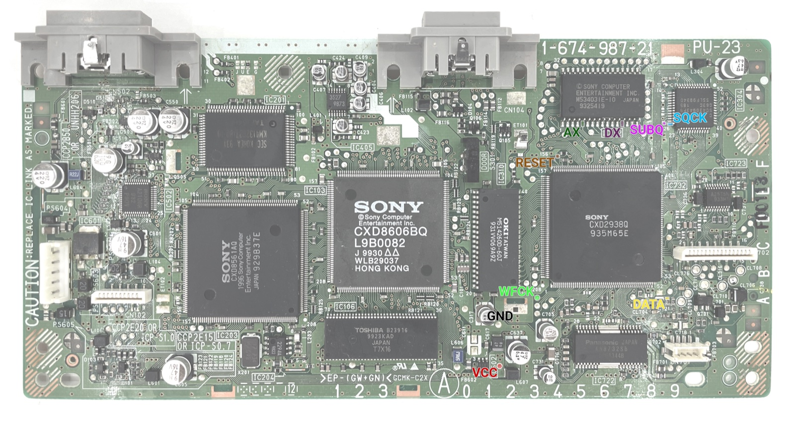</a><br><sub><b>PU-23</b>。照片来自 PsNee</sub></td><td align="center" width="33%"><a href="assets/psnee/pm-41.jpg">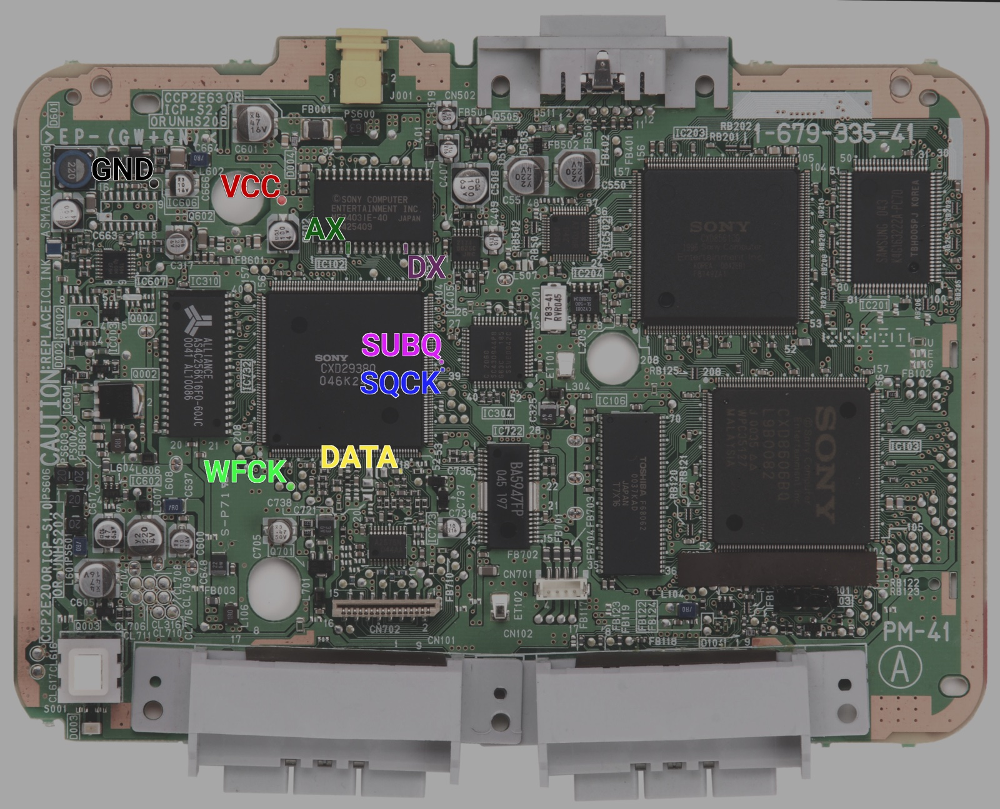</a><br><sub><b>PM-41</b>。照片来自 PsNee</sub></td><td align="center" width="33%"><a href="assets/psnee/pm-41-2.jpg">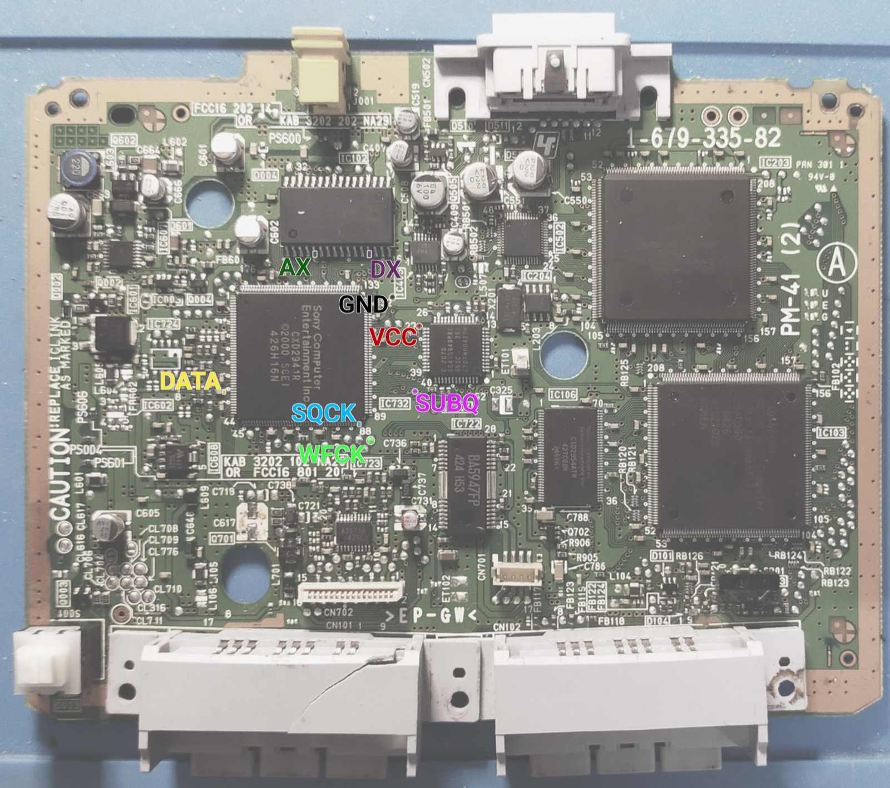</a><br><sub><b>PM-41(2)</b>。照片来自 PsNee</sub></td></tr>
</table>

这九张照片来自 kalymos 及其贡献者的 [PsNee](https://github.com/kalymos/PsNee) V9.0，以 [Unlicense](LICENSES/Unlicense.txt) 发布至公有领域，此处为缩小后的副本。

| 主板系列 | SCPH 年代 | DATA 注入点 | WFCK 作用 | 出处 |
|:---------|:----------|:------------|:----------|:--|
| PU-7、PU-8、PU-18、PU-20 | 1000-750x | 摆动 ASIC 送入机芯控制器的数字 NRZ 输出 | 静态门控 | [assets/psnee](assets/psnee), [PsNee PSNee.ino L372-L406](https://github.com/kalymos/PsNee/blob/df52aec97d4e1677e3ed3ead1fba0bf102b1cfd7/PSNee/PSNee.ino#L372-L406) |
| PU-22、PU-23 | 7500-900x | CD 处理器的循迹线，WFCK 作伪载波，三线加跳线 | 实时时钟，需同步 | [assets/psnee](assets/psnee), [PsNee PSNee.ino L372-L406](https://github.com/kalymos/PsNee/blob/df52aec97d4e1677e3ed3ead1fba0bf102b1cfd7/PSNee/PSNee.ino#L372-L406) |
| PM-41、PM-41(2) | PSone 100-103 | 同样的循迹线载波方式；PM-41(2) 空闲时让芯片 I/O 浮空 | 实时时钟 | [assets/psnee](assets/psnee), [quade.co PsNee guide](https://quade.co/ps1-modchip-guide/psnee/) |

没有时钟线和光驱盖线，因此芯片可以放在 4 根信号线够得着的任何位置。请让这些线尽量短：长线会拾取噪声，这是 Mayumi V4 故障的已知原因（quade.co）。为早期版本安装的芯片在写入本固件前必须拆掉时钟线与光驱盖线，因为 2 号脚现在是 PB3（指示输出），会与留在上面的主机时钟反向驱动。 出处：[src/trim.c](src/trim.c), [src/loop.c](src/loop.c), [quade.co Mayumi V4 guide](https://quade.co/ps1-modchip-guide/mayumi-v4/), [include/port/registers.h](include/port/registers.h)。

## 电路板

一块可选的电路板把芯片装在 DIP-8 插座上，便于取下重新烧录。主机导线焊在下边六个无孔的正面焊盘上，焊盘 4 × 4 mm、间距 6 mm，依次为 WFCK、SQCK、SUBQ、DATA、VCC 和 GND。所有元件都是直插件。插座、100 nF 去耦电容、220 µF 储能电容和 10 kΩ RESET 上拉总是安装，上拉是因为芯片内部的上拉抵不住主机的噪声。三个插针可选，板上标有 "opt"，只装用得到的即可。电路板是 KiCad 10 工程，含原理图、布局和设计规则，尺寸 35.6 × 34.3 mm。 出处：[hardware/openscex.kicad_sch](hardware/openscex.kicad_sch), [hardware/openscex.kicad_pcb](hardware/openscex.kicad_pcb)。

| 元件 | 安装 | 用途 | 出处 |
|:--|:--|:--|:--|
| U1，DIP-8 插座 | 总是 | 固定 ATtiny85 | [hardware/openscex.kicad_sch](hardware/openscex.kicad_sch) |
| C1，100 nF 陶瓷 | 总是 | 在电源引脚处应对芯片的快速电流变化 | [hardware/openscex.kicad_sch](hardware/openscex.kicad_sch) |
| C2，220 µF 电解 | 总是 | 在 J2 接有脉冲负载（如有源蜂鸣器）时稳住电源，免得电流脉冲经细电源线拉低电压；高 11.2 mm，可弯脚平放 | [hardware/openscex.kicad_sch](hardware/openscex.kicad_sch), [Panasonic FC series](https://industrial.panasonic.com/cdbs/www-data/pdf/RDF0000/ABA0000C1209.pdf) |
| R1，10 kΩ | 总是 | 使 RESET 保持高电平 | [hardware/openscex.kicad_sch](hardware/openscex.kicad_sch) |
| J1，防呆 2×3 ISP 插座 | 可选 | 重新烧录芯片 | [hardware/openscex.kicad_sch](hardware/openscex.kicad_sch) |
| J2，防呆 JST XH 3 针插座 | 可选 | 1 脚 GND，2 脚 VCC，3 脚 PB3（板上标为 SIG），接到自选指示器的线缆：带电阻的 LED、有源蜂鸣器或自制的电路板 | [hardware/openscex.kicad_sch](hardware/openscex.kicad_sch), [JST XH datasheet](https://www.jst-mfg.com/product/pdf/eng/eXH.pdf) |
| J3，6 针插针 | 可选 | trace 镜像的串口线，接 FTDI TTL-232R 线缆 | [hardware/openscex.kicad_sch](hardware/openscex.kicad_sch) |

<table>
<tr><td align="center" width="33%"><a href="assets/boards/openscex-3d.png">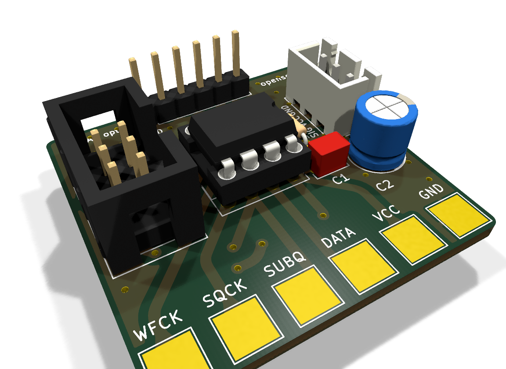</a><br><sub><b>电路板</b>，3D 视图</sub></td><td align="center" width="33%"><a href="assets/boards/openscex-top.png">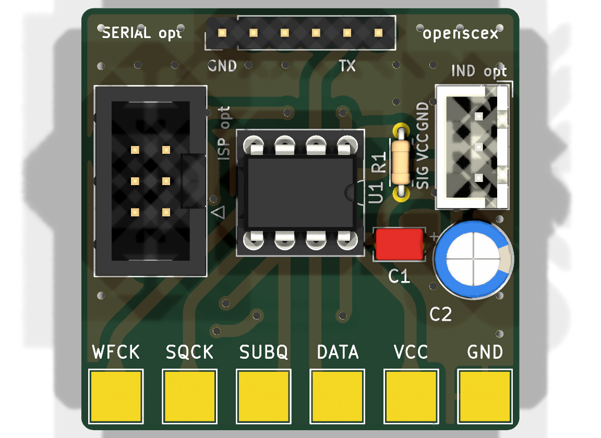</a><br><sub><b>电路板</b>，正面</sub></td><td align="center" width="33%"><a href="assets/boards/openscex-bottom.png">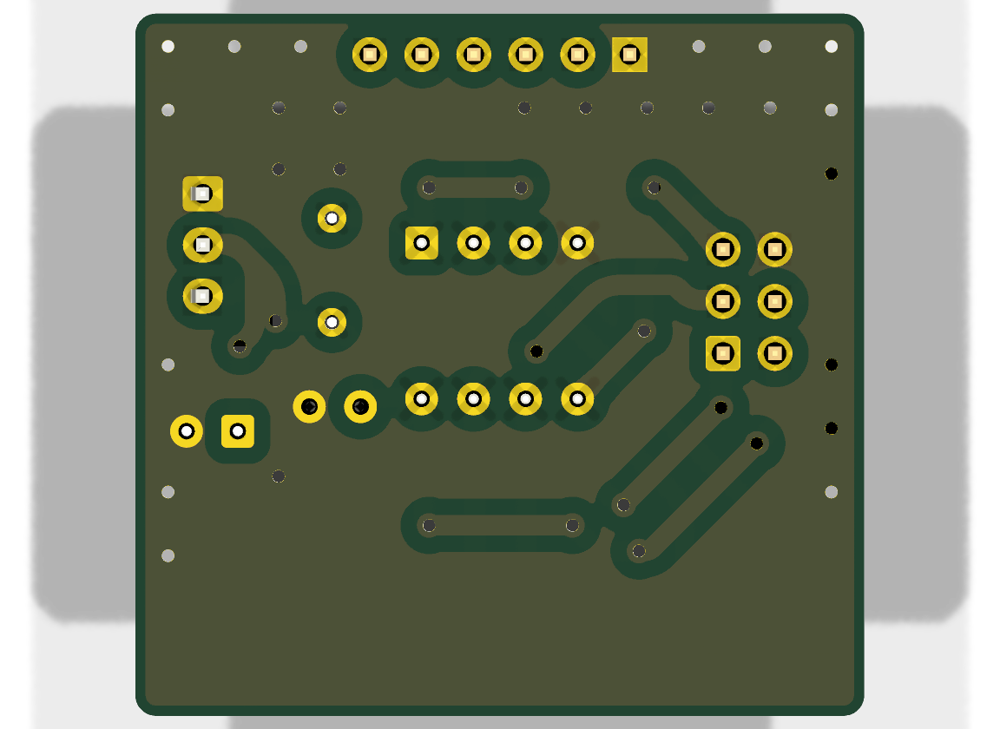</a><br><sub><b>电路板</b>，背面接地层</sub></td></tr>
</table>

电路板关于竖直中心线对称：芯片、串口插针和焊盘排都位于这条线上，左侧的 ISP 插座与右侧的指示插座、R1 和 C1 相互平衡。它是按抗噪设计的双层板。每条走线都在路径允许的范围内尽量加宽，本板为 1.0 mm；走线尽量放在正面，使背面在主机信号线下方保持为接地层；两层都铺地，并用 0.6 mm 过孔缝合；每个弯折都是不超过 45 度的相切圆弧；不同网络的走线彼此相距 1 mm，与焊盘相距 0.8 mm。 出处：[hardware/openscex.kicad_pcb](hardware/openscex.kicad_pcb), [hardware/openscex.kicad_dru](hardware/openscex.kicad_dru)。

ISP 插座采用 AVR 六针排列：1 MISO 接 SUBQ，2 VCC，3 SCK 接 DATA，4 MOSI 接 SQCK，5 RESET，6 GND。防呆护套与其他所有元件保持 1.5 mm 间距。请把电路板从主机上取下或拆下导线后再烧录；装在主机上时，编程器会给主机电源供电，并在 SQCK 和 SUBQ 上与主机的驱动器冲突。 出处：[hardware/openscex.kicad_sch](hardware/openscex.kicad_sch), [ATtiny25/45/85 datasheet 2586Q](https://ww1.microchip.com/downloads/en/DeviceDoc/Atmel-2586-AVR-8-bit-Microcontroller-ATtiny25-ATtiny45-ATtiny85_Datasheet.pdf)。

J2 是防呆的 JST XH 插座，插头只能以一个方向插入。针脚按 RC 舵机的 GND、VCC、信号顺序排列，中间的 VCC 不会碰到地线，所以即使强行反插也不会反向供电。VCC 为线缆另一端供电，例如蜂鸣器模块或自制的电路板；普通 LED 只需 GND 和 SIG。VCC 是主机的 3.5 V 电源，线缆绝不能把它接到 GND。 出处：[hardware/openscex.kicad_sch](hardware/openscex.kicad_sch), [JST XH datasheet](https://www.jst-mfg.com/product/pdf/eng/eXH.pdf)。

串口插针 J3 可直接插上 FTDI TTL-232R 线缆的 6 孔插座：1 脚为 GND，5 脚为线缆的 RXD 输入，2、3、4、6 脚悬空，因此线缆的 5 V 输出不会接到主机。它位于上边，周围留出 2 mm，插座不会碰到其他元件。J2 和 J3 都接 PB3，而 PB3 的用途由烧录的镜像决定，所以只插与之相符的线缆：`debug` 或 `final` 用指示器线缆，`trace` 用串口线缆。 出处：[hardware/openscex.kicad_sch](hardware/openscex.kicad_sch), [hardware/openscex.kicad_pcb](hardware/openscex.kicad_pcb), [TTL-232R datasheet](https://www.farnell.com/datasheets/81225.pdf)。

电路板附有物料清单，其 Fit 列标明可选元件，以及可直接交给制板厂的 Gerber 和钻孔压缩包，均由 KiCad 10.0.6 导出。泪滴直接画在电路板中，无需在 KiCad 中重新填充。 出处：[hardware/openscex-bom.csv](hardware/openscex-bom.csv), [hardware/fab/openscex-gerbers.zip](hardware/fab/openscex-gerbers.zip)。

## 安全

- 接线前测量每个接点的电压。从 PU-7 到 PM-41(2)，每块主板的大多数芯片都由 +3.5 V 供电，这也是芯片的电源；主板的 +5 V 只供少数元件，例如 AV 多路输出、音频放大器以及声音与 CD 电源的稳压器，PsNee 也警告不要把芯片接到那里。 出处：[psx-spx pinouts.md, voltage summary](https://github.com/psx-spx/psx-spx.github.io/blob/6d7d1bc106a7e0b616b0330fe58401ab1ba57f0f/docs/pinouts.md#L1777-L1795), [PsNee changelog](https://github.com/kalymos/PsNee/blob/df52aec97d4e1677e3ed3ead1fba0bf102b1cfd7/changelog#L38)。
- 打开主机并焊接 CD 子系统可能损坏主机。风险自负。 出处：[quade.co PS1 modchip guide](https://quade.co/ps1-modchip-guide/)。

## 状态指示

PB3 可选接一个指示器（通常是 LED），这是芯片唯一的诊断手段。它显示当前阶段、每张光盘是否通过区域检查，以及出问题时该检查哪根线。它从不延迟或阻碍任何功能，也不保存历史，所以除两个启动代码外，代码都反映当前状态。 出处：[src/indicator.c](src/indicator.c)。

| 部件 | 选择 | 出处 |
|:-----|:-----|:--|
| LED | 3 mm 或 5 mm 的红、橙、黄、绿 LED，正向电压约 2 V；不要用蓝色或白色，其 3 V 正向电压在主机的 3.5 V 电源下几乎不给电阻留电压 | [Kingbright WP7113ID datasheet](https://www.kingbrightusa.com/images/catalog/SPEC/WP7113ID.pdf), [ATtiny25/45/85 datasheet 2586Q](https://ww1.microchip.com/downloads/en/DeviceDoc/Atmel-2586-AVR-8-bit-Microcontroller-ATtiny25-ATtiny45-ATtiny85_Datasheet.pdf) |
| 电阻 | 1 kΩ，功率不限：在主机的 3.5 V 下约 1.5 mA，远低于引脚 40 mA 的绝对最大值 | [ATtiny25/45/85 datasheet 2586Q](https://ww1.microchip.com/downloads/en/DeviceDoc/Atmel-2586-AVR-8-bit-Microcontroller-ATtiny25-ATtiny45-ATtiny85_Datasheet.pdf) |
| LED 接线 | 2 号引脚（PB3）或电路板插座 J2 的 3 脚接电阻，电阻接 LED 阳极（长脚），阴极（平边）接地或 J2 的 1 脚；在电路板上，LED 和电阻装在线缆上，LED 可以放在机壳内任何位置 | [include/port/registers.h](include/port/registers.h), [hardware/openscex.kicad_sch](hardware/openscex.kicad_sch) |

驱动该引脚的构建有两种。默认的 `debug` 显示下表全部内容；用 `make PROFILE=final` 构建、以 `-final` 镜像发布的 `final` 保持安静。安装和排查故障时烧录 `debug`，玩游戏时换成 `final`。只有该引脚不同：模拟器逐个边沿核对两者在同一时刻发送相同的字符串。 出处：[include/pscu/indicator.h](include/pscu/indicator.h), [tests/sim/sim_profile.c](tests/sim/sim_profile.c)。

| 阶段 | debug | final | 出处 |
|:-----|:------|:------|:--|
| 主板识别 | 上电后点亮约 0.4 s | 熄灭 | [src/engine.c](src/engine.c) |
| 主板确定 | 静态门控主板（PU-18、PU-20）闪 1 次 300 ms，WFCK 载波主板（PU-22 及以后）闪 2 次 | 静态门控主板短闪 1 次 60 ms，WFCK 载波主板 2 次 | [src/indicator.c](src/indicator.c) |
| 等待光盘 | 每 2 s 短闪 40 ms | 熄灭 | [src/indicator.c](src/indicator.c) |
| 注入中 | 每个区域字符串闪 90 至 181 ms | 熄灭 | [src/engine.c](src/engine.c) |
| 结果 | 代码显示 3 次，之后熄灭 | 被接受的光盘短闪 1 次 60 ms，被拒绝的光盘显示代码 2 两次；之后熄灭 | [src/indicator.c](src/indicator.c) |
| 游戏中 | 熄灭；每次 OSCCAL 变动或写入校准值时闪 40 ms | 熄灭 | [src/indicator.c](src/indicator.c), [src/run.c](src/run.c) |

代码是 700 ms 的长闪，间隔 300 ms，暂停 2 s 后重复。`final` 中代码 3 和 4 每张光盘只显示一次，代码 7 在持续期间每 30 s 重复一次。 出处：[src/indicator.c](src/indicator.c)。

| 代码 | 含义 | 检查 | 出处 |
|:----:|:-----|:-----|:--|
| 1 | 主机接受了区域字符串 | 无需处理，光盘正常运行 | [src/indicator.c](src/indicator.c), [src/loop.c](src/loop.c) |
| 2 | 已送出字符串但主机未到达程序区 | DATA 与 WFCK 接线，以及构建的区域是否与光盘一致 | [src/indicator.c](src/indicator.c), [src/loop.c](src/loop.c) |
| 3 | 上电后 5 s 内没有 SUBQ 帧；显示 15 s 后回到心跳闪烁 | SQCK、SUBQ、电源与地；没有光盘时也会显示 | [src/indicator.c](src/indicator.c), [src/loop.c](src/loop.c) |
| 4 | 有帧但 20 s 内没有区域检查；持续期间重复 | SUBQ；音乐 CD 时也属正常 | [src/indicator.c](src/indicator.c), [src/loop.c](src/loop.c) |
| 5 | 看门狗复位了芯片，下次启动时显示一次 | 电源与地线：电压跌落或噪声让主循环停下 | [src/indicator.c](src/indicator.c), [src/port_chip.S](src/port_chip.S) |
| 6 | 主板与校准记录中的不同，启动时显示一次；代码 5 优先 | 接触不良的 WFCK 线，除非芯片换到了另一台主机 | [src/indicator.c](src/indicator.c), [src/calib.c](src/calib.c) |
| 7 | 测得电源低于约 2.75 V，或测量失败；持续期间不发送字符串，优先于代码 3 和 4 | 取电点的 VCC 与地，应在 3.3 V 以上 | [src/indicator.c](src/indicator.c), [src/supply.c](src/supply.c) |

### 串口跟踪

`make PROFILE=trace` 构建的镜像把引脚 2 (PB3) 改作 115200 baud、8N1 的串口线，不再驱动指示。它带出不用示波器就能查出故障所需的全部信息：启动报告、芯片捕获的每个 SUBQ 帧，以及芯片每做一个决定就发出的一行，每行都带有从上电起的时间。各行在每帧之后的空隙中发出，每个空隙最多一行决定，所以 DATA 与另外两种镜像保持相同的时序，模拟器逐个边沿核对这一点。 出处：[src/trace.c](src/trace.c), [src/run.c](src/run.c), [tests/sim/sim_trace.c](tests/sim/sim_trace.c), [tests/sim/sim_profile.c](tests/sim/sim_profile.c)。

在电路板上，J2 不插指示器线缆，把 TTL-232R 线缆插到串口插针 J3 上，黑线对准 GND；单独使用芯片时，把引脚 2 接到 USB 串口适配器的 RX 输入，适配器的地接主机的地。线路在 0 与主机的 3.5 V 逻辑电源之间摆动，TTL-232R-3V3 这样的 3.3 V 适配器即可读取。请在给主机上电之前开始捕获，这样启动报告也会被记录。 出处：[hardware/openscex.kicad_sch](hardware/openscex.kicad_sch), [TTL-232R datasheet](https://www.farnell.com/datasheets/81225.pdf), [psx-spx pinouts.md, voltage summary](https://github.com/psx-spx/psx-spx.github.io/blob/6d7d1bc106a7e0b616b0330fe58401ab1ba57f0f/docs/pinouts.md#L1777-L1795)。

```sh
# Linux；macOS 上端口是 /dev/cu.usbserial-*，stty 用 -f
stty -F /dev/ttyUSB0 115200 raw && cat /dev/ttyUSB0 | tee capture.txt
python3 tools/serial_trace.py capture.txt
```

帧行是 12 个 SUBQ 字节的十六进制；捕获失败时整行为 `F`。其余每行都以 `@` 和时间开头，例如 `@1.460 OPEN 0A 0A`，即从上电起的秒和毫秒。 出处：[src/trace.c](src/trace.c)。

| 行 | 含义 | 出处 |
|:--|:--|:--|
| `BOOT US 1A2B` | 编译进去的区域，以及提交哈希的前 4 位十六进制；末尾的 `V` 表示 Video CD 过滤 | [src/trace.c](src/trace.c), [Makefile](Makefile) |
| `RST PWR`、`RST WDT` | 从上电开始，或主循环停住后被看门狗重启 | [src/trace.c](src/trace.c), [src/port_chip.S](src/port_chip.S) |
| `BRD W D` | 主板：`W` 为 WFCK 载波，`G` 为静态门控；随后 `D` 为检测所得，`K` 为看门狗重启后沿用记录，`C` 为检测所得且与记录的主板不同 | [src/trace.c](src/trace.c), [src/calib.c](src/calib.c) |
| `OSC 50>4E` | OSCCAL 从出厂值到应用值，之后是按 75 Hz 帧率做的每一步微调 | [src/trace.c](src/trace.c), [src/trim.c](src/trim.c) |
| `REC W 0C P -2` | 校准记录：主板、十六进制的起点、`F` 已固定或 `P` 仍在探测、微调值；启动时为从 EEPROM 读出的值，之后每次学习时发出 | [src/trace.c](src/trace.c), [src/calib.c](src/calib.c) |
| `SUP OK 3303mV`、`SUP LOW 2601mV` | 启动时的电源电压，以及每次越过 2.75 V 保护值时的电压；低于该值时既不发送字符串也不写记录 | [src/trace.c](src/trace.c), [src/supply.c](src/supply.c) |
| `DISC`、`GONE` | 重新收到有效的 SUBQ 帧，或 1.5 s 内一帧也没有 | [src/trace.c](src/trace.c), [src/inject.c](src/inject.c) |
| `OPEN 0A 0A` | 窗口打开：SUBQ 计数器和它到达的起点，十六进制 | [src/trace.c](src/trace.c), [src/loop.c](src/loop.c) |
| `HOLD 03 0A 3303mV` | 窗口保持但不发送：低于电源保护值，或打开后略低于起点 | [src/trace.c](src/trace.c), [src/loop.c](src/loop.c) |
| `SHUT P 00` | 窗口关闭：`P` 为程序区帧，`G` 为光盘离开，`D` 为计数器回落 | [src/trace.c](src/trace.c), [src/loop.c](src/loop.c) |
| `SCEX 3 W` | 本次打开中最多 16 个字符串里的第 3 个，以及发送时的主板模式 | [src/trace.c](src/trace.c), [src/engine.c](src/engine.c) |
| `PASS`、`FAIL` | 字符串之后主机进入了程序区，或没有及时进入 | [src/trace.c](src/trace.c), [src/loop.c](src/loop.c) |
| `MISS 0B 0C` | 窗口打开之前导入区就结束了：计数器到达的值和所需的起点；下一张光盘的起点会提前 | [src/trace.c](src/trace.c), [src/calib.c](src/calib.c) |
| `SAVE OK`、`SAVE NO 2601mV` | 记录已写入 EEPROM，或因电压不足未写入并保留重试 | [src/trace.c](src/trace.c), [src/engine.c](src/engine.c) |
| `LOST 2` | 连续事件超出 4 条队列容量而丢弃的数量 | [src/trace.c](src/trace.c), [include/pscu/trace.h](include/pscu/trace.h) |

`tools/serial_trace.py` 读取保存的捕获，或通过管道传入的终端输出，用文字打印时间线：每帧都标出在光盘上的位置并核对 CRC，相同帧的连续段合并为一行。最后给出诊断，指出可能的故障和应检查之处：没有帧或每次捕获都失败指向 SQCK 与 SUBQ 接线，CRC 错误多指向这些线上的噪声，看门狗重启指向让主循环停下的电压跌落或噪声，反复上电或电压不足指向取电点，导入区从未打开窗口指向学习到的起点，发送了字符串却没有 `PASS` 指向 DATA 与 WFCK 接线或区域不符，`PASS` 之后游戏仍停住则是防改机检查或启动 ROM 的区域检查。`--summary` 只打印诊断。 出处：[tools/serial_trace.py](tools/serial_trace.py), [tests/serial_trace/test_serial_trace.py](tests/serial_trace/test_serial_trace.py)。


## 工作原理

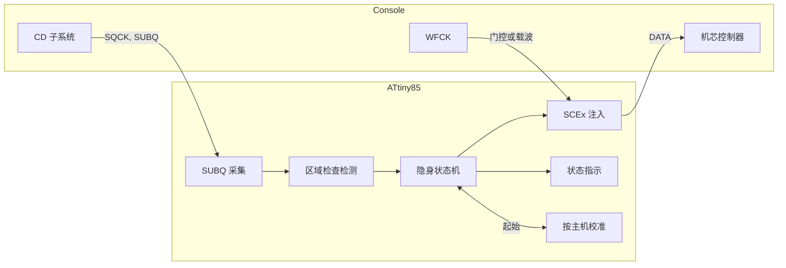

## 包含内容

| 功能 | 说明 | 出处 |
|:-----|:-----|:--|
| SCEx 注入 | 44 位 LSB 优先的区域字符串；PU-7 至 PU-20 用静态门控方式，与 PsNee 和 Mayumi V4 一样在每个字符串期间把 WFCK 拉低；PU-22 及以后用 WFCK 载波方式 | [src/inject.c](src/inject.c), [src/port.S](src/port.S), [PsNee PSNee.ino L53](https://github.com/kalymos/PsNee/blob/df52aec97d4e1677e3ed3ead1fba0bf102b1cfd7/PSNee/PSNee.ino#L53) |
| 主板自动识别 | 启动时的 WFCK 决定门控或载波模式，因此一个构建适用所有主板。与 MultiMode 3 和 Mayumi V4 一样，只有 25 个连续的 WFCK 边沿、每个都在上一个之后 360 µs 内出现时才算载波。在门控主板上，每个字符串前再观测 WFCK 13.1 ms，因此较晚出现的载波绝不会被拉低。看门狗复位后沿用启动时记录的主板，因此停止的载波不会被当作门控驱动 | [src/board_mode.c](src/board_mode.c), [src/engine.c](src/engine.c), [src/calib.c](src/calib.c), [PsNee PSNee.ino L372-L406](https://github.com/kalymos/PsNee/blob/df52aec97d4e1677e3ed3ead1fba0bf102b1cfd7/PSNee/PSNee.ino#L372-L406) |
| 电源保护 | 每个字符串前芯片用 1.1 V 带隙测量自身电源；低于约 2.75 V 或读数不可能时，不发送任何内容并显示代码 7。短暂的电压下降只暂停一轮发送而不重新计数，被关闭的窗口不会让校准学到任何东西 | [src/supply.c](src/supply.c), [src/port_chip.S](src/port_chip.S), [ATtiny25/45/85 datasheet 2586Q](https://ww1.microchip.com/downloads/en/DeviceDoc/Atmel-2586-AVR-8-bit-Microcontroller-ATtiny25-ATtiny45-ATtiny85_Datasheet.pdf) |
| 振荡器校正 | 在导入区与游戏中对主机 75 Hz 的 SUBQ 帧计时，每批最多调 4 级、每次写入一级，直到误差在 1% 以内，且离出厂值不超过 16 级；校正值保存在 EEPROM 中，启动时应用 | [src/trim.c](src/trim.c), [src/run.c](src/run.c), [ATtiny25/45/85 datasheet 2586Q](https://ww1.microchip.com/downloads/en/DeviceDoc/Atmel-2586-AVR-8-bit-Microcontroller-ATtiny25-ATtiny45-ATtiny85_Datasheet.pdf) |
| 换盘 | 无需光驱盖线：只有停转的光驱会带来 1.5 s 没有有效 SUBQ 帧，这会重新武装芯片；寻道和重读会持续产生帧。SUBQ 计数器最多比起始位置高 8 帧，因此即使光盘被拒绝，打开光驱盖后约半秒窗口就会关闭。每张光盘都可以得到整个 16 个字符串的上限 | [src/inject.c](src/inject.c), [src/loop.c](src/loop.c), [include/pscu/loop.h](include/pscu/loop.h) |
| 隐身 | 只在 SUBQ 区域检查窗口内、每次武装有上限地注入，与 PsNee 和 Mayumi V4 一样在字符串之间间隔 5 帧（67 ms）；其余时间 DATA 高阻、指示引脚关闭。主机读到程序区后不再开始新的字符串，正在发送的字符串会发完。之后的导入区读取，例如反改机 v2 的 TOC 重读，会在同一上限下再次得到响应。计数略低于起始点时上限与间隔保持不变，只有低于起始点 8 帧才重新武装 | [src/inject.c](src/inject.c), [src/loop.c](src/loop.c), [include/pscu/config.h](include/pscu/config.h), [PsNee PSNee.ino L53](https://github.com/kalymos/PsNee/blob/df52aec97d4e1677e3ed3ead1fba0bf102b1cfd7/PSNee/PSNee.ino#L53), [psx-spx cdromformat.md, anti-modchip](https://github.com/psx-spx/psx-spx.github.io/blob/6d7d1bc106a7e0b616b0330fe58401ab1ba57f0f/docs/cdromformat.md#L1624-L1646) |
| 单一区域 | 只送出 `REGION`，从不送出全部三个 | [src/region.c](src/region.c) |
| 自适应时序 | 在 WFCK 载波主板上每个注入位持续 30 个 WFCK 周期，因此在单倍速和倍速下都跟随主机的时钟；在静态门控主板上由校正后的振荡器计时 | [src/port.S](src/port.S), [src/trim.c](src/trim.c) |
| 自我恢复 | 每次 SUBQ 采集都在帧间空隙重新对齐，30 ms 内没有边沿或比特超过 16 ms（长于一帧）时放弃，因此悬空的 SQCK 显示代码 3，而不是让芯片重启；超过 8 ms 的载波比特单元会结束字符串并释放 DATA，因此注入中 WFCK 变慢或停止都不会占住 DATA；停住 0.5 s 的主循环由看门狗重启。没有引脚需要上拉：SQCK、SUBQ、WFCK 是主机的线，DATA 释放时是主机的线，PB3 是输出 | [src/engine.c](src/engine.c), [src/port.S](src/port.S), [include/port/registers.h](include/port/registers.h) |
| 帧完整性 | 只有 CRC-16 匹配的 SUBQ 帧才计入，因此损坏或错位的帧既不会触发字符串，也不会被算作光盘仍在，更不会被当作程序区 | [src/subq.c](src/subq.c), [ECMA-130, Q-channel CRC](https://ecma-international.org/publications-and-standards/standards/ecma-130/) |
| 状态指示 | 可选的 LED 显示启动阶段、每张光盘的结果和当前故障；固件从不等待它，什么都不接也正确运行 | [src/indicator.c](src/indicator.c) |
| 现场诊断 | 代码指出失败的阶段，从没有时钟的 SUBQ 到始终没有区域检查的 SUBQ；无需编程器 | [src/indicator.c](src/indicator.c), [src/loop.c](src/loop.c) |
| 按主机校准 | 学习本主机的起始位置与自身振荡器的快慢，保存在 6 字节的 EEPROM 记录中，缺失或损坏时回退到默认值 | [src/calib.c](src/calib.c) |
| 闭环确认 | 注入后，芯片等待程序区帧（真实的音轨号），机芯控制器只有在接受字符串后才允许读取它，并显示结果 | [src/inject.c](src/inject.c), [src/loop.c](src/loop.c) |
| 验证 | 主机测试行与分支覆盖率 100%，包含偏快与偏慢振荡器的 simavr 主机模型，变异测试，可复现构建，以及把同一个模拟主机接到本固件、PsNee、Mayumi V4 和 MM3 上的主机测试台。本固件必须在它们被接受的场景中都被接受、位单元落在它们的范围内、在区域检查之外发送的不多于它们。测试台执行每一条可达指令，无法到达的指令都在源码中注明原因 | [tests/host](tests/host), [tests/sim](tests/sim), [tools/mutate.py](tools/mutate.py), [tools/bench](tools/bench), [CONTRIBUTING.md](CONTRIBUTING.md) |

## 按主机校准

芯片学习所装主机如何读取区域字符串，并把结果保存在 6 字节的 EEPROM 记录中，因此之后的光盘驱动 DATA 的时间更短。学到的值只会朝默认值回退，所以记录丢失、损坏或来自别处时，损失的只是隐蔽性，而不是光盘。 出处：[src/calib.c](src/calib.c)。

| 值 | 学习来源 | 效果 | 出处 |
|:---|:---------|:-----|:--|
| 起始位置 | 每张被接受的光盘把起始推迟 2 个导入区帧（27 ms），最多 20 帧；`jp` 构建保持默认值，因为 PsNee 告诫在日本主机上不要用更晚的触发 | 字符串更接近区域检查开始；被拒绝，或导入区读取在起始之前结束，则回退 2 帧并结束探索 | [src/calib.c](src/calib.c), [PsNee PSNee.ino L48](https://github.com/kalymos/PsNee/blob/df52aec97d4e1677e3ed3ead1fba0bf102b1cfd7/PSNee/PSNee.ino#L48) |
| 主板 | 启动时识别的主板 | 主板不同则显示一次代码 6，并重新学习起始位置 | [src/calib.c](src/calib.c), [src/indicator.c](src/indicator.c) |
| 振荡器 | 主机晶振决定的 75 Hz 单倍速帧间隔，导入区与游戏中均计；振荡器速率随电源变化，因此只在电源检查通过时计 | 每批 64 帧按超出 1% 死区的误差每 1% 调一级（向上取整），最多 4 级，每次写入一级；校正属于芯片本身，因此更换主板时保留 | [src/trim.c](src/trim.c), [src/run.c](src/run.c) |

芯片只写入值有变化的字节，只在启动时、光盘检查有结果之后、振荡器微调变动时，以及上电后才出现 WFCK 载波时在第一个字符串之前写入一次，除此之外在隐蔽窗口打开或保持期间从不写入，写不成的记录会保留并重试，因此微调也稳定下来的主机不再写入。单元擦写寿命为 100,000 次。因断电只写了一半的记录由校验字节发现，按默认值读取。重新烧录也会擦除记录，因为上面两组熔丝都让 EESAVE 保持未编程（数据手册 Table 20-4，高熔丝位 3）。2 帧的步长和 20 帧的上限尚未在主机上调校。校正的目标是数据手册给出的用户校准后精度 1%，出厂精度为 10%（Table 21-2）。 出处：[src/calib.c](src/calib.c), [src/run.c](src/run.c), [src/port_chip.S](src/port_chip.S), [ATtiny25/45/85 datasheet 2586Q](https://ww1.microchip.com/downloads/en/DeviceDoc/Atmel-2586-AVR-8-bit-Microcontroller-ATtiny25-ATtiny45-ATtiny85_Datasheet.pdf)。

## 配置

同一套源码构建所有变体；参数传给 `make`。 出处：[Makefile](Makefile)。

| 参数 | 取值 | 默认 | 选择 | 出处 |
|:-----|:-----|:-----|:-----|:--|
| `REGION` | `jp`、`us`、`eu` | `us` | 芯片送出的唯一区域字符串 | [Makefile](Makefile), [src/region.c](src/region.c) |
| `PROFILE` | `debug`、`final`、`trace` | `debug` | 2 号引脚的作用：debug 显示每个阶段、字符串和故障；final 在上电和光盘被接受时短闪，每个故障只显示一次；trace 把该引脚变成 115200 baud 的串口线，发出启动报告、每个 SUBQ 帧和芯片的每个决定；三者的 DATA 相同 | [Makefile](Makefile), [src/run.c](src/run.c), [src/trace.c](src/trace.c), [include/pscu/indicator.h](include/pscu/indicator.h) |
| `VCD_FILTER` | `off`、`on` | `off` | 仅 SCPH-5903 设为 on：与 PsNee V9.0 的 SCPH-5903 过滤器一样，注入只在游戏的导入区 TOC 触发，不在 Video CD 上触发 | [Makefile](Makefile), [src/subq.c](src/subq.c), [PsNee PSNee.ino L456-L490](https://github.com/kalymos/PsNee/blob/df52aec97d4e1677e3ed3ead1fba0bf102b1cfd7/PSNee/PSNee.ino#L456-L490) |

非默认区域、过滤器或配置会在产物名上加标签，例如 `openscex-modchip-attiny85-jp.hex`、`openscex-modchip-attiny85-jp-vcd.hex` 或 `openscex-modchip-attiny85-final.hex`。 出处：[Makefile](Makefile)。

## 与其他芯片对比

| 能力 | openscex | PsNee V9 | Mayumi V4 | MM3 | 出处 |
|:-----|:---------|:---------|:----------|:----|:--|
| 隐身触发 | 由程序区关闭的 SUBQ 检查窗口 | SUBQ 解码 | 感应线加光驱盖线 | 与 Mayumi V4 相同的程序 | [src/loop.c](src/loop.c), [PsNee PSNee.ino L525-L551](https://github.com/kalymos/PsNee/blob/df52aec97d4e1677e3ed3ead1fba0bf102b1cfd7/PSNee/PSNee.ino#L525-L551), [quade.co Mayumi V4 guide](https://quade.co/ps1-modchip-guide/mayumi-v4/), [quade.co MM3 guide](https://quade.co/ps1-modchip-guide/mm3/) |
| 换盘检测 | 光驱停转时 SUBQ 的静默 | SUBQ 计数器衰减 | 光驱盖线 | 光驱盖线 | [src/run.c](src/run.c), [PsNee PSNee.ino L525-L551](https://github.com/kalymos/PsNee/blob/df52aec97d4e1677e3ed3ead1fba0bf102b1cfd7/PSNee/PSNee.ino#L525-L551), [quade.co Mayumi V4 guide](https://quade.co/ps1-modchip-guide/mayumi-v4/), [quade.co MM3 guide](https://quade.co/ps1-modchip-guide/mm3/) |
| 时钟 | 内部，按 SUBQ 校正 | 内部 | 主机 | 内部 RC | [src/trim.c](src/trim.c), [quade.co PsNee guide](https://quade.co/ps1-modchip-guide/psnee/), [quade.co Mayumi V4 guide](https://quade.co/ps1-modchip-guide/mayumi-v4/), [quade.co MM3 guide](https://quade.co/ps1-modchip-guide/mm3/) |
| 引导 ROM BIOS 补丁 | 无，使用已修补的 BIOS | 有，ATmega 版本 | 无 | 无 | [AGENTS.md](AGENTS.md), [PsNee PSNee.ino L33-L38](https://github.com/kalymos/PsNee/blob/df52aec97d4e1677e3ed3ead1fba0bf102b1cfd7/PSNee/PSNee.ino#L33-L38), [quade.co Mayumi V4 guide](https://quade.co/ps1-modchip-guide/mayumi-v4/), [quade.co MM3 guide](https://quade.co/ps1-modchip-guide/mm3/) |
| 主板 | PU-7 至 PM-41(2) | PU-7 至 PM-41(2) | PU-18 及以后 | PU-7 及以后 | [src/board_mode.c](src/board_mode.c), [quade.co PsNee guide](https://quade.co/ps1-modchip-guide/psnee/), [quade.co Mayumi V4 guide](https://quade.co/ps1-modchip-guide/mayumi-v4/), [quade.co MM3 guide](https://quade.co/ps1-modchip-guide/mm3/) |
| 诊断 | 指示引脚的阶段与结果代码 | 串口调试 | 无 | 无 | [src/indicator.c](src/indicator.c), [quade.co PsNee guide](https://quade.co/ps1-modchip-guide/psnee/) |
| 按主机学习 | 起始位置与振荡器校正 | 无 | 无 | 无 | [src/calib.c](src/calib.c), [quade.co PsNee guide](https://quade.co/ps1-modchip-guide/psnee/) |
| 测试与静态分析 | 主机、simavr、变异、MISRA、主机测试台 | 无 | 无 | 无 | [CONTRIBUTING.md](CONTRIBUTING.md), [.github/workflows/ci.yml](.github/workflows/ci.yml) |
| 实战记录 | 2 块主板，旧固件 | 数年 | 数十年 | 数十年 | [compatibility reports](https://github.com/gufranco/openscex-modchip/issues?q=label%3Acompatibility), [quade.co PS1 modchip guide](https://quade.co/ps1-modchip-guide/) |

### 主机测试台中的对比

主机测试台把同一台模拟主机接到所有能构建或加载的芯片上。每个项目模拟一项反改机检测或一种主机故障，只有在芯片所面向主板的每个场景中都成立才算通过；芯片不面向任何相关主板时记为不适用。这些是仿真结果，而非实机结果；模型及其出处见 [CONTRIBUTING.md](CONTRIBUTING.md)。

<!-- showcase:start -->
| 项目 | openscex | psnee-attiny85 | psnee-atmega328p | mayumi-v4 | mm3-12c508a | old-crow-12c508 | old-crow-12c508-v54f | old-crow-16c84 | old-crow-16c54 | modavr-attiny13 | ubernee-atmega328p | onechip-12c508a | liss-at90s1200 | 出处 |
|---|---|---|---|---|---|---|---|---|---|---|---|---|---|---|
| 反改机 v1 检测期间保持静默 | 通过 | 通过 | 通过 | 未通过 | 未通过 | 未通过 | 未通过 | 未通过 | 未通过 | 未通过 | 通过 | 通过 | 未通过 | [psx-spx cdromformat.md, anti-modchip](https://github.com/psx-spx/psx-spx.github.io/blob/6d7d1bc106a7e0b616b0330fe58401ab1ba57f0f/docs/cdromformat.md#L1624-L1646) |
| 反改机 v2 重读时重新认证 | 通过 | 通过 | 通过 | 未通过 | 未通过 | 通过 | 通过 | 通过 | 通过 | 通过 | 通过 | 未通过 | 通过 | [tonyhax docs/ap_v2.c](https://github.com/socram8888/tonyhax/blob/6c9d18ccbdfd3ffc3dc5f0eb373a50600199e208/docs/ap_v2.c#L225-L285), [aprip readme, APv2](https://github.com/alex-free/aprip/blob/767fa1ded63076e2380822986120170272420443/readme.md#apv2) |
| 反改机 v2 检测期间保持静默 | 通过 | 通过 | 通过 | 未通过 | 未通过 | 未通过 | 未通过 | 未通过 | 未通过 | 未通过 | 通过 | 通过 | 未通过 | [tonyhax docs/ap_v2.c](https://github.com/socram8888/tonyhax/blob/6c9d18ccbdfd3ffc3dc5f0eb373a50600199e208/docs/ap_v2.c#L225-L285), [psx-spx cdromformat.md, anti-modchip](https://github.com/psx-spx/psx-spx.github.io/blob/6d7d1bc106a7e0b616b0330fe58401ab1ba57f0f/docs/cdromformat.md#L1624-L1646) |
| 游戏运行后不再发送字符串 | 通过 | 通过 | 通过 | 未通过 | 未通过 | 未通过 | 未通过 | 未通过 | 未通过 | 未通过 | 未通过 | 未通过 | 未通过 | [psx-spx cdromdrive.md, 19h,04h](https://github.com/psx-spx/psx-spx.github.io/blob/6d7d1bc106a7e0b616b0330fe58401ab1ba57f0f/docs/cdromdrive.md#L1211-L1230) |
| 不注入时主机侧引脚全部悬空 | 通过 | 未通过 | 未通过 | 未通过 | 未通过 | 未通过 | 未通过 | 未通过 | 未通过 | 未通过 | 未通过 | 未通过 | 未通过 | [quade.co PsNee guide](https://quade.co/ps1-modchip-guide/psnee/), [bench runners](bench) |
| SQCK 卡住后仍能认证 | 通过 | 通过 | 通过 | 通过 | 通过 | 不适用 | 不适用 | 不适用 | 不适用 | 不适用 | 通过 | 未通过 | 不适用 | [tools/bench/edge_scenarios.py](tools/bench/edge_scenarios.py) |
| WFCK 停顿后恢复且从不驱动 WFCK | 通过 | 通过 | 通过 | 通过 | 通过 | 不适用 | 不适用 | 不适用 | 不适用 | 不适用 | 未通过 | 通过 | 不适用 | [tools/bench/edge_scenarios.py](tools/bench/edge_scenarios.py) |
| 第二张光盘时重新启用 | 通过 | 通过 | 通过 | 通过 | 通过 | 不适用 | 不适用 | 不适用 | 不适用 | 不适用 | 通过 | 通过 | 不适用 | [tools/bench/scenarios.py](tools/bench/scenarios.py) |

- **反改机 v1 检测期间保持静默**：游戏在播放程序区时统计 SCEx 字符串；正版光盘在那里没有字符串，只要完整收到一条字符串就会被判定为改机芯片。出处：[psx-spx cdromformat.md, anti-modchip](https://github.com/psx-spx/psx-spx.github.io/blob/6d7d1bc106a7e0b616b0330fe58401ab1ba57f0f/docs/cdromformat.md#L1624-L1646)。
- **反改机 v2 重读时重新认证**：ReadTOC 会清除正版认证状态；重读导入区期间若没有收到完整字符串，拷贝盘的 GetID 就会失败。出处：[tonyhax docs/ap_v2.c](https://github.com/socram8888/tonyhax/blob/6c9d18ccbdfd3ffc3dc5f0eb373a50600199e208/docs/ap_v2.c#L225-L285), [aprip readme, APv2](https://github.com/alex-free/aprip/blob/767fa1ded63076e2380822986120170272420443/readme.md#apv2)。
- **反改机 v2 检测期间保持静默**：重读之后，游戏寻道到光盘中部，再次统计 SCEx 字符串。出处：[tonyhax docs/ap_v2.c](https://github.com/socram8888/tonyhax/blob/6c9d18ccbdfd3ffc3dc5f0eb373a50600199e208/docs/ap_v2.c#L225-L285), [psx-spx cdromformat.md, anti-modchip](https://github.com/psx-spx/psx-spx.github.io/blob/6d7d1bc106a7e0b616b0330fe58401ab1ba57f0f/docs/cdromformat.md#L1624-L1646)。
- **游戏运行后不再发送字符串**：区域检查读取的是导入区；读取程序区时出现的字符串正是检测方要找的。出处：[psx-spx cdromdrive.md, 19h,04h](https://github.com/psx-spx/psx-spx.github.io/blob/6d7d1bc106a7e0b616b0330fe58401ab1ba57f0f/docs/cdromdrive.md#L1211-L1230)。
- **不注入时主机侧引脚全部悬空**：字符串之间被驱动或上拉的线会给主机自身的信号加负载（PM-41(2) 的拾取噪声），也会被任何监视者看到；在 DATA、门控线和所有输入上检查。出处：[quade.co PsNee guide](https://quade.co/ps1-modchip-guide/psnee/), [bench runners](bench)。
- **SQCK 卡住后仍能认证**：在帧中途停止的时钟不得让芯片卡住而错过检查。出处：[tools/bench/edge_scenarios.py](tools/bench/edge_scenarios.py)。
- **WFCK 停顿后恢复且从不驱动 WFCK**：在载波主板上 WFCK 是 CD DSP 的输出，驱动它会与主机冲突。出处：[tools/bench/edge_scenarios.py](tools/bench/edge_scenarios.py)。
- **第二张光盘时重新启用**：多光盘游戏在换盘后会再次要求区域字符串。出处：[tools/bench/scenarios.py](tools/bench/scenarios.py)。
<!-- showcase:end -->

## 实机测试

使用 2026-10-05 的主机时钟版固件、在真实主机上成功启动外区光盘的组合。 出处：[compatibility reports](https://github.com/gufranco/openscex-modchip/issues?q=label%3Acompatibility)。

| 主板系列 | 主机 | 时钟 | 注入 | 状态 | 出处 |
|:---------|:-----|:-----|:-----|:-----|:--|
| PU-18 | 厚机，NTSC-U/C | 主机 | SCEx | 已启动 | [compatibility reports](https://github.com/gufranco/openscex-modchip/issues?q=label%3Acompatibility) |
| PM-41 | PSone | 主机 | SCEx | 已启动 | [compatibility reports](https://github.com/gufranco/openscex-modchip/issues?q=label%3Acompatibility) |

该固件早于无需光驱盖线的换盘检测、带校正的内部振荡器、程序区静默、重读处理与有上限的 SUBQ 等待；当前固件尚未在实机上运行。尚未在实机测试：PU-7、PU-8、PU-20、PU-22、PU-23、PM-41(2)，以及任何主板上的 PAL 与 NTSC-J。 出处：[compatibility reports](https://github.com/gufranco/openscex-modchip/issues?q=label%3Acompatibility), [AGENTS.md](AGENTS.md)。

要添加你的主机，请提交[兼容性报告](../../issues/new?template=compatibility.yml)。带有 APv1 或 APv2 反改装保护的光盘最严格地考验隐身窗口：只有当主机开始读取游戏后芯片保持静默，它才会启动。表单会询问这类结果；[tonyhax international 反盗版表](https://github.com/alex-free/tonyhax/blob/7fd1825740c670bd4612db5db999ebd285c66796/anti-piracy-bypass.md)列出了 57 张 APv1 光盘和 200 张 APv2 光盘。来源：[tonyhax international 反盗版表](https://github.com/alex-free/tonyhax/blob/7fd1825740c670bd4612db5db999ebd285c66796/anti-piracy-bypass.md)、[src/inject.c](src/inject.c)。

## 版本

发布遵循 `0.x` 系列的[语义化版本](https://semver.org/)，因此次版本也可能破坏兼容性。v0.3.0 至 v0.8.0 为 ATtiny84 构建，v0.2.0 及之前为旧四线设计的 ATtiny85 构建。每个发布都从 CI 通过、且在推送改动其覆盖范围时平台变异测试也通过的提交加上它的更新日志条目构建，改动其他内容的标签会被[发布任务](.github/workflows/release.yml)拒绝；说明见[发布](../../releases)。

## 支持

| 需求 | 渠道 |
|:-----|:-----|
| 报告缺陷 | [缺陷模板](../../issues/new?template=bug.yml) |
| 你的主机上的结果 | [兼容性报告](../../issues/new?template=compatibility.yml) |
| 安全报告 | [安全策略](SECURITY.md)，私下报告 |
| 贡献 | [贡献指南](CONTRIBUTING.md) |
| 行为准则 | [行为准则](CODE_OF_CONDUCT.md) |

## 许可证

固件、文档及 [hardware/](hardware) 中的电路板设计采用 [MIT](LICENSE)。

[hardware/openscex.pretty](hardware/openscex.pretty) 中的封装源自 KiCad 库的封装，沿用其许可证 [CC-BY-SA-4.0](LICENSES/CC-BY-SA-4.0.txt) 及 [KiCad 库例外条款](LICENSES/KiCad-libraries-exception.txt)：用它们制作的电路板不承担任何义务。来源：[REUSE.toml](REUSE.toml)。
